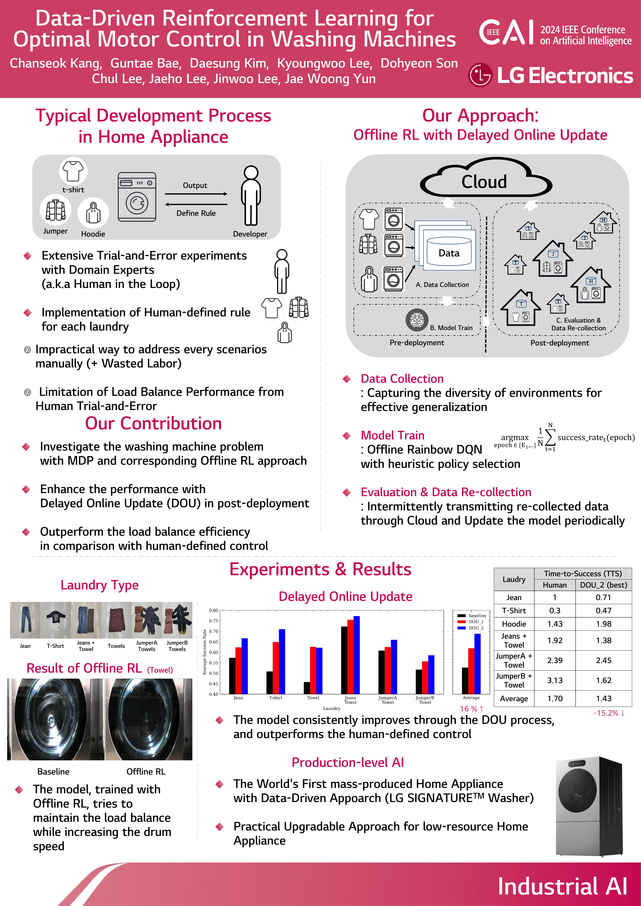

```{r}
#| label: setup
#| include: false
library(distilltools)
```

## 2026

**(2026. 11)** I participated in Meta VR Start Developer Competition 2026, and built **GhostLab**, a VR application for reviewing Robot Motion with Your Hands.
`r icon_link(icon = "fas fa-link", text = "Project", url = "projects/ghostlab/", target = "_self")`

**(2026. 11)** I participated in Meta Global AI Developer Hackathon, and built **EdgeGate**, a Deployment Gate for Edge Vision model which works on Jetson Orin nano and Raspberry pi 5 with Hailo-8 using Muse Glimmer and SAM 3.1.
`r icon_link(icon = "fas fa-link", text = "Project", url = "projects/edgegate/", target = "_self")`
`r icon_link(icon = "fas fa-link", text = "CerebralValley", url = "https://cerebralvalley.ai/e/meta-ai-developer-hackathon/hackathon/gallery?q=edgegate&project=1584")`

**(2026. 10)** I participated in Google Deepmind AI Hackathon, held in South Korea, and built **LabLens**, an annotation-aware robot episode investigator that links SO-101 trajectory intervals to exact camera frames and deterministic signal statistics using Gemini 4 Argon.
`r icon_link(icon = "fas fa-link", text = "Project", url = "projects/lablens/", target = "_self")`

**(2026. 10)** I participated in Nebius &times; NVIDIA Global AI Hackathon: Physical AI track, and built **QuantGate**, the audit gate for deploying quantized policy in real device. I used SO-101 ARM and Jetson Orin nano for training ACT policy, and built 26 deployable quantized builds. Also I opensourced the SO-101 dataset (Pick-and-Place) on HuggingFace Hub.
`r icon_link(icon = "fas fa-link", text = "Project", url = "projects/quantgate/", target = "_self")`
`r suppressMessages(icon_link(icon = "hf-icon", text = "HuggingFace Hub", url = "https://huggingface.co/datasets/chans/quantgate-so101-coaster"))`

**(2026. 08)** I presented a poster entitled **"When Reward and Safety Need Different Model Horizons: A Selection Theorem for Pessimistic Offline Planning"** at the [RLC 2026 Workshop - Model-Based RL in the Era of Generative World Models](https://worldmodels-rlc.github.io/) in Montreal, Canada.

**(2026. 08)** I participated in [NAS Unseen-Data Challenge 2026](https://www.nascompetition.com/), which held in AutoML 2026 Competition, and took 25th place.
`r icon_link(text = "Certificate", url = "contents/files/NAS_Certificate.pdf")`

**(2026. 04)** I served as a reviewer in 2026 IEEE 22nd CASE(International Conference on Automation Science and Engineering).
`r icon_link(text = "Link", url = "https://2026.ieeecase.org/")`

## 2025
**(2025. 09)** I served as a Mentor (AI session) in 2025 LG Software Developer Conference (SDC).

## 2024

**(2024. 09)** I gave a corporate presentation and recruitment session at ComSee, an event hosted by the Student Association of Seoul National University’s Department of Computer Science and Engineering, on the topic **“Data‑Driven Reinforcement Learning in Real‑World Environments.”**
`r icon_link(text = "File", url = "contents/files/AI_ComSee_RWRL.pdf")`

::: {.activity-item .activity-photo}
{.activity-image fig-alt="Poster for Data-Driven Reinforcement Learning for Optimal Motor Control in Washing Machines"}

::: {.activity-body}
**(2024. 06)** I presented a poster entitled **"Data‑Driven Reinforcement Learning for Optimal Motor Control in Washing Machines"** at the 2024 [IEEE Conference on Artificial Intelligence (CAI)](https://ieeecai.org/) in Singapore.
:::
:::

## 2023
**(2023. 02)** AI dehydration model with Offline RL created by our team has been launched in a washing machine.
`r icon_link(text = "Press 1", url = "https://www.lge.co.kr/wash-combo/fh25lmth")`
`r icon_link(text = "Press 2", url = "https://live.lge.co.kr/2402-lg-signature/")`

## 2022

**(2022. 11)** I delivered a presentation titled **"Improving Model Performance with Real‑World Data"** at a software developer conference hosted by LG Electronics (LG SDC).
`r icon_link(text = "Link", url = "https://live.lge.co.kr/2211-lg-sdc-2022-post/")`
`r icon_link(text = "File", url = "contents/files/T2_D1_Kang_DDRL.pdf")`

**(2022. 09)** The Korean translation of **"Grokking Deep Reinforcement Learning"** (Hanbit Media) that I produced was selected as an Excellent Academic Book by the National Academy of Sciences, Republic of Korea, in 2022.
`r icon_link(text = "Link", url = "https://www.nas.go.kr/page/59725ab6-21c4-11ec-8e17-001e6746f4e8?searchGubun=N&page=1&reqst_dt=2022&book_lclas_cd_old=&book_lclas_cd=BOOK_LCLAS_04&search_type=&search_text=")`

## 2020

**(2020. 05)** I published multi-lingual-targeted technical articles through [fastpages](https://fastpages.fast.ai/), named **"Chan's Jupyter"**.
(Contents will be migrated in near future.)
`r icon_link(text = "Link", url = "https://goodboychan.github.io/")`

## 2019

**(2019. 10)** I was selected by LG Electronics as an **AI Specialist** (Control Domain).
`r icon_link(text = "Press 1", url = "https://live.lge.co.kr/lg_ai_specialist_1020/")`
`r icon_link(text = "Press 2", url = "https://www.yna.co.kr/view/PYH20191020018800013")`

## 2010

**(2010. 08)** I published technical articles through tistory, named **"Talking About Me"**,
`r icon_link(text = "Link", url = "https://talkingaboutme.tistory.com/")`
