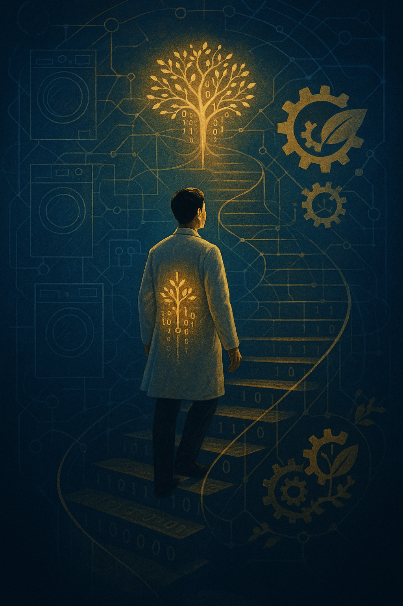

```{=html}
<div class="home-container">
  <section class="home-hero">
    <div class="hero-copy">
      <div class="hero-eyebrow">Practitioner–Scholar &middot; Applied RL &amp; On-Device AI</div>
      <h1 class="hero-title">실천적 지혜의 상승</h1>
      <p class="hero-lead">
        한 명의 실천‑학자가 0과 1의 이진 스트림으로 짜인 나선 계단을 오릅니다.
        이론이 물리적 제약과 만날 때 탄생하는 깊은 학습—<strong>프락시스(Praxis)</strong>—를 화두로,
        강화학습과 온디바이스 AI를 가전과 로보틱스의 실세계 제어 문제에 연결합니다.
      </p>

      <div class="hero-tags">
        <span class="hero-tag">Reinforcement Learning</span>
        <span class="hero-tag">On-Device AI &amp; Quantization</span>
        <span class="hero-tag">Physical &amp; Appliance Control</span>
        <span class="hero-tag">Robotics</span>
      </div>

      <div class="hero-actions">
        <a class="hero-btn-primary" href="projects.html">
          <i class="fas fa-layer-group"></i> 대표 프로젝트 보기
        </a>
        <a class="hero-btn-secondary" href="publications.html">
          <i class="fas fa-book-open"></i> 출간물
        </a>
        <a class="hero-btn-secondary" href="blog.html">
          <i class="fas fa-pen-nib"></i> 연구 노트
        </a>
        <a class="hero-btn-secondary" href="about.html">
          <i class="fas fa-user"></i> 소개 &amp; CV
        </a>
      </div>

      <details class="hero-meaning">
        <summary>페르소나 일러스트에 담긴 네 가지 상징 펼쳐보기</summary>
        <div class="hero-meaning-grid">
          <div class="hero-meaning-item">
            <strong>나선 계단</strong>
            배움과 성장은 직선이 아니라 실험·적용·이론이 맞물리는 순환과 누적의 과정입니다.
          </div>
          <div class="hero-meaning-item">
            <strong>빛으로 피어난 데이터‑나무</strong>
            데이터와 통찰이 결합해 지속 가능한 혁신으로 꽃피는 모습을 표현합니다.
          </div>
          <div class="hero-meaning-item">
            <strong>회로‑청사진 배경</strong>
            철학적 성찰이 가전과 임베디드라는 실세계 엔지니어링 문제 속에 뿌리내리고 있음을 뜻합니다.
          </div>
          <div class="hero-meaning-item">
            <strong>맞물린 기어와 잎사귀</strong>
            효율(기어)과 환경(잎사귀)의 조화를 통해 기술이 인간 삶에 봉사한다는 사명을 상징합니다.
          </div>
        </div>
      </details>
    </div>

    <div class="hero-visual">
      <div class="hero-visual-frame">
        
      </div>
      <div class="hero-visual-caption">Every hard‑won lesson becomes the next foothold upward.</div>
    </div>
  </section>

  <div class="section-header">
    <h2>핵심 연구 영역</h2>
    <a class="section-more" href="about.html">연구자 소개 더보기 &rarr;</a>
  </div>

  <div class="pillar-grid">
    <div class="pillar-card">
      <div class="pillar-icon"><i class="fas fa-microchip"></i></div>
      <h3>On-Device AI &amp; 배포 검증</h3>
      <p>제한된 임베디드 자원과 NPU(Edge TPU, Hailo-8, Jetson) 환경에서 양자화 아티팩트의 실제 제어 성능을 감사하고 최적화합니다.</p>
    </div>
    <div class="pillar-card">
      <div class="pillar-icon"><i class="fas fa-project-diagram"></i></div>
      <h3>데이터 기반 &amp; 오프라인 강화학습</h3>
      <p>탐색이 제한된 실물 시스템에서 로그 데이터와 월드 모델·보상 학습을 결합해 안전하고 지속 개선 가능한 제어 정책을 설계합니다.</p>
    </div>
    <div class="pillar-card">
      <div class="pillar-icon"><i class="fas fa-robot"></i></div>
      <h3>가전 제어 &amp; 피지컬 AI</h3>
      <p>세탁기·건조기·냉장고·HVAC 양산 제어부터 SO-101 로봇 팔과 XR 분석 도구까지 물리 세계와 맞닿은 AI 파이프라인을 구축합니다.</p>
    </div>
  </div>

  <div class="section-header">
    <h2>주요 연구 &amp; 프로젝트</h2>
    <a class="section-more" href="projects.html">전체 프로젝트 (8) &rarr;</a>
  </div>

  <div class="featured-grid">
    <a class="featured-card" href="projects/paired-task-audits-on-device/">
      <div>
        <span class="venue-badge">NeurIPS 2026 Workshop (ODI)</span>
        <h3>Paired Task Audits for On-Device Neural Control</h3>
        <p>동일한 정책과 INT8 라벨이라도 calibration row 선택만으로 Hailo-8 제어 성공률이 96.6%와 21.4%로 갈리는 현상을 실물 가속기 루프에서 규명합니다.</p>
      </div>
      <div class="card-metric-row">
        <span>96.6% vs 21.4%</span> &middot; <span>1,024 Paired Seeds</span>
      </div>
    </a>

    <a class="featured-card" href="projects/ghostlab/">
      <div>
        <span class="venue-badge badge-teal">Meta VR Competition 2026</span>
        <h3>GhostLab: 손으로 살펴보는 로봇의 동작</h3>
        <p>SO-101 로봇 팔의 정책 실행 궤적을 Meta Quest 가상 작업대로 옮겨, 핸드 트래킹과 0.25배속 관절 재생으로 오프라인 정밀 검토를 수행합니다.</p>
      </div>
      <div class="card-metric-row">
        <span>Meta Quest XR</span> &middot; <span>ACT Policy Rollout</span>
      </div>
    </a>

    <a class="featured-card" href="projects/data-driven-rl-washing-machines/">
      <div>
        <span class="venue-badge badge-amber">IEEE CAI 2024 &middot; 세계 최초 양산</span>
        <h3>Data-Driven RL for Washing Machines</h3>
        <p>실생활 운전 데이터를 활용한 오프라인 강화학습으로 다양한 세탁 부하의 탈수 진동을 억제하고 양산 가전에 탑재한 연구입니다.</p>
      </div>
      <div class="card-metric-row">
        <span>Offline RL</span> &middot; <span>Mass-Produced Control</span>
      </div>
    </a>
  </div>
</div>
```
