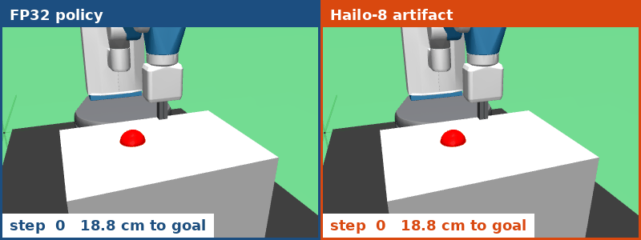
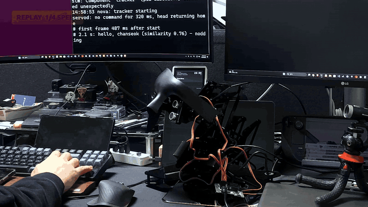
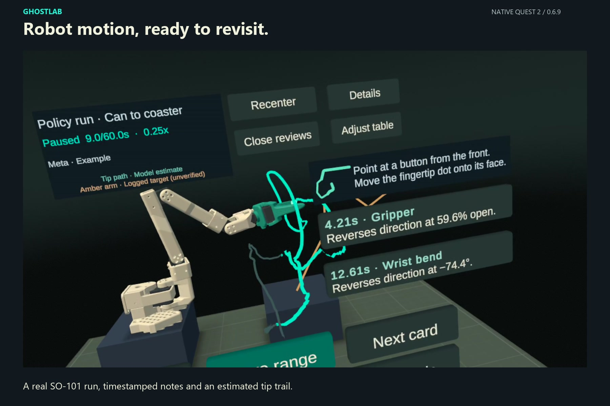
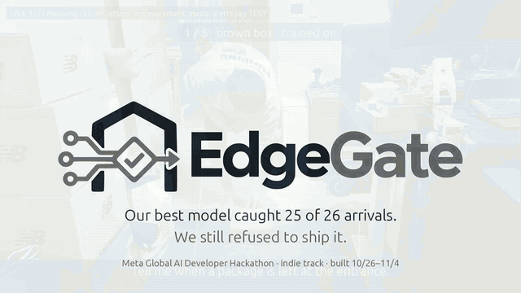
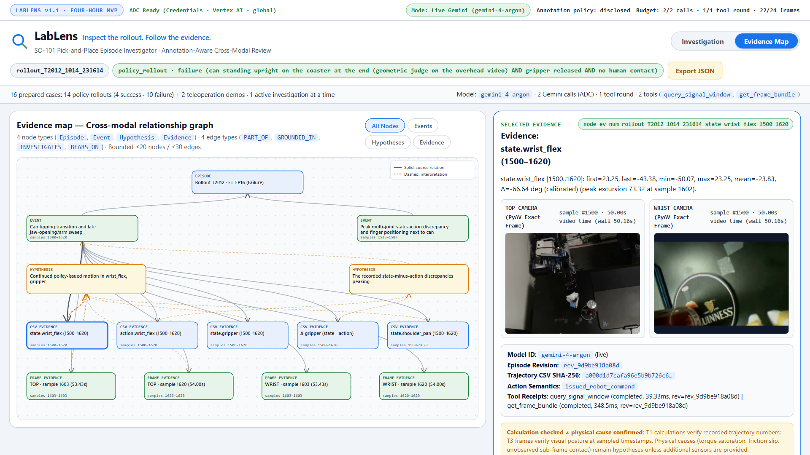
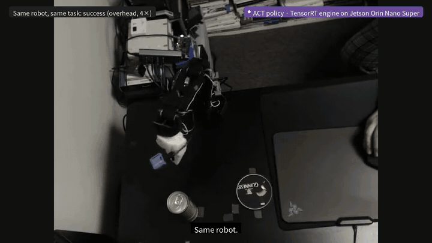
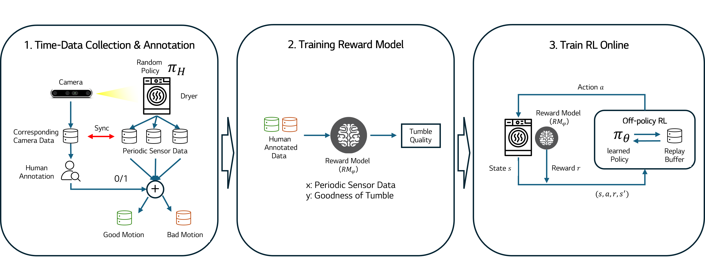
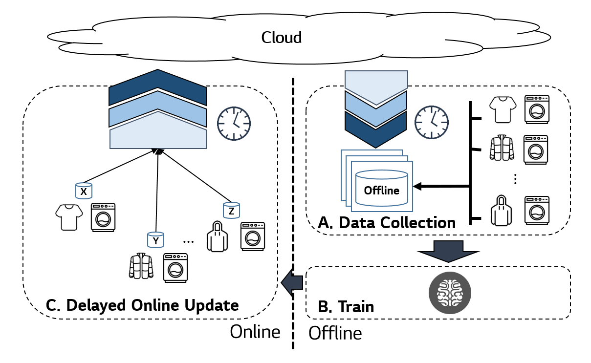

```{=html}
<div class="home-container">
  <div class="projects-hub-grid">

    <a class="project-hub-card" href="projects/paired-task-audits-on-device/">
      
      <div class="project-hub-body">
        <span class="venue-badge">NeurIPS 2026 Workshop (ODI)</span>
        <h3>Same Policy, Different Artifacts: Paired Task Audits</h3>
        <p>"INT8"이라는 라벨 하나로는 실제 배포 제어기를 특정할 수 없습니다. 실제 Edge TPU와 Hailo-8 가속기를 제어 루프에 연결해 calibration row에 따른 태스크 성패(96.6% vs 21.4%)를 검증합니다.</p>
        <div class="card-metric-row">
          <span>Hailo-8 &amp; Edge TPU</span> &middot; <span>1,024 Paired Seeds</span> &middot; <span>7/8 Policies Replicated</span>
        </div>
      </div>
    </a>

    <a class="project-hub-card" href="projects/qnx-robot-head/">
      
      <div class="project-hub-body">
        <span class="venue-badge badge-teal">QNX Global Hackathon 2026</span>
        <h3>When the AI Crashes, the Robot Doesn't</h3>
        <p>QNX 8.0 RTOS와 Raspberry Pi 5 위에서 얼굴 추적 비전과 서보 제어(<code>servod</code>)를 프로세스 단위로 격리했습니다. 비전 프로세스가 죽어도 301 ms 만에 안전 위치로 복귀하고 재부팅 없이 610 ms 만에 재기동합니다.</p>
        <div class="card-metric-row">
          <span>QNX 8.0 RTOS</span> &middot; <span>301 ms Watchdog</span> &middot; <span>Upstream BSP PR</span>
        </div>
      </div>
    </a>

    <a class="project-hub-card" href="projects/ghostlab/">
      
      <div class="project-hub-body">
        <span class="venue-badge badge-teal">Meta VR Start Competition 2026</span>
        <h3>GhostLab: 손으로 살펴보는 로봇의 동작</h3>
        <p>기록된 SO-101 로봇 팔의 ACT 정책 실행 궤적을 Meta Quest 공간 작업대로 가져와, 손 추적으로 타임라인을 조작하고 0.25배속 관절 재생과 관찰 노트를 오프라인으로 검토합니다.</p>
        <div class="card-metric-row">
          <span>Meta Quest 2/3</span> &middot; <span>1,797 Samples (60s)</span> &middot; <span>Hand Tracking</span>
        </div>
      </div>
    </a>

    <a class="project-hub-card" href="projects/edgegate/">
      
      <div class="project-hub-body">
        <span class="venue-badge badge-teal">Meta Global AI Hackathon 2026</span>
        <h3>EdgeGate: 엣지 비전 배포 게이트</h3>
        <p>Muse Glimmer와 SAM 3.1로 학습한 택배 도착 판별 비전 모델 빌드들을 실제 Jetson Orin Nano와 Raspberry Pi 5 + Hailo-8에서 측정하고 사전 정의된 규칙으로 배포 적합성을 판정합니다.</p>
        <div class="card-metric-row">
          <span>Jetson Orin Nano</span> &middot; <span>RPi 5 + Hailo-8</span> &middot; <span>SAM 3.1</span>
        </div>
      </div>
    </a>

    <a class="project-hub-card" href="projects/lablens/">
      
      <div class="project-hub-body">
        <span class="venue-badge badge-teal">Google DeepMind AI Hackathon 2026</span>
        <h3>LabLens: 로봇 에피소드 근거 추적기</h3>
        <p>SO-101 궤적 구간을 정확한 카메라 프레임 및 결정론적 신호 통계에 연결해 로봇 롤아웃의 이상 징후와 시각 가설을 구조적으로 검증하는 조사 도구입니다.</p>
        <div class="card-metric-row">
          <span>SO-101 Robotics</span> &middot; <span>Evidence Graph</span> &middot; <span>Multimodal Audit</span>
        </div>
      </div>
    </a>

    <a class="project-hub-card" href="projects/quantgate/">
      
      <div class="project-hub-body">
        <span class="venue-badge badge-teal">Nebius &times; NVIDIA Physical AI Hackathon</span>
        <h3>QuantGate: 양자화 로봇 정책 배포 리뷰</h3>
        <p>SO-101 로봇 팔의 ACT 정책 하나를 Jetson Orin Nano Super용 26개 양자화 빌드로 변환하고, 745회의 실물 로봇 시행 데이터를 바탕으로 차기 검증 대상을 선별합니다.</p>
        <div class="card-metric-row">
          <span>26 Quantized Builds</span> &middot; <span>745 Real-Arm Trials</span> &middot; <span>HF Dataset 공개</span>
        </div>
      </div>
    </a>

    <a class="project-hub-card" href="projects/reward-learning-dryer/">
      
      <div class="project-hub-body">
        <span class="venue-badge">IEEE CASE 2026</span>
        <h3>Sensor-Based Reward Learning for Dryer Control</h3>
        <p>내부 카메라 없이도 세탁물 움직임을 평가할 수 있도록 비디오 라벨로부터 센서 기반 보상 모델을 학습하고, 강화학습으로 가정용 건조기의 최적 텀블 모션을 제어합니다.</p>
        <div class="card-metric-row">
          <span>Reward Learning</span> &middot; <span>Household Dryer</span> &middot; <span>RL Control</span>
        </div>
      </div>
    </a>

    <a class="project-hub-card" href="projects/data-driven-rl-washing-machines/">
      
      <div class="project-hub-body">
        <span class="venue-badge badge-amber">IEEE CAI 2024 &middot; 세계 최초 양산 적용</span>
        <h3>Data-Driven RL for Optimal Motor Control in Washing Machines</h3>
        <p>다양한 부하 조건에서 발생하는 세탁기 탈수 진동을 줄이기 위해 데이터 기반 오프라인 강화학습과 실환경 지속 개선 파이프라인을 구축하여 실제 양산 제품에 탑재했습니다.</p>
        <div class="card-metric-row">
          <span>Continual Offline RL</span> &middot; <span>Motor Control</span> &middot; <span>LG Signature 탑재</span>
        </div>
      </div>
    </a>

  </div>
</div>
```
