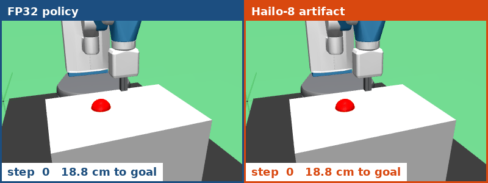
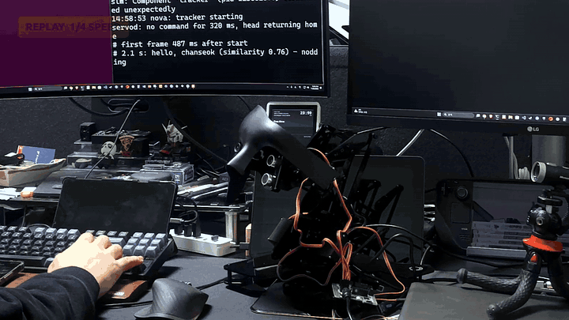
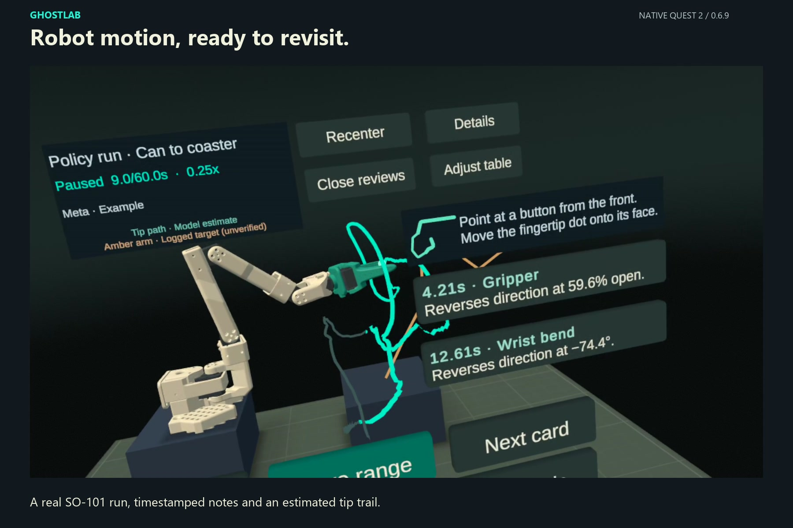
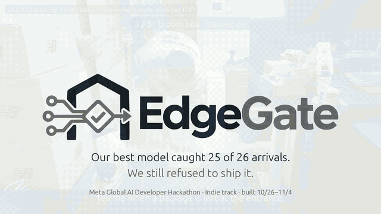
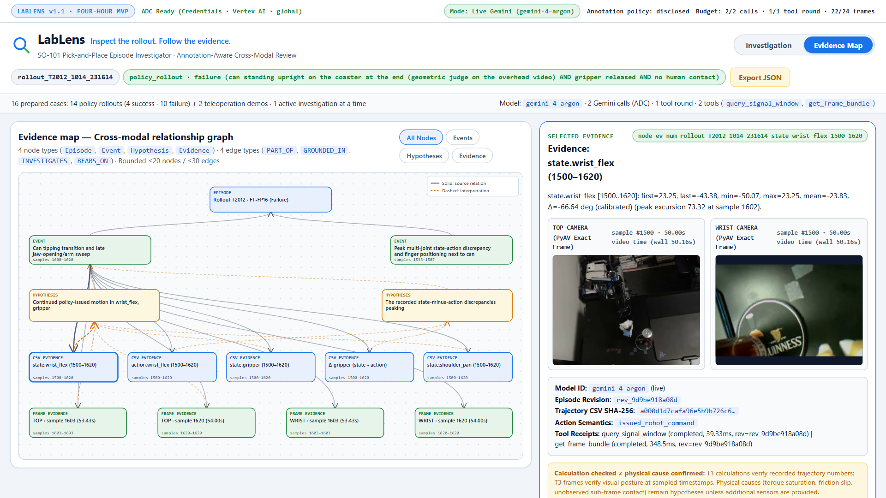
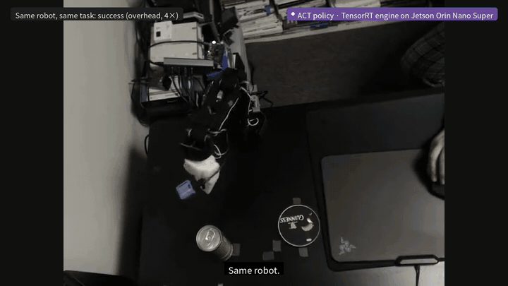
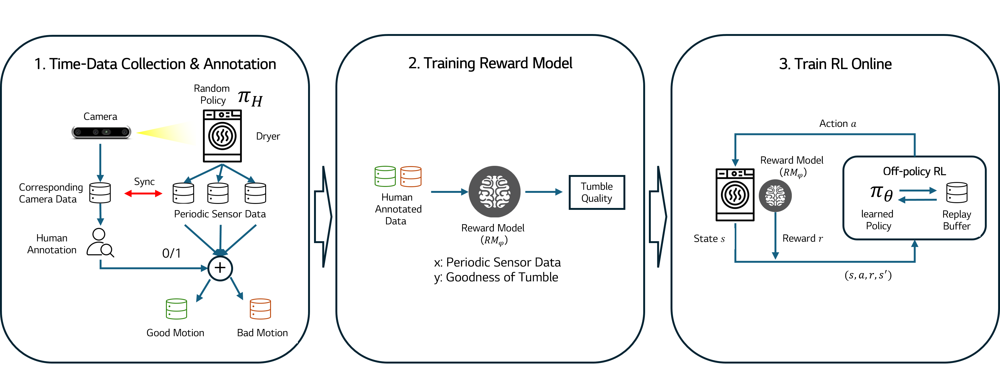
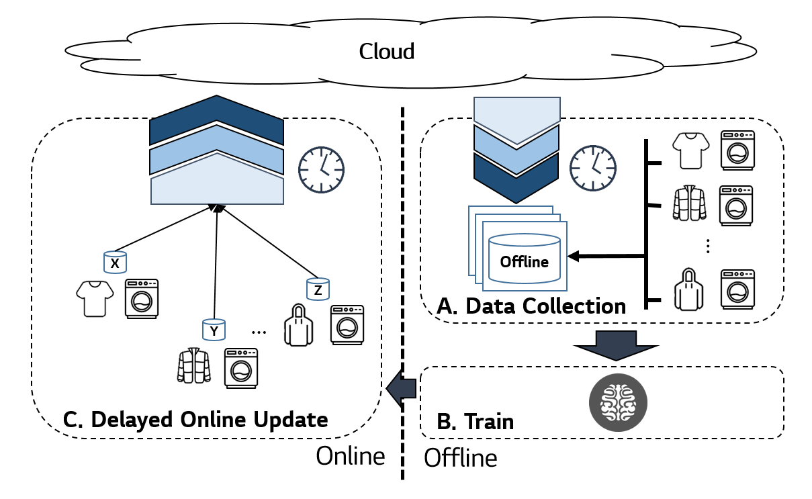

```{=html}
<div class="home-container">
  <div class="projects-hub-grid">

    <a class="project-hub-card" href="projects/paired-task-audits-on-device/">
      
      <div class="project-hub-body">
        <span class="venue-badge">NeurIPS 2026 Workshop (ODI)</span>
        <h3>Same Policy, Different Artifacts: Paired Task Audits</h3>
        <p>An "INT8" label does not name a single controller. Qualifies compiled artifacts via paired hardware-in-the-loop task outcomes on physical Edge TPU and Hailo-8 accelerators (96.6% vs 21.4%).</p>
        <div class="card-metric-row">
          <span>Hailo-8 &amp; Edge TPU</span> &middot; <span>1,024 Paired Seeds</span> &middot; <span>7/8 Policies Replicated</span>
        </div>
      </div>
    </a>

    <a class="project-hub-card" href="projects/qnx-robot-head/">
      
      <div class="project-hub-body">
        <span class="venue-badge badge-teal">QNX Global Hackathon 2026</span>
        <h3>When the AI Crashes, the Robot Doesn't</h3>
        <p>Rebuilt a face-tracking robot head on QNX 8.0 RTOS and Raspberry Pi 5 with strict process isolation between ONNX vision and a resource-managed servo server (<code>servod</code>), recovering safely within 301 ms of a vision kill.</p>
        <div class="card-metric-row">
          <span>QNX 8.0 RTOS</span> &middot; <span>301 ms Watchdog</span> &middot; <span>Upstream BSP PR</span>
        </div>
      </div>
    </a>

    <a class="project-hub-card" href="projects/ghostlab/">
      
      <div class="project-hub-body">
        <span class="venue-badge badge-teal">Meta VR Start Competition 2026</span>
        <h3>GhostLab: Review Robot Motion with Your Hands</h3>
        <p>Brings recorded SO-101 ACT policy rollouts onto a seated Meta Quest workbench for hand-tracked timeline scrubbing, 0.25&times; joint replay, and offline observation review.</p>
        <div class="card-metric-row">
          <span>Meta Quest 2/3</span> &middot; <span>1,797 Samples (60s)</span> &middot; <span>Hand Tracking</span>
        </div>
      </div>
    </a>

    <a class="project-hub-card" href="projects/edgegate/">
      
      <div class="project-hub-body">
        <span class="venue-badge badge-teal">Meta Global AI Hackathon 2026</span>
        <h3>EdgeGate: A Deployment Gate for Edge Vision</h3>
        <p>Evaluates package-at-the-door vision builds trained with Muse Glimmer and SAM 3.1 directly on Jetson Orin Nano and Raspberry Pi 5 + Hailo-8 against pre-committed release rules.</p>
        <div class="card-metric-row">
          <span>Jetson Orin Nano</span> &middot; <span>RPi 5 + Hailo-8</span> &middot; <span>SAM 3.1</span>
        </div>
      </div>
    </a>

    <a class="project-hub-card" href="projects/lablens/">
      
      <div class="project-hub-body">
        <span class="venue-badge badge-teal">Google DeepMind AI Hackathon 2026</span>
        <h3>LabLens: Inspect the Rollout, Follow the Evidence</h3>
        <p>An annotation-aware robot episode investigator linking SO-101 trajectory intervals to exact camera frames and deterministic signal statistics.</p>
        <div class="card-metric-row">
          <span>SO-101 Robotics</span> &middot; <span>Evidence Graph</span> &middot; <span>Multimodal Audit</span>
        </div>
      </div>
    </a>

    <a class="project-hub-card" href="projects/quantgate/">
      
      <div class="project-hub-body">
        <span class="venue-badge badge-teal">Nebius &times; NVIDIA Physical AI Hackathon</span>
        <h3>QuantGate: Deployment Review for Quantized Policies</h3>
        <p>Audits 26 deployable quantized builds of an SO-101 ACT policy on Jetson Orin Nano Super across 745 sealed real-arm trials, with open-sourced demonstration datasets.</p>
        <div class="card-metric-row">
          <span>26 Quantized Builds</span> &middot; <span>745 Real-Arm Trials</span> &middot; <span>Open HF Dataset</span>
        </div>
      </div>
    </a>

    <a class="project-hub-card" href="projects/reward-learning-dryer/">
      
      <div class="project-hub-body">
        <span class="venue-badge">IEEE CASE 2026</span>
        <h3>Sensor-Based Reward Learning for Dryer Control</h3>
        <p>Learns sensor-only reward models from video labels to optimize household dryer tumble-motion control via reinforcement learning without production camera hardware.</p>
        <div class="card-metric-row">
          <span>Reward Learning</span> &middot; <span>Household Dryer</span> &middot; <span>RL Control</span>
        </div>
      </div>
    </a>

    <a class="project-hub-card" href="projects/data-driven-rl-washing-machines/">
      
      <div class="project-hub-body">
        <span class="venue-badge badge-amber">IEEE CAI 2024 &middot; Commercial Launch</span>
        <h3>Data-Driven RL for Optimal Motor Control in Washing Machines</h3>
        <p>Continual offline reinforcement learning pipeline reducing spin-cycle vibration across varied laundry loads and deployed in mass-produced LG appliances.</p>
        <div class="card-metric-row">
          <span>Continual Offline RL</span> &middot; <span>Motor Control</span> &middot; <span>LG Signature</span>
        </div>
      </div>
    </a>

  </div>
</div>
```
