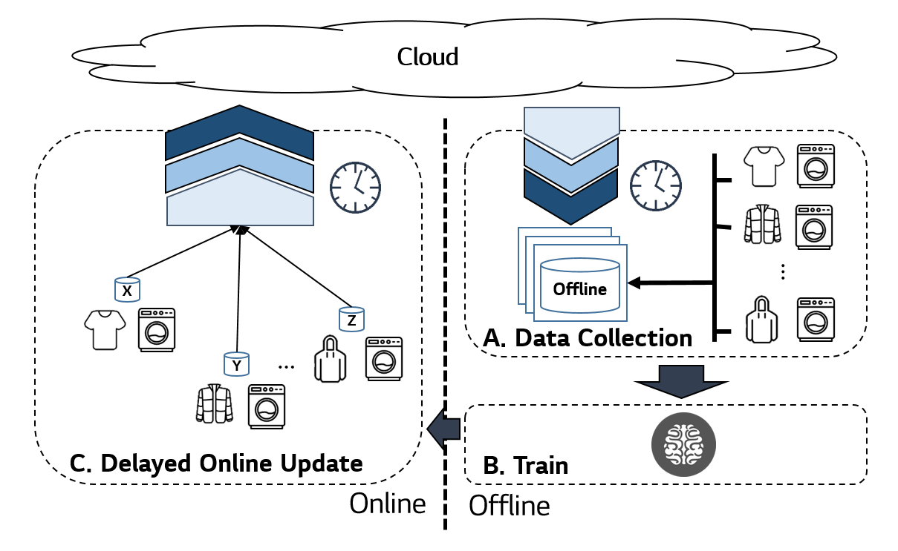
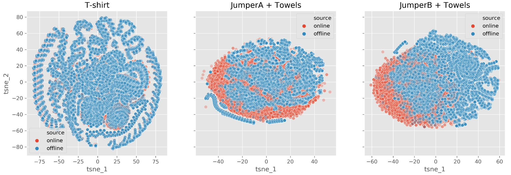
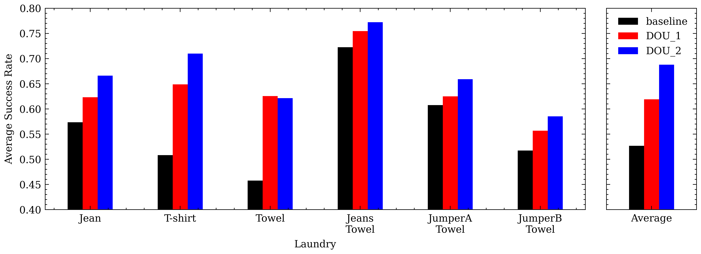
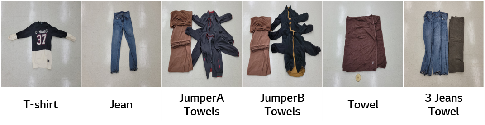
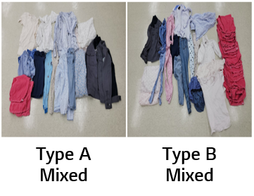
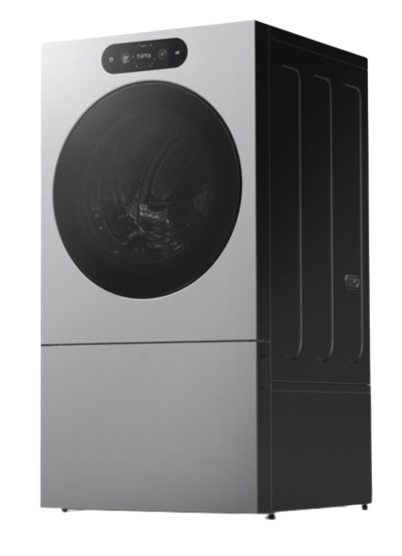
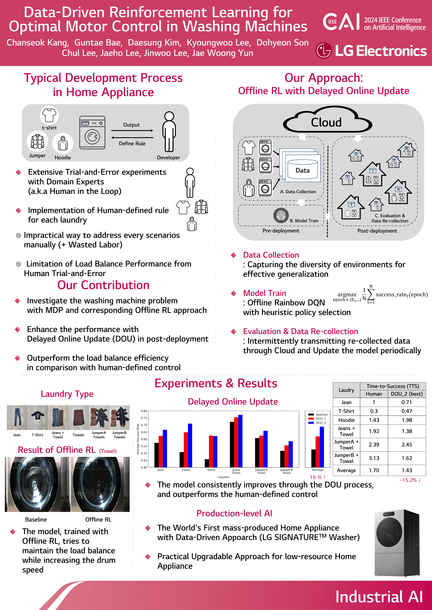

::: {.paper-project}

::: {.paper-hero}
<div class="paper-title">Data-Driven Reinforcement Learning for Optimal Motor Control in Washing Machines</div>

::: {.paper-venue}
2024 IEEE Conference on Artificial Intelligence (CAI), Singapore
:::

<div class="paper-authors">
  <a class="paper-author" href="../../about.html">Chanseok Kang</a>
  <span class="paper-author">Guntae Bae</span>
  <span class="paper-author">Daesung Kim</span>
  <span class="paper-author">Kyoungwoo Lee</span>
  <span class="paper-author">Dohyeon Son</span>
  <span class="paper-author">Chul Lee</span>
  <span class="paper-author">Jaeho Lee</span>
  <span class="paper-author">Jinwoo Lee</span>
  <span class="paper-author">Jae Woong Yun</span>
</div>

::: {.paper-affiliation}
LG Electronics AI Lab
:::

<div class="paper-links">
  <a class="paper-button" href="https://ieeexplore.ieee.org/document/10605463/" target="_blank" rel="noopener"><i class="ai ai-ieee"></i> IEEE</a>
  <a class="paper-button" href="https://doi.org/10.1109/CAI59869.2024.00083" target="_blank" rel="noopener"><i class="fas fa-link"></i> DOI</a>
  <!-- Add a local manuscript after placing projects/data-driven-rl-washing-machines/assets/paper.pdf:
  <a class="paper-button" href="assets/paper.pdf"><i class="fas fa-file-pdf"></i> PDF</a>
  -->
</div>
:::

## TL;DR

::: {.paper-tldr}
**Delayed Online Update (DOU)**는 실험실에서 학습한 모델에 실제 사용 환경에서 모은 데이터를 더해 계속 학습시키는 Continual Offline Reinforcement Learning 방법입니다. 실생활에서 만나는 다양한 세탁물을 탈수할 때도 진동이 적도록 load balancing 성능을 개선했습니다.
:::

::: {.paper-teaser}
::: {.paper-figure .paper-figure-main}
{.paper-image}

::: {.paper-media-caption}
배포 후에도 강화학습 모델의 성능을 계속 개선하는 Delayed Online Update (DOU) 흐름.
:::
:::
:::

## Overview

::: {.paper-summary-grid}
::: {.paper-summary-card}
### Problem
탈수 중 진동을 줄이려면 세탁조 안의 세탁물이 균형을 이뤄야 합니다. 그런데 세탁물 조합은 사실상 무한하고, 조합마다 진동 패턴도 다릅니다. 지금은 세탁기 개발자가 대표적인 세탁물 케이스만 골라 직접 시행착오를 겪으며 성능을 개선하는 Human-in-the-Loop(HITL) 방식에 기대고 있습니다. 게다가 대량 생산되는 가전에는 보통 저사양 MCU가 들어가기 때문에, 학습하지 않은 부하에 대해서는 제어 성능을 끌어올리기 어렵습니다.
:::

::: {.paper-summary-card}
### Approach

이 논문은 Continual Offline Reinforcement Learning으로 세탁기 모터를 제어해 탈수 중 진동을 줄입니다. 배포 후 실제 환경에서 쌓이는 unseen transition data로 policy를 주기적으로 갱신하는 delayed online update (DOU)를 써서, 기존 데이터와 실제 환경 데이터 사이의 distribution shift 위험을 낮췄습니다.
:::

::: {.paper-summary-card}
### Outcome

실험실에서 세탁물 6종으로 실험한 결과, DOU를 두 차례 거친 모델의 평균 success rate가 baseline보다 약 16%p 높았습니다.
:::
:::

## Method

::: {.paper-method}
::: {.paper-method-steps}
1. 실험실에서 세탁기를 돌리며 다양한 세탁물의 transition data를 수집합니다.
2. 탈수 구간의 진동을 줄이는 objective를 정의하고, 이를 기준으로 offline RL policy를 학습합니다.
3. 학습된 policy를 실제 환경에 deploy한 후, 새롭게 수집되는 online interaction data를 delay window 동안 누적합니다.
4. 짧은 online rollout마다 즉시 반응하는 대신 확장된 dataset(기존 데이터 + 새로 수집한 데이터)으로 policy를 갱신합니다.
:::

::: {.paper-figure}
{.paper-image}

::: {.paper-media-caption}
같은 세탁물에 대해 실험실에서 모은 데이터와 실제 환경에서 모은 데이터의 분포를 시각화했습니다. 두 분포가 비슷하게 겹치는 세탁물도 있었지만, 확연히 어긋나는 세탁물도 있었습니다. offline data와 online data 사이에 distribution shift가 실제로 일어나고 있다는 뜻입니다.
:::
:::
:::

## Results

::: {.paper-result-grid}
::: {.paper-result-card .paper-result-wide}
### Average Success Rate

{.paper-image}

실험실에서 세탁물 6종을 대상으로 DOU를 두 차례 수행했고, 평균 success rate가 초기 baseline의 약 0.53에서 0.69로 약 16%p 올랐습니다.
:::

::: {.paper-result-card}
### Multi-Task Laundry Set

{.paper-image}

세탁조에 세탁물이 들어 있는 배치 하나를 task 하나로 정의하고, 실험은 multi-task로 구성했습니다.
:::

::: {.paper-result-card}
### Unseen Tasks

{.paper-image}

학습에 쓴 세탁물 외에, 실생활에서 만날 법한 unseen 세탁물로도 성능을 평가해 generalization 여부를 확인했습니다.
:::

::: {.paper-result-card}
### Production Device

{.paper-image}

이 과정으로 개선한 강화학습 모델은 실제 양산 제품에 탑재되어 세계 최초로 출시되었습니다.
:::
:::

## Videos

::: {.paper-media-grid}
::: {.paper-media-card .paper-media-feature}
```{=html}
<video class="paper-video" controls muted loop playsinline preload="metadata">
  <source src="assets/supplement_2.mp4" type="video/mp4">
</video>
```

::: {.paper-media-caption}
Supplemental motion example.
:::
:::

::: {.paper-media-card}
```{=html}
<video class="paper-video" controls muted loop playsinline preload="metadata">
  <source src="assets/sample1.mp4" type="video/mp4">
</video>
```

::: {.paper-media-caption}
Naive rule-based baseline motion.
:::
:::

::: {.paper-media-card}
```{=html}
<video class="paper-video" controls muted loop playsinline preload="metadata">
  <source src="assets/sample2.mp4" type="video/mp4">
</video>
```

::: {.paper-media-caption}
Proposed learned motion.
:::
:::
:::

## Poster

::: {.paper-poster}
{.paper-image}
:::

## Citation

::: {.paper-citation}
```bibtex
@inproceedings{kang2024dataDrivenRLWasher,
  title     = {Data-Driven Reinforcement Learning for Optimal Motor Control in Washing Machines},
  author    = {Kang, Chanseok and Bae, Guntae and Kim, Daesung and Lee, Kyoungwoo and Son, Dohyeon and Lee, Chul and Lee, Jaeho and Lee, Jinwoo and Yun, Jae Woong},
  booktitle = {Proceedings - 2024 IEEE Conference on Artificial Intelligence (CAI)},
  pages     = {418--424},
  year      = {2024},
  doi       = {10.1109/CAI59869.2024.00083}
}
```
:::

:::
