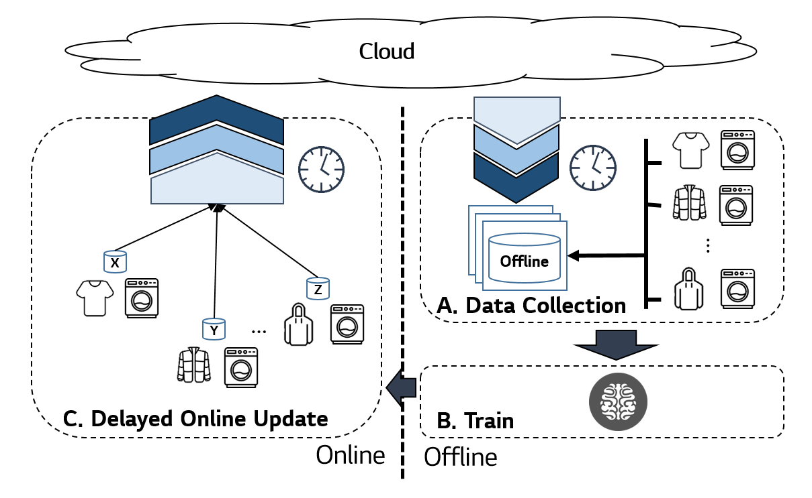
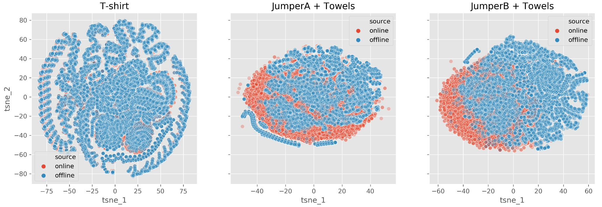
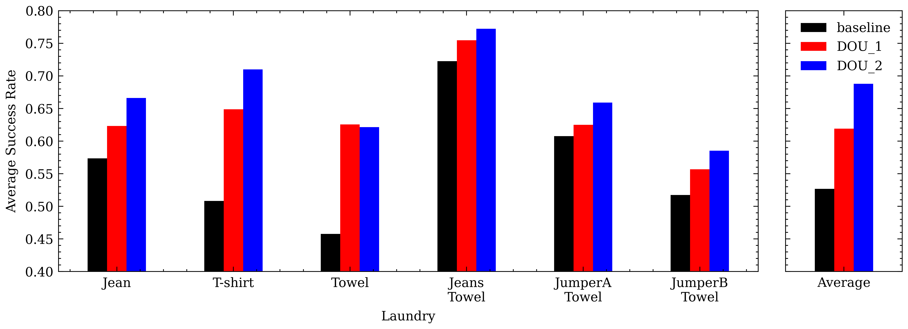
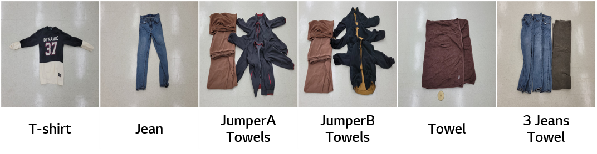
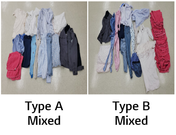
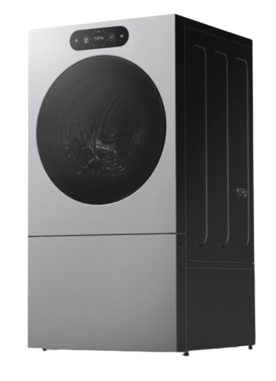
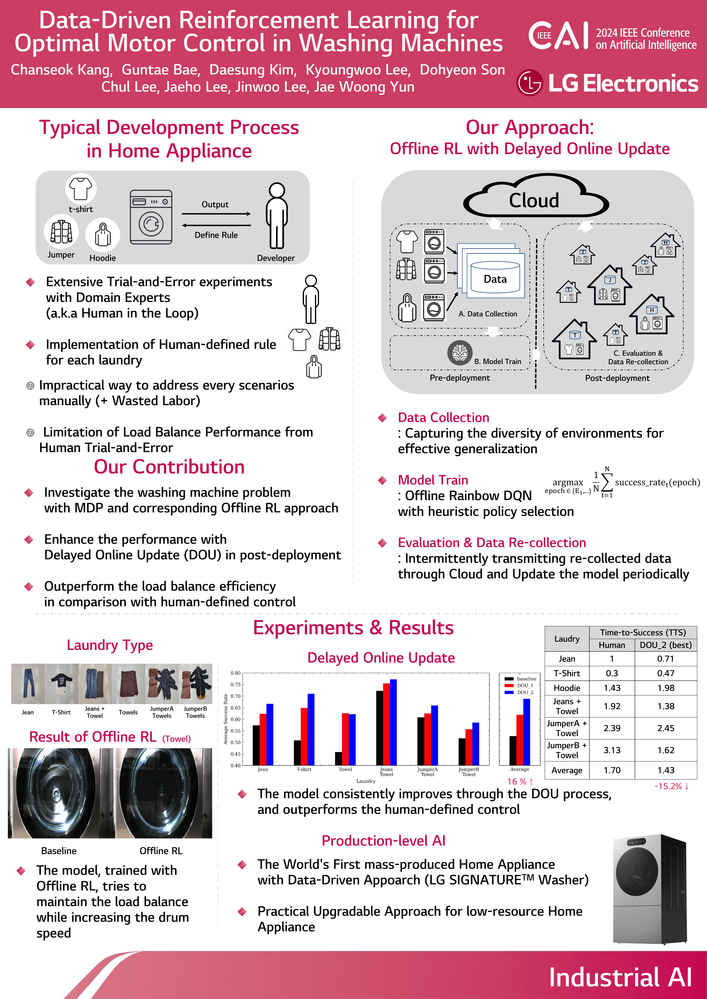

::: {.paper-project}

::: {.paper-hero}
<div class="paper-title">Data-Driven Reinforcement Learning for Optimal Motor Control in Washing Machines</div>

::: {.paper-venue}
2024 IEEE Conference on Artificial Intelligence (CAI), Singapore
:::

<div class="paper-authors">
  <a class="paper-author" href="../../about.html">Chanseok Kang</a>
  <span class="paper-author">Guntae Bae</span>
  <span class="paper-author">Daesung Kim</span>
  <span class="paper-author">Kyoungwoo Lee</span>
  <span class="paper-author">Dohyeon Son</span>
  <span class="paper-author">Chul Lee</span>
  <span class="paper-author">Jaeho Lee</span>
  <span class="paper-author">Jinwoo Lee</span>
  <span class="paper-author">Jae Woong Yun</span>
</div>

::: {.paper-affiliation}
LG Electronics AI Lab
:::

<div class="paper-links">
  <a class="paper-button" href="https://ieeexplore.ieee.org/document/10605463/" target="_blank" rel="noopener"><i class="ai ai-ieee"></i> IEEE</a>
  <a class="paper-button" href="https://doi.org/10.1109/CAI59869.2024.00083" target="_blank" rel="noopener"><i class="fas fa-link"></i> DOI</a>
  <!-- Add a local manuscript after placing projects/data-driven-rl-washing-machines/assets/paper.pdf:
  <a class="paper-button" href="assets/paper.pdf"><i class="fas fa-file-pdf"></i> PDF</a>
  -->
</div>
:::

## TL;DR

::: {.paper-tldr}
Delayed Online Update combines real washing-machine operation data with continual offline reinforcement learning to improve load balancing during dehydration without hand-coding every laundry scenario.
:::

::: {.paper-teaser}
::: {.paper-figure .paper-figure-main}
{.paper-image}

::: {.paper-media-caption}
Delayed Online Update (DOU) workflow for post-deployment improvement.
:::
:::
:::

## Overview

::: {.paper-summary-grid}
::: {.paper-summary-card}
### Problem

To keep vibration down during the dehydration cycle, a washer has to keep its load balanced, and the number of possible laundry combinations is effectively unlimited. Today developers tune the controller by trial and error on a handful of representative loads (a human-in-the-loop process). Mass-produced appliances also run on low-spec MCUs, so loads the controller was never tuned for are hard to handle well.
:::

::: {.paper-summary-card}
### Approach

The paper introduces a continual offline reinforcement learning workflow for washer motor control. The policy trains on logged transition data, then gets delayed online updates so that distribution shift between lab and field data stays manageable.
:::

::: {.paper-summary-card}
### Outcome

In lab tests on six laundry types, two rounds of DOU raised the average success rate by about 16 percentage points over the baseline.
:::
:::

## Method

::: {.paper-method}
::: {.paper-method-steps}
1. Collect transition data from real washing-machine operation.
2. Train an offline RL policy for dehydration-cycle motor control.
3. Accumulate new online interaction data over a delay window.
4. Update the policy from the expanded dataset instead of reacting to every short online rollout.
:::

::: {.paper-figure}
{.paper-image}

::: {.paper-media-caption}
Offline and online data coverage for selected laundry tasks.
:::
:::
:::

## Results

::: {.paper-result-grid}
::: {.paper-result-card .paper-result-wide}
### Average Success Rate

{.paper-image}

Both DOU rounds beat the baseline on every laundry task. After the second round, the average success rate went from about 0.53 to 0.69.
:::

::: {.paper-result-card}
### Multi-Task Laundry Set

{.paper-image}

Representative laundry configurations used for multi-task evaluation.
:::

::: {.paper-result-card}
### Unseen Tasks

{.paper-image}

Unseen laundry combinations for evaluating generalization.
:::

::: {.paper-result-card}
### Production Device

{.paper-image}

The improved model shipped in a mass-produced LG SIGNATURE washer, the first mass-produced home appliance to use this kind of data-driven control.
:::
:::

## Videos

::: {.paper-media-grid}
::: {.paper-media-card .paper-media-feature}
```{=html}
<video class="paper-video" controls muted loop playsinline preload="metadata">
  <source src="assets/supplement_2.mp4" type="video/mp4">
</video>
```

::: {.paper-media-caption}
Supplemental motion example.
:::
:::

::: {.paper-media-card}
```{=html}
<video class="paper-video" controls muted loop playsinline preload="metadata">
  <source src="assets/sample1.mp4" type="video/mp4">
</video>
```

::: {.paper-media-caption}
Naive rule-based baseline motion.
:::
:::

::: {.paper-media-card}
```{=html}
<video class="paper-video" controls muted loop playsinline preload="metadata">
  <source src="assets/sample2.mp4" type="video/mp4">
</video>
```

::: {.paper-media-caption}
Proposed learned motion.
:::
:::
:::

## Poster

::: {.paper-poster}
{.paper-image}
:::

## Citation

::: {.paper-citation}
```bibtex
@inproceedings{kang2024dataDrivenRLWasher,
  title     = {Data-Driven Reinforcement Learning for Optimal Motor Control in Washing Machines},
  author    = {Kang, Chanseok and Bae, Guntae and Kim, Daesung and Lee, Kyoungwoo and Son, Dohyeon and Lee, Chul and Lee, Jaeho and Lee, Jinwoo and Yun, Jae Woong},
  booktitle = {Proceedings - 2024 IEEE Conference on Artificial Intelligence (CAI)},
  pages     = {418--424},
  year      = {2024},
  doi       = {10.1109/CAI59869.2024.00083}
}
```
:::

:::
