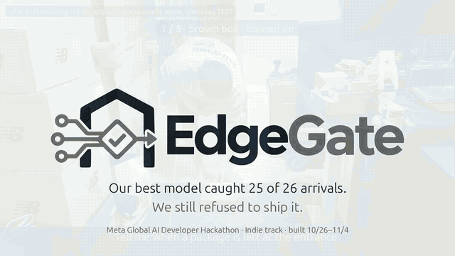
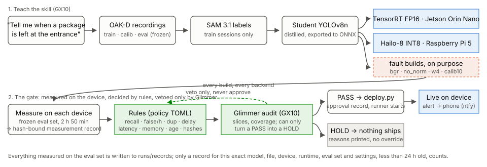
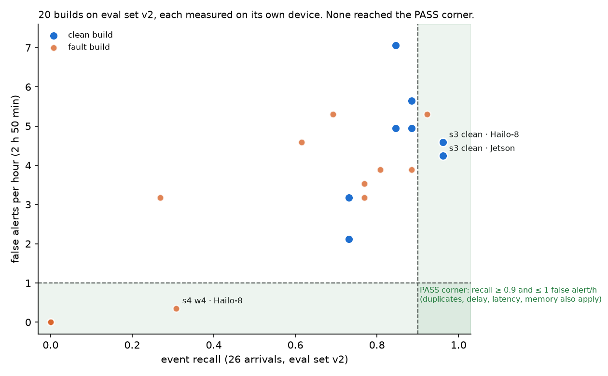
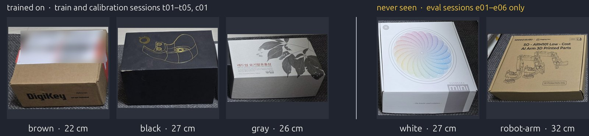

::: {.paper-project}

::: {.paper-hero}
<div class="paper-title">EdgeGate: A Deployment Gate for Edge Vision</div>

::: {.paper-venue}
Meta Global AI Developer Hackathon 2026 &middot; Indie developer track &middot; Push the Frontier &middot; 2026년 10월 26일 &ndash; 11월 4일
:::

<div class="paper-authors">
  <a class="paper-author" href="../../about.html">Chanseok Kang</a>
</div>

::: {.paper-affiliation}
개인 프로젝트
:::

<div class="paper-links">
  <a class="paper-button" href="https://github.com/goodboychan/edgeGate"><i class="fab fa-github"></i> 코드와 기록 (GitHub)</a>
  <a class="paper-button" href="https://www.youtube.com/watch?v=J4OQVwTwqV8"><i class="fab fa-youtube"></i> 영상 (3분)</a>
  <a class="paper-button" href="https://huggingface.co/datasets/chans/edgegate-package-entrance-eval"><i class="fas fa-database"></i> 평가 세션 (Hugging Face)</a>
  <a class="paper-button" href="https://cerebralvalley.ai/e/meta-ai-developer-hackathon/hackathon/gallery/1584"><i class="fas fa-trophy"></i> 해커톤 갤러리</a>
</div>
:::

## 요약

::: {.paper-tldr}
데모에서 돌아가는 모델이 곧 배포해도 되는 모델은 아닙니다. EdgeGate는 작은 비전 모델의 모든 빌드를 실제로 돌아갈 엣지 칩에서 측정하고, 평가 전에 써 둔 규칙으로 배포 여부를 결정합니다. 가장 좋은 student는 Jetson Orin Nano와 Hailo-8 모두에서 택배 도착 **26건 중 25건**을 잡았지만, 오탐이 시간당 **4.24회**(Jetson, Hailo-8은 4.59회)로 한도 1회를 넘어 HOLD됐습니다. 일부러 망가뜨린 빌드 12개도 모두 HOLD였고, 배포된 빌드는 없습니다.
:::

::: {.paper-teaser}
::: {.paper-figure .paper-figure-main}
{.paper-image}

::: {.paper-media-caption}
과제는 "현관에 택배가 놓이면 알려줘"입니다. 이 장면의 러너는 측정 모드라 모든 알림에 TEST가 붙습니다. 승인된 빌드가 없으므로 배포된 것은 없습니다. 이 페이지의 판정은 이 라이브 장면이 아니라 고정된 평가 세션에서 나왔습니다.
:::
:::
:::

::: {.paper-metric-strip}
::: {.paper-metric}
<strong>25/26 &rarr; HOLD</strong>
<span>가장 좋은 student가 두 칩에서 잡은 도착 수. 오탐이 시간당 4.24회(Jetson), 4.59회(Hailo-8)로 한도 1회를 넘어 HOLD</span>
:::

::: {.paper-metric}
<strong>12/12</strong>
<span>일부러 망가뜨린 빌드(색 채널 뒤바꿈, 정규화 누락, 4-bit weight, calibration 이미지 10장)가 모두 HOLD</span>
:::

::: {.paper-metric}
<strong>20 &middot; 4 &middot; 0</strong>
<span>같은 기록으로 always-deploy, 오탐만 보는 게이트, 규칙이 각각 배포했을 빌드 수</span>
:::
:::

## 개요

::: {.paper-summary-grid}
::: {.paper-summary-card}
### 문제

엣지 비전 모델은 재학습, 양자화, 재컴파일, 장치 변경을 거치고, 그때마다 동작이 달라질 수 있습니다. 데모는 빌드 하나가 한 번 돌아갔다는 것만 보여줍니다. **지금 배포하려는 그 파일이 그 장치에서** 요구사항을 만족하는지는 보여주지 않습니다. 여기서 요구사항은 택배가 놓이면 10초 안에, 헛알림 없이 알리는 것입니다.
:::

::: {.paper-summary-card}
### 접근

각 빌드를 자기 장치에서 고정된 평가 녹화로 측정합니다. 결과 기록은 모델, 컴파일된 파일, 장치, 런타임, 평가셋, 이벤트 설정에 해시로 묶입니다. **후보를 측정하기 전에 써 둔 규칙**이 PASS와 HOLD를 정하고, Muse Glimmer 30B는 근거를 감사해 HOLD를 더할 수만 있습니다.
:::

::: {.paper-summary-card}
### 결과

student 네 개의 빌드 20개를 2시간 50분 분량의 평가 세션으로 측정했습니다. Jetson Orin Nano Super에서는 TensorRT, Raspberry Pi 5 + Hailo-8에서는 HEF입니다. 통과한 빌드는 없습니다. 같은 기록으로 더 단순한 정책이었다면 무엇을 배포했을지도 함께 보입니다.
:::
:::

## 한 문장에서 판정까지

::: {.paper-figure}
{.paper-image}

::: {.paper-media-caption}
SAM 3.1은 학습 세션에만 라벨을 답니다. 그 라벨로 YOLOv8n student를 distill해 ONNX로 내보내고, Jetson용 TensorRT FP16과 Hailo-8용 INT8 HEF로 컴파일합니다. 평가 프레임과 그 정답은 학습이나 calibration에 한 번도 쓰지 않았습니다.
:::
:::

## 게이트: 기록이 맞아야 하는 것

::: {.paper-pipeline}
::: {.pipeline-stage}
<span>측정</span>
<strong>실제 장치에서</strong>
<p>모든 빌드가 같은 고정 녹화를 자기 장치에서 처리합니다. 추론, 디코딩, 도착 규칙을 그 장치에서 실행하고 시간을 잽니다. 검출 결과는 모든 빌드에 같은 코드로 이벤트 점수가 매겨집니다.</p>
:::

::: {.pipeline-arrow}
&rarr;
:::

::: {.pipeline-stage}
<span>결속</span>
<strong>정확히 그 대상에만</strong>
<p>기록은 그 모델 해시, 컴파일 파일 해시, 대상 장치와 런타임, 평가셋 해시, 이벤트 설정에만 유효하고 24시간 뒤 만료됩니다. 평가셋 해시는 후보를 측정하기 전에 정책에 적어 두었습니다.</p>
:::

::: {.pipeline-arrow}
&rarr;
:::

::: {.pipeline-stage}
<span>판정</span>
<strong>규칙이 정하고, 감사가 뒤따름</strong>
<p>이벤트 recall &ge; 0.9, 오탐 시간당 &le; 1회, 중복 알림 0, 검출 지연 p95 &le; 5초, 지연 p95 &le; 100 ms(Hailo-8: 50 ms), 최대 메모리 &le; 2 GB. Glimmer는 PASS를 거부할 수 있지만 HOLD를 풀 수는 없습니다.</p>
:::
:::

## 결과

::: {.paper-result-grid}
::: {.paper-result-card .paper-result-wide}
### 모든 빌드, 자기 장치에서 측정

{.paper-image}

평가셋 v2: 세션 e01&ndash;e06과 u01, 2시간 50분, 채점 대상 도착 26건. 스탠드 하나만 켠 밤, 방 조명을 켠 밤, 비 오는 낮, 택배 없이 2시간 비워 둔 구간이 들어 있습니다. 기준값은 한 번도 바꾸지 않았습니다.
:::

::: {.paper-result-card .paper-result-wide}
### student 네 개

| Student | 학습 데이터 | Backend | Recall | 오탐/h | 중복 | 추론 지연 p95 | HOLD 사유 |
|---|---|---|---:|---:|---:|---:|---|
| s1 (YOLOv8n) | t01&ndash;t03 | Jetson (TensorRT) | 0.885 | 5.65 | 1 | 19.4 ms | recall, 오탐, 중복 |
| | | Hailo-8 | 0.846 | 7.06 | 1 | 16.1 ms | recall, 오탐, 중복 |
| s2 (YOLOv8n) | t01&ndash;t03, 재라벨 | Jetson (TensorRT) | 0.731 | 3.18 | 0 | 19.4 ms | recall, 오탐 |
| | | Hailo-8 | 0.731 | 2.12 | 0 | 15.4 ms | recall, 오탐 |
| **s3 (YOLOv8n)** | t01&ndash;t05 | Jetson (TensorRT) | **0.962** | 4.24 | 0 | 19.5 ms | 오탐 |
| | | Hailo-8 | **0.962** | 4.59 | 1 | 15.9 ms | 오탐, 중복 |
| s4 (YOLOv8s) | t01&ndash;t05 | Jetson (TensorRT) | 0.846 | 4.95 | 0 | 22.9 ms | recall, 오탐 |
| | | Hailo-8 | 0.885 | 4.95 | 0 | 21.5 ms | recall, 오탐 |

s3가 유일한 개선 라운드입니다. s1이 어두울 때 도착을 놓친 뒤 학습용 밤 녹화를 두 번 더 했고, s3와 s4를 t01&ndash;t05로 한 번씩 학습했습니다. Jetson에서 recall은 0.885에서 0.962로 올랐고 중복 알림도 사라졌지만 오탐은 줄지 않았습니다. GX10의 ONNX 기준 모델도 TensorRT 빌드와 같은 recall과 오탐 수를 냅니다.
:::

::: {.paper-result-card}
### 가장 좋은 모델이 HOLD된 이유

| s3 오탐 12건의 원인 | 건수 |
|---|---:|
| 규칙: 영역 안에서 손에 든 상자 | 6 |
| 규칙: 영역 경계에 걸쳐 내려놓은 상자 | 3 |
| 어둠 속 검출 실패 또는 없는 상자 검출 | 3 |

오탐은 한 건씩 프레임 단위로 확인했습니다. 12건 모두 사람이 있던 50분에 몰려 있고(사람과 상자가 움직이는 동안 시간당 약 14회), 비워 둔 2시간에는 0건입니다. 9건이 이벤트 규칙이 손과 경계를 만나서 생긴 것이므로, 다음 수정 대상은 모델이 아니라 규칙입니다. 새 정책 버전으로 만들어 새 세션에서 측정해야 합니다.
:::

::: {.paper-result-card}
### 같은 기록, 네 가지 판정 방식

| 정책 | 배포 | 의미 |
|---|---:|---|
| Always deploy | 20 | 17개는 도착의 10% 넘게 놓치고, 16개는 오탐이 시간당 1회를 넘음 |
| 오탐만 확인 | 4 | 알림을 아예 내지 않는 빌드 3개와, 26건 중 8건만 잡는 `s4 w4` |
| 규칙 | 0 | 모든 빌드 HOLD, 사유 출력 |
| 규칙 + Glimmer | 0 | 4개 빌드 감사, 거부 0건. 규칙이 이미 HOLD한 빌드였음 |

"Always deploy"는 기록으로 계산한 가정일 뿐, 실제로 배포하지 않았습니다.
:::

::: {.paper-result-card .paper-result-wide}
### 일부러 망가뜨린 빌드: 모두 HOLD

| Student | 결함 | Backend | Recall | 오탐/h | 중복 | 검출 지연 p95 | HOLD 사유 |
|---|---|---|---:|---:|---:|---:|---|
| s3 | bgr | Jetson | 0.769 | 3.53 | 1 | 3.2 s | recall, 오탐, 중복 |
| s3 | bgr | Hailo-8 | 0.808 | 3.89 | 1 | 3.4 s | recall, 오탐, 중복 |
| s3 | no_norm | Jetson | 0 | 0 | 0 | &ndash; | recall, 지연 (알림 없음) |
| s3 | no_norm | Hailo-8 | 0 | 0 | 0 | &ndash; | recall, 지연 (알림 없음) |
| s3 | w4 | Hailo-8 | 0.615 | 4.59 | 4 | 6.8 s | recall, 오탐, 중복, 지연 |
| s3 | calib10 | Hailo-8 | 0.923 | 5.30 | 1 | 3.1 s | 오탐, 중복 |
| s4 | bgr | Jetson | 0.692 | 5.30 | 1 | 3.3 s | recall, 오탐, 중복 |
| s4 | bgr | Hailo-8 | 0.769 | 3.18 | 2 | 3.3 s | recall, 오탐, 중복 |
| s4 | no_norm | Jetson | 0 | 0 | 0 | &ndash; | recall, 지연 (알림 없음) |
| s4 | no_norm | Hailo-8 | 0.269 | 3.18 | 0 | 2.5 s | recall, 오탐 |
| **s4** | **w4** | Hailo-8 | 0.308 | **0.353** | 0 | 3.4 s | **recall** |
| s4 | calib10 | Hailo-8 | 0.885 | 3.89 | 2 | 3.1 s | recall, 오탐, 중복 |

`bgr`은 컴파일 전에 색 채널을 뒤바꾸고, `no_norm`은 입력 정규화를 빼고, `w4`는 Hailo-8에서 4-bit weight를 쓰고, `calib10`은 calibration 이미지를 64장 대신 10장만 씁니다. `s4 w4`는 알림을 내는 빌드 중 오탐이 가장 적은데, 그 이유가 도착의 69%를 놓치기 때문입니다. 오탐만 보는 게이트라면 이 빌드를 배포했을 것입니다.
:::

::: {.paper-result-card}
### 알림 전달, 같은 시계로 측정

판정을 내린 프레임부터 푸시 서버까지 **1.2초**입니다. 후보를 측정하기 전에 실제 경로에서 재서 정책에 적어 둔 값입니다. 휴대폰의 카메라 플래시 알림까지는 **1.7&ndash;2.4초**로, 11월 3일 라이브 세션의 알림 4건 모두에서 쟀습니다. 기록 안의 10초 요구사항은 푸시 서버까지만 검증된 것입니다.
:::

::: {.paper-result-card}
### 바꿔치기한 파일은 실행되지 않음

통과한 실제 빌드가 없어서, PASS 경로는 오탐 한도만 5로 올린 별도 표시의 테스트 정책으로 확인했습니다. 실제 정책은 s3의 새 Jetson 기록을 HOLD했고, 테스트 정책은 PASS했습니다. `deploy.py`가 승인 기록을 쓰고 러너를 시작했으며, 재생한 도착에 알림이 왔습니다. 같은 승인으로 다른 모델 파일을 실행하자 거부됐습니다: `not starting: this model file is not the approved one`.
:::
:::

## 학습에 쓴 상자, 처음 보는 상자

::: {.paper-figure}
{.paper-image}

::: {.paper-media-caption}
왼쪽: 학습·calibration 세션 t01&ndash;t05, c01에 나오는 상자. 오른쪽: 평가 세션 e01&ndash;e06에만 나오는 상자. 표시된 값은 상자 가로 길이입니다.
:::
:::

## 영상

```{=html}
<div style="position:relative;width:100%;aspect-ratio:16/9;margin:0.5rem 0 1.5rem">
  <iframe src="https://www.youtube-nocookie.com/embed/J4OQVwTwqV8" title="EdgeGate 영상 (3분)" style="position:absolute;inset:0;width:100%;height:100%;border:0;border-radius:6px" loading="lazy" allow="accelerometer; encrypted-media; gyroscope; picture-in-picture" allowfullscreen></iframe>
</div>
```

## Meta 모델을 쓴 방식

::: {.paper-method}
::: {.paper-method-steps}
1. **SAM 3.1**이 GX10에서 학습 세션에 라벨을 답니다. YOLOv8n·YOLOv8s student는 이 라벨로 distill했습니다. 평가 정답은 사람이 직접 표시했고, SAM은 평가 프레임을 보지 않았습니다.
2. **Muse Glimmer 30B**는 GX10에서 로컬로 띄운 open weights 모델로, MCP 도구로 후보를 감사합니다. 규칙 판정, 평가 coverage, slice별 recall(조명, 크기, 태그, 세션)을 봅니다. 규칙이 PASS한 backend에만, 자기 감사에서 나온 근거를 인용할 때만 HOLD를 제안할 수 있습니다.
3. **Muse Spark 1.3**과 **Muse Voice Transcribe**는 타이핑하거나 말한 한 문장을 과제 사양으로 바꿉니다. 이 사양은 사람이 쓴 정책과 대조할 뿐, 정책에 쓰이지 않습니다.
:::

::: {.paper-figure}
### 각 모델이 실제로 기여한 것

| 모델 | 기여 |
|---|---|
| SAM 3.1 | 학습 라벨 |
| 측정값과 규칙 | 모든 판정 |
| Glimmer 30B | 실제 빌드 4개 감사, 거부 0건(모두 이미 HOLD). 합성 사례 5개 &times; 3회 &times; 장치 2대에서 예상 판정 30/30 |
| Spark와 Voice | 정책과 일치하는 사양. 후보를 측정한 뒤에 추가 |
:::
:::

## 배운 점과 한계

::: {.paper-summary-grid}
::: {.paper-summary-card}
### 배운 점

- 높은 recall이 배포 결정은 아닙니다. 가장 좋은 모델은 오탐 때문에 HOLD됐고, 지표 하나만 보는 게이트는 도착 26건 중 8건만 잡는 빌드를 배포했을 것입니다.
- 근거를 정확히 그 파일에 묶어야 합니다. 모델, 컴파일 파일, 장치, 런타임, 평가셋, 설정, 그리고 만료 시각까지.
- 오탐 대부분은 검출기가 아니라, 이벤트 규칙이 손과 경계를 만나서 생겼습니다.
:::

::: {.paper-summary-card}
### 한계

- 집 한 곳, 카메라 한 대, 영역 하나, 도착 26건입니다. s3 recall의 95% 단측 하한은 0.83이고, 정책은 아직 표본 크기를 검사하지 않습니다.
- 통과한 실제 빌드가 없어서 PASS 경로는 별도 표시의 테스트 정책으로만 보였습니다.
- 실제 빌드에서 Glimmer의 거부권이 필요했던 적은 없고, 단순한 slice 규칙보다 나은지는 보이지 않았습니다. 승인은 서명되지 않은 로컬 파일이며, 러너가 시작할 때만 확인합니다.
:::

::: {.paper-summary-card}
### 출처

2026년 10월 26일부터 11월 4일 사이에 처음부터 만들었습니다. 모든 측정 기록, 감사, 판정이 저장소에 커밋돼 있어 하드웨어 없이 재현되고, CI가 push마다 비교표를 다시 만들어 대조합니다. 평가 세션은 사람을 블러 처리해 Hugging Face에 공개했습니다(CC BY-NC 4.0). 코드는 AGPL-3.0입니다.
:::
:::

## 인용

::: {.paper-citation}
```bibtex
@software{kang2026edgegate,
  title  = {EdgeGate: A Deployment Gate for Edge Vision},
  author = {Kang, Chanseok},
  year   = {2026},
  url    = {https://github.com/goodboychan/edgeGate},
  note   = {Meta Global AI Developer Hackathon 2026, Indie developer track}
}
```
:::

:::
