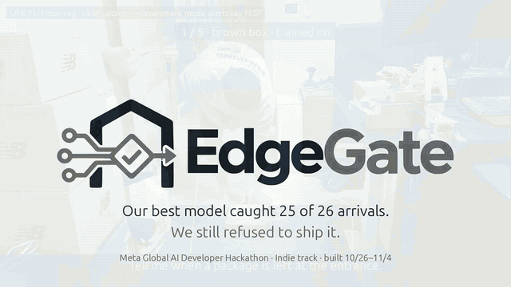
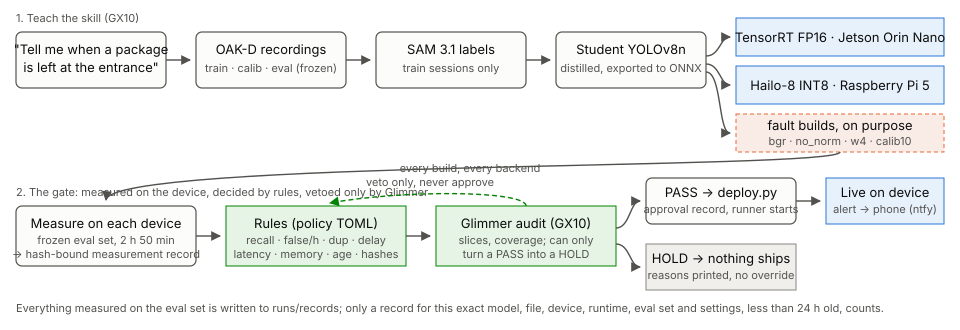
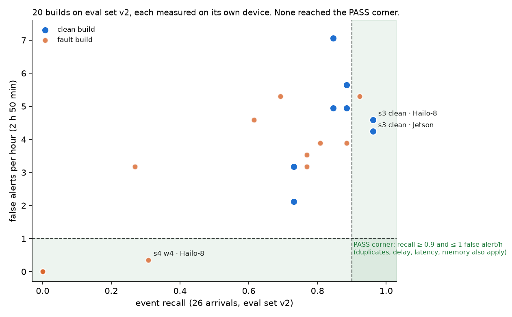
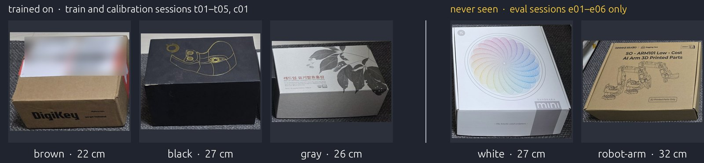

::: {.paper-project}

::: {.paper-hero}
<div class="paper-title">EdgeGate: A Deployment Gate for Edge Vision</div>

::: {.paper-venue}
Meta Global AI Developer Hackathon 2026 &middot; Indie developer track &middot; Push the Frontier &middot; 26 October &ndash; 4 November 2026
:::

<div class="paper-authors">
  <a class="paper-author" href="../../about.html">Chanseok Kang</a>
</div>

::: {.paper-affiliation}
Independent project
:::

<div class="paper-links">
  <a class="paper-button" href="https://github.com/goodboychan/edgeGate"><i class="fab fa-github"></i> Code and records (GitHub)</a>
  <a class="paper-button" href="https://www.youtube.com/watch?v=J4OQVwTwqV8"><i class="fab fa-youtube"></i> Video (3 min)</a>
  <a class="paper-button" href="https://huggingface.co/datasets/chans/edgegate-package-entrance-eval"><i class="fas fa-database"></i> Eval sessions (Hugging Face)</a>
  <a class="paper-button" href="https://cerebralvalley.ai/e/meta-ai-developer-hackathon/hackathon/gallery/1584"><i class="fas fa-trophy"></i> Hackathon gallery</a>
</div>
:::

## TL;DR

::: {.paper-tldr}
A model that runs in a demo is not yet a model that may be deployed. EdgeGate measures every build of a small vision model on the edge chip it will run on, and rules written before any evaluation decide whether it ships. Our best student caught **25 of 26** package arrivals on both a Jetson Orin Nano and a Hailo-8, but raised **4.24 false alerts an hour** on the Jetson (4.59 on the Hailo-8) against a limit of 1, so the gate held it. It also held all twelve builds we broke on purpose. Nothing shipped.
:::

::: {.paper-teaser}
::: {.paper-figure .paper-figure-main}
{.paper-image}

::: {.paper-media-caption}
The skill is "tell me when a package is left at the entrance". The runner here is in measurement mode, so every alert says TEST; no build was approved, so nothing was deployed. The verdicts on this page come from the frozen eval sessions, not from this live run.
:::
:::
:::

::: {.paper-metric-strip}
::: {.paper-metric}
<strong>25/26 &rarr; HOLD</strong>
<span>arrivals caught by the best student on both chips; held for 4.24 (Jetson) and 4.59 (Hailo-8) false alerts an hour against a limit of 1</span>
:::

::: {.paper-metric}
<strong>12/12</strong>
<span>builds broken on purpose (swapped color channels, missing normalization, 4-bit weights, 10 calibration images), all held</span>
:::

::: {.paper-metric}
<strong>20 &middot; 4 &middot; 0</strong>
<span>builds that always-deploy, a false-alert-only gate and the rules would ship from the same records</span>
:::
:::

## Overview

::: {.paper-summary-grid}
::: {.paper-summary-card}
### Problem

An edge vision model is retrained, quantized, recompiled and moved to new devices, and each step can change what it does. A demo shows that one build ran once. It does not show that **the file about to be deployed, on that device**, meets the requirement: here, an alert within 10 s when a package is left at the door, without crying wolf.
:::

::: {.paper-summary-card}
### Approach

Each build is measured on its own device over frozen eval recordings. The result is a record bound by hash to the model, the compiled file, the device, the runtime, the eval set and the event settings. **Rules written before any candidate was measured** decide PASS or HOLD; Muse Glimmer 30B audits the evidence and can only add a HOLD.
:::

::: {.paper-summary-card}
### Outcome

20 builds of four students were measured over 2 h 50 min of eval sessions: TensorRT on a Jetson Orin Nano Super and HEF on a Raspberry Pi 5 with a Hailo-8. None passed. The same records show what simpler policies would have shipped instead.
:::
:::

## From one sentence to a decision

::: {.paper-figure}
{.paper-image}

::: {.paper-media-caption}
SAM 3.1 labels the train sessions only; a YOLOv8n student is distilled from those labels and exported to ONNX, then compiled to TensorRT FP16 for the Jetson and to an INT8 HEF for the Hailo-8. Eval frames and their ground truth were never used for training or calibration.
:::
:::

## The gate: what a record must match

::: {.paper-pipeline}
::: {.pipeline-stage}
<span>Measured</span>
<strong>On the device</strong>
<p>Every build runs over the same frozen recordings on its own device. Inference, decoding and the arrival rule run and are timed there; the detections are scored into events by the same code for every build.</p>
:::

::: {.pipeline-arrow}
&rarr;
:::

::: {.pipeline-stage}
<span>Bound</span>
<strong>To one exact thing</strong>
<p>A record counts only for that model hash, compiled-file hash, target device and runtime, eval set hash and event settings, and only for 24 h. The eval set hash was written into the policy before any candidate was measured.</p>
:::

::: {.pipeline-arrow}
&rarr;
:::

::: {.pipeline-stage}
<span>Decided</span>
<strong>By rules, then audited</strong>
<p>Event recall &ge; 0.9, &le; 1 false alert an hour, 0 duplicate alerts, detection delay p95 &le; 5 s, latency p95 &le; 100 ms (Hailo-8: 50 ms), peak memory &le; 2 GB. Glimmer can veto a PASS; it can never lift a HOLD.</p>
:::
:::

## Results

::: {.paper-result-grid}
::: {.paper-result-card .paper-result-wide}
### Every build, measured on its device

{.paper-image}

Eval set v2: sessions e01&ndash;e06 and u01, 2 h 50 min, 26 scored arrivals, covering night with one floor lamp, night with the room lights on, a rainy day and 2 h unattended with no package. The thresholds were not changed at any point.
:::

::: {.paper-result-card .paper-result-wide}
### The four students

| Student | Trained on | Backend | Recall | False/h | Dup | Latency p95 | Held for |
|---|---|---|---:|---:|---:|---:|---|
| s1 (YOLOv8n) | t01&ndash;t03 | Jetson (TensorRT) | 0.885 | 5.65 | 1 | 19.4 ms | recall, false alerts, duplicates |
| | | Hailo-8 | 0.846 | 7.06 | 1 | 16.1 ms | recall, false alerts, duplicates |
| s2 (YOLOv8n) | t01&ndash;t03, relabeled | Jetson (TensorRT) | 0.731 | 3.18 | 0 | 19.4 ms | recall, false alerts |
| | | Hailo-8 | 0.731 | 2.12 | 0 | 15.4 ms | recall, false alerts |
| **s3 (YOLOv8n)** | t01&ndash;t05 | Jetson (TensorRT) | **0.962** | 4.24 | 0 | 19.5 ms | false alerts |
| | | Hailo-8 | **0.962** | 4.59 | 1 | 15.9 ms | false alerts, duplicates |
| s4 (YOLOv8s) | t01&ndash;t05 | Jetson (TensorRT) | 0.846 | 4.95 | 0 | 22.9 ms | recall, false alerts |
| | | Hailo-8 | 0.885 | 4.95 | 0 | 21.5 ms | recall, false alerts |

s3 is the one improvement round: after s1 missed arrivals in the dark, two more training nights were recorded and s3 and s4 were trained once on t01&ndash;t05. On the Jetson, recall rose from 0.885 to 0.962 and the duplicate alert went away; the false alerts did not. The ONNX reference on the GX10 gives the same recall and false-alert count as the TensorRT build.
:::

::: {.paper-result-card}
### Why the best model was held

| Cause of s3's 12 false alerts | Alerts |
|---|---:|
| The rule: a box in a hand inside the zone | 6 |
| The rule: a box set down across the zone line | 3 |
| Detection in the dark, or a phantom box | 3 |

Each alert was watched frame by frame. All 12 fall in the 50 attended minutes (about 14 an hour while people and boxes move) and none in the 2 unattended hours. Nine come from the event rule meeting hands and edges, so the next fix is the rule, as a new policy version measured on a new session.
:::

::: {.paper-result-card}
### Four ways to decide, same records

| Policy | Ships | What that means |
|---|---:|---|
| Always deploy | 20 | 17 miss more than 10% of arrivals; 16 raise more than one false alert an hour |
| False alerts only | 4 | the three builds that never alert, and `s4 w4` at 8 of 26 arrivals |
| Rules | 0 | every build held, with the reasons printed |
| Rules + Glimmer | 0 | 4 builds audited, 0 vetoed: the rules had already held them |

"Always deploy" is a what-if computed from the records, never a deployment.
:::

::: {.paper-result-card .paper-result-wide}
### Builds broken on purpose: all held

| Student | Fault | Backend | Recall | False/h | Dup | Delay p95 | Held for |
|---|---|---|---:|---:|---:|---:|---|
| s3 | bgr | Jetson | 0.769 | 3.53 | 1 | 3.2 s | recall, false alerts, duplicates |
| s3 | bgr | Hailo-8 | 0.808 | 3.89 | 1 | 3.4 s | recall, false alerts, duplicates |
| s3 | no_norm | Jetson | 0 | 0 | 0 | &ndash; | recall, delay (no alert at all) |
| s3 | no_norm | Hailo-8 | 0 | 0 | 0 | &ndash; | recall, delay (no alert at all) |
| s3 | w4 | Hailo-8 | 0.615 | 4.59 | 4 | 6.8 s | recall, false alerts, duplicates, delay |
| s3 | calib10 | Hailo-8 | 0.923 | 5.30 | 1 | 3.1 s | false alerts, duplicates |
| s4 | bgr | Jetson | 0.692 | 5.30 | 1 | 3.3 s | recall, false alerts, duplicates |
| s4 | bgr | Hailo-8 | 0.769 | 3.18 | 2 | 3.3 s | recall, false alerts, duplicates |
| s4 | no_norm | Jetson | 0 | 0 | 0 | &ndash; | recall, delay (no alert at all) |
| s4 | no_norm | Hailo-8 | 0.269 | 3.18 | 0 | 2.5 s | recall, false alerts |
| **s4** | **w4** | Hailo-8 | 0.308 | **0.353** | 0 | 3.4 s | **recall** |
| s4 | calib10 | Hailo-8 | 0.885 | 3.89 | 2 | 3.1 s | recall, false alerts, duplicates |

`bgr` swaps the color channels before the compiler, `no_norm` leaves out input normalization, `w4` uses 4-bit weights on the Hailo-8 and `calib10` calibrates on 10 images instead of 64. `s4 w4` has the lowest false-alert rate of any build that alerts at all because it misses 69% of the arrivals: a gate that watched false alerts alone would ship it.
:::

::: {.paper-result-card}
### Alert delivery, on one clock

From the deciding frame to the push server: **1.2 s**, measured on the live path before any candidate and written into the policy. To the phone's camera-flash notification: **1.7&ndash;2.4 s**, 4 of 4 alerts on the 3 November live session. The 10 s requirement in the records is verified to the push server only.
:::

::: {.paper-result-card}
### A swapped file does not run

No real build passed, so the PASS path was run under a labeled test policy whose only change raises the false-alert limit to 5. The real policy held s3's fresh Jetson record, the test policy passed it, `deploy.py` wrote the approval and started the runner, and a replayed arrival was alerted. A different model file against the same approval was refused: `not starting: this model file is not the approved one`.
:::
:::

## Trained on, never seen

::: {.paper-figure}
{.paper-image}

::: {.paper-media-caption}
Left: the boxes in train and calibration sessions t01&ndash;t05 and c01. Right: boxes that appear only in eval sessions e01&ndash;e06. Widths as labeled.
:::
:::

## Video

```{=html}
<div style="position:relative;width:100%;aspect-ratio:16/9;margin:0.5rem 0 1.5rem">
  <iframe src="https://www.youtube-nocookie.com/embed/J4OQVwTwqV8" title="EdgeGate video (3 min)" style="position:absolute;inset:0;width:100%;height:100%;border:0;border-radius:6px" loading="lazy" allow="accelerometer; encrypted-media; gyroscope; picture-in-picture" allowfullscreen></iframe>
</div>
```

## How the Meta models are used

::: {.paper-method}
::: {.paper-method-steps}
1. **SAM 3.1** labels the train sessions on the GX10. The YOLOv8n and YOLOv8s students are distilled from those labels. Eval ground truth is marked by hand, and SAM never sees eval frames.
2. **Muse Glimmer 30B**, open weights served locally on the GX10, audits a candidate through MCP tools: rule verdicts, eval coverage and recall per slice (lighting, size, tag, session). It can propose a HOLD only for a backend the rules passed, and only by citing evidence from its own audit.
3. **Muse Spark 1.3** and **Muse Voice Transcribe** turn one typed or spoken sentence into a task spec. The spec is checked against the hand-written policy and is never written into it.
:::

::: {.paper-figure}
### What each one actually contributed

| Model | Contribution |
|---|---|
| SAM 3.1 | the training labels |
| Rules on measurements | every verdict |
| Glimmer 30B | 4 real builds audited, 0 vetoed (all already held); 30/30 expected verdicts on 5 synthetic cases &times; 3 runs &times; 2 devices |
| Spark and Voice | a spec matching the policy, written after the candidates were measured |
:::
:::

## Takeaways and limits

::: {.paper-summary-grid}
::: {.paper-summary-card}
### Takeaways

- High recall is not a deployment decision. The best model was held for false alerts, while a single-metric gate would ship a build that catches 8 of 26 arrivals.
- Bind the evidence to the exact file: model, compiled file, device, runtime, eval set and settings, with an expiry.
- Most false alerts came from the event rule meeting hands and edges, not from the detector.
:::

::: {.paper-summary-card}
### Limits

- One home, one camera, one zone, 26 arrivals: the 95% one-sided lower bound on s3's recall is 0.83. The policy does not yet check sample size.
- No real build passed; the PASS path is shown under a labeled test policy.
- Glimmer's veto was never needed on a real build, and its value over a simple per-slice rule is not shown. The approval is an unsigned local file, checked when the runner starts.
:::

::: {.paper-summary-card}
### Provenance

Built from scratch between 26 October and 4 November 2026. Every measurement record, audit and verdict is committed to the repository and replays without hardware; CI re-derives the comparison table on every push. The eval sessions are public on Hugging Face with people blurred (CC BY-NC 4.0). Code under AGPL-3.0.
:::
:::

## Citation

::: {.paper-citation}
```bibtex
@software{kang2026edgegate,
  title  = {EdgeGate: A Deployment Gate for Edge Vision},
  author = {Kang, Chanseok},
  year   = {2026},
  url    = {https://github.com/goodboychan/edgeGate},
  note   = {Meta Global AI Developer Hackathon 2026, Indie developer track}
}
```
:::

:::
