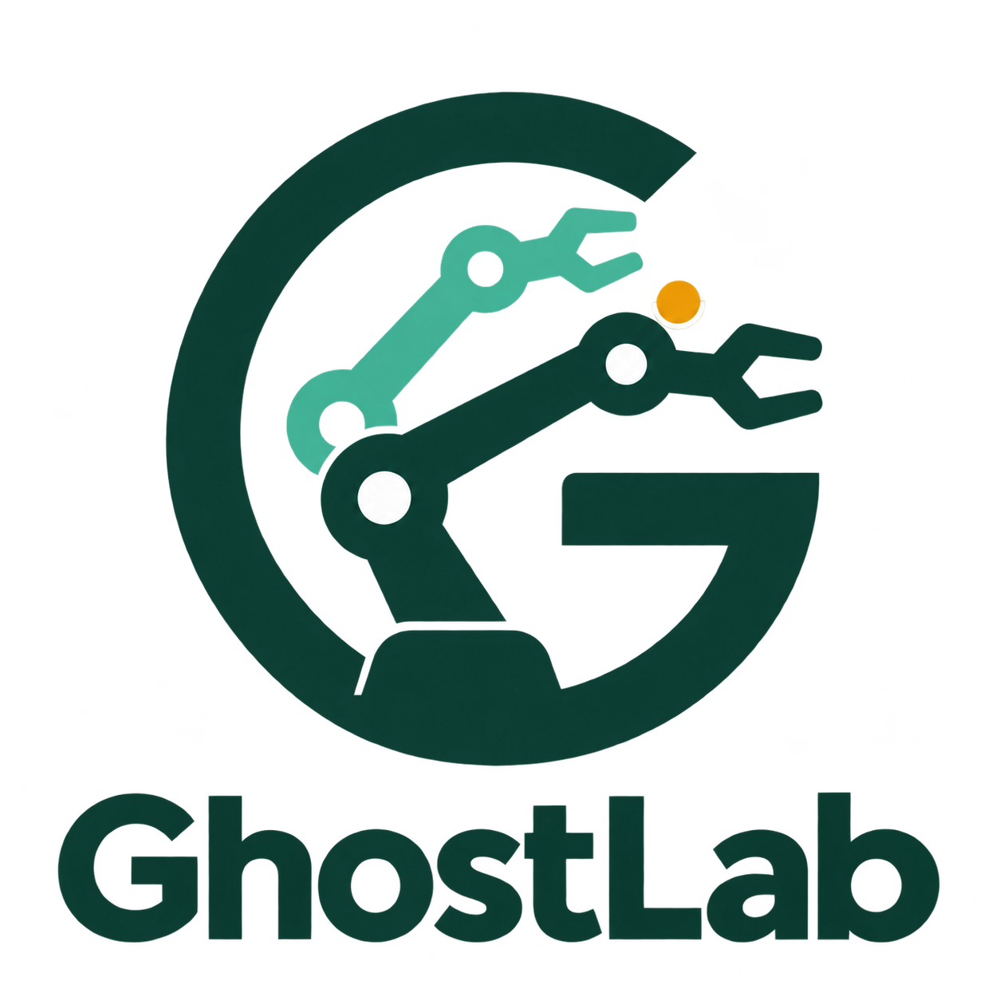
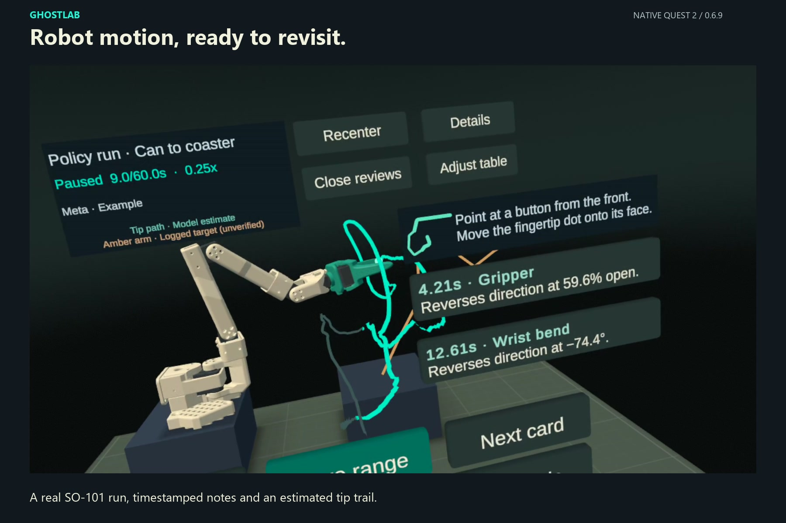
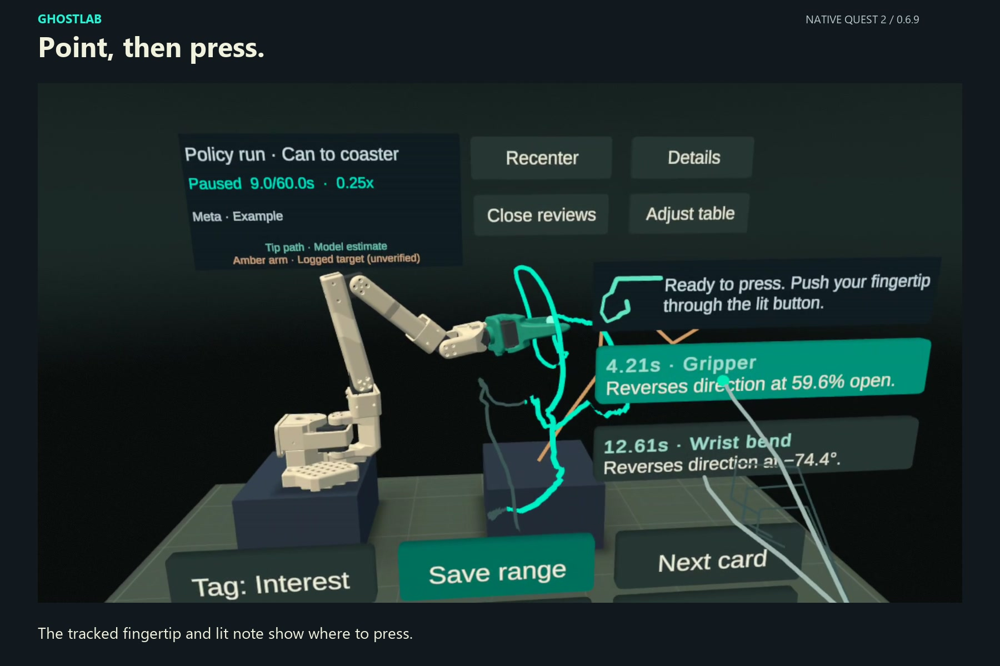
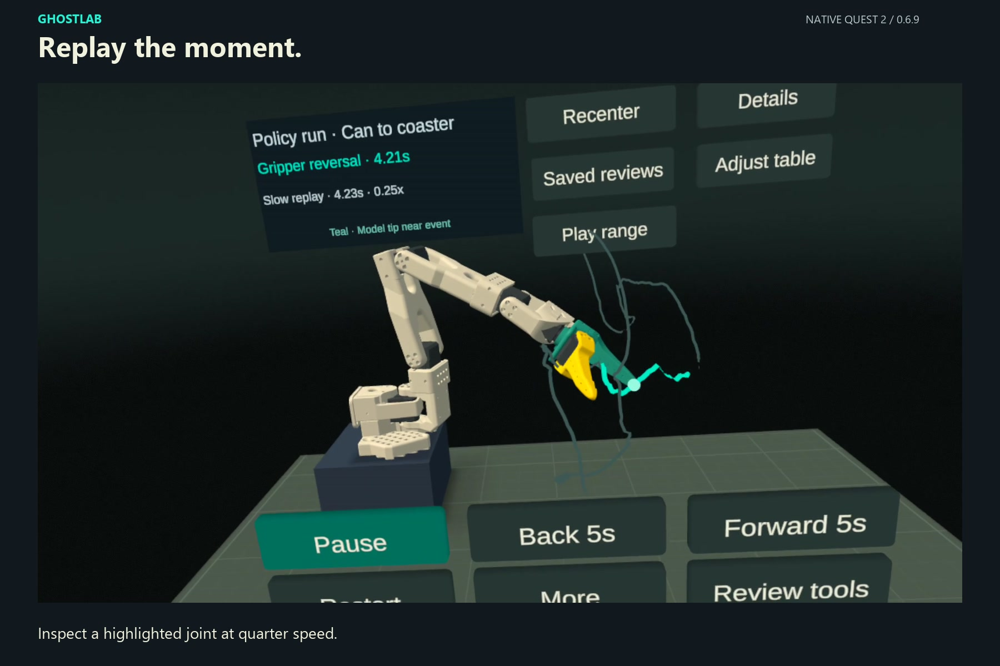
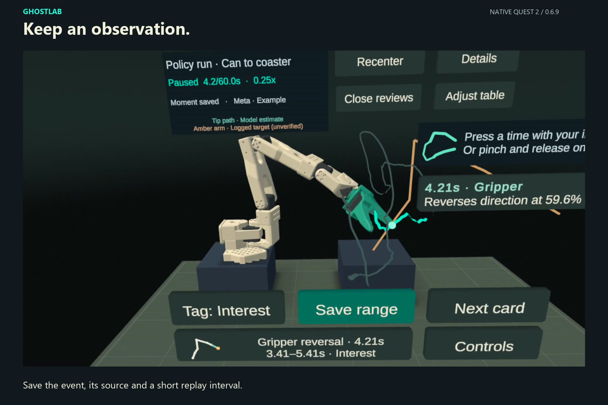
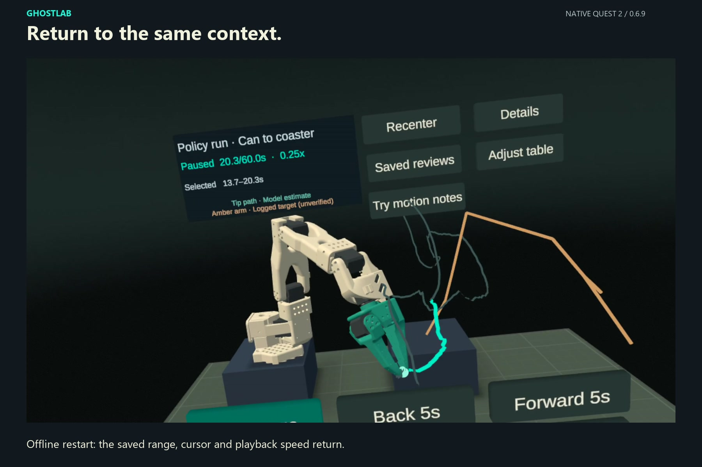
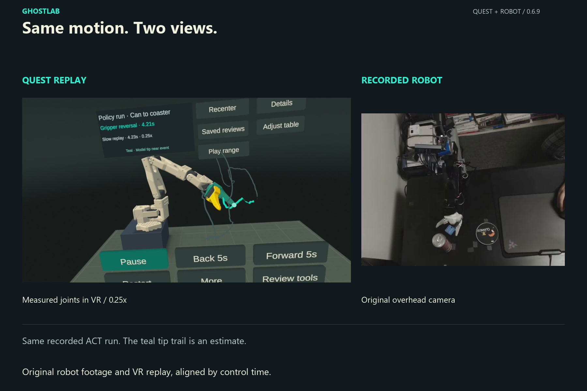
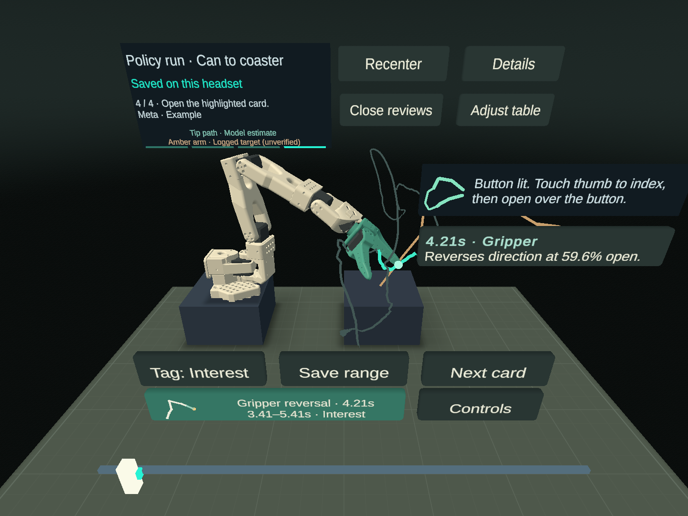

::: {.paper-project .ghostlab-project}

::: {.paper-hero}


<h1 class="paper-title">GhostLab: 손으로 살펴보는 <br>로봇의 동작</h1>

::: {.paper-venue}
Meta VR Start Developer Competition 2026 &middot; Productivity 트랙 &middot; New Experience 부문
:::

<div class="paper-authors">
  <a class="paper-author" href="https://kcsgoodboy.github.io/ko/about.html">Chanseok Kang</a>
</div>

::: {.paper-affiliation}
SO-101 로보틱스 &middot; Meta Quest &middot; 공간에서 살펴보는 동작 기록
:::

<div class="paper-links">
  <a class="paper-button ghostlab-primary" href="https://www.meta.com/s/caSHme36e">Quest에서 체험하기</a>
  <a class="paper-button" href="https://youtu.be/N_KHN0hDETw">데모 영상</a>
  <a class="paper-button" href="https://devpost.com/software/ghostlab-ximb0c">Devpost</a>
  <a class="paper-button" href="https://github.com/goodboychan/GhostLab">코드와 검증 기록</a>
  <a class="paper-button" href="https://huggingface.co/datasets/chans/quantgate-so101-coaster">시연 데이터셋</a>
</div>
:::

## 요약 {#tldr}

::: {.paper-tldr}
**순간을 찾고, 다시 재생하고, 검토 결과를 남깁니다.** GhostLab은 로봇의 실행 기록을 손이 닿는 거리에서 살펴볼 수 있는 가상 작업대로 옮깁니다. 시각이 표시된 노트를 누르고, 해당 관절을 0.25배속으로 재생한 뒤, 관찰한 순간을 저장해 오프라인에서 다시 열 수 있습니다. 앱에 포함된 체험은 로봇이나 워크스테이션, API 키 없이 Quest만으로 동작합니다.
:::

::: {.paper-teaser}
::: {.paper-figure .paper-figure-main}
{.paper-image fig-alt="SO-101 모델, 추정된 팔 끝 궤적, 시각이 표시된 동작 노트가 놓인 GhostLab 작업대."}

::: {.paper-media-caption}
Quest 2에서 직접 녹화한 GhostLab 0.6.9 화면입니다. SO-101 모델은 측정된 관절값을 따라 움직이고, 청록색 궤적은 그리퍼 끝 위치의 추정치를 보여줍니다. 각 노트는 관찰 내용을 원본 기록의 해당 시각과 연결합니다.
:::
:::
:::

::: {.paper-metric-strip}
::: {.paper-metric}
<strong>60초의 실행 기록</strong>
<span>실제 SO-101 정책 실행에서 얻은 1,797개 샘플을 앱에 포함했습니다</span>
:::

::: {.paper-metric}
<strong>0.25배속 재생</strong>
<span>선택한 이벤트 주변의 짧은 구간을 재생하며 해당 관절을 강조합니다</span>
:::

::: {.paper-metric}
<strong>오프라인 검토</strong>
<span>원본 기록, 선택 구간, 재생 위치와 속도를 헤드셋에서 다시 엽니다</span>
:::
:::

## 개요 {#overview}

::: {.paper-summary-grid}
::: {.paper-summary-card}
### 문제

로봇이 실행을 마친 뒤 무슨 일이 있었는지 이해하려면 카메라 영상과 관절 그래프를 번갈아 봐야 합니다. 동작은 공간에서 일어나는데, 검토는 서로 떨어진 2차원 화면에서 하게 됩니다.
:::

::: {.paper-summary-card}
### 접근

기록된 로봇 팔을 앉아서 사용할 수 있는 Quest 작업대로 가져옵니다. 손 추적으로 재생 시점을 옮기고, 측정된 이벤트를 살펴보고, 관심 있는 구간을 남깁니다.
:::

::: {.paper-summary-card}
### 결과

노트 선택부터 재생, 저장, 다시 열기까지 이어지는 검토 흐름을 구현했습니다. 0.6.10에서는 4단계 안내와 시각적 피드백을 추가하고 Quest 2에서 확인했습니다.
:::
:::

## 로봇에게 동작을 가르친 뒤, 그 결과를 살펴보기까지 {#from-teaching-a-robot-to-reviewing-its-motion}

SO-101을 원격 조작하다가 이 아이디어를 떠올렸습니다. 책상 위 실험 환경에서 캔을 코스터에 올려놓는 작업을 **120회 시연**해 Hugging Face에 공개했고, 그중 **80개로 ACT(Action Chunking with Transformers) 정책을 학습**했습니다. 학습한 정책이 스스로 동작하기 시작하자, 그 결과를 가상환경에서 살펴보고 손으로 재생 시점을 옮길 수 있으면 좋겠다고 생각했습니다.

GhostLab은 `rollout_main012_1008_004335` 기록을 열며 시작합니다. 로봇 팔이 콜라 캔을 집어 코스터 위에 세워 놓는 **학습된 정책의 실행 기록**입니다. 공개된 시연 데이터는 이 정책의 학습 데이터가 나온 곳이고, 앱에 포함된 기록은 그 정책이 실제로 수행한 결과입니다. 이 둘을 구분해 보여주는 것도 검토의 일부입니다.

::: {.paper-pipeline}
::: {.pipeline-stage}
<span>동작 기록</span>
<strong>원본을 유지합니다</strong>
<p>측정된 관절값, 원본 시각, 기록에 포함된 목표값을 함께 불러옵니다. 데이터가 빠진 구간은 빈 구간으로 남깁니다.</p>
:::

::: {.pipeline-arrow}
&rarr;
:::

::: {.pipeline-stage}
<span>공간에서 살펴보기</span>
<strong>관심 있는 순간을 찾습니다</strong>
<p>시각이 표시된 노트를 선택하거나 타임라인을 움직입니다. 해당 관절을 느리게 재생하고 팔 끝의 추정 궤적을 살펴봅니다.</p>
:::

::: {.pipeline-arrow}
&rarr;
:::

::: {.pipeline-stage}
<span>검토 결과 저장</span>
<strong>같은 맥락으로 돌아옵니다</strong>
<p>이벤트, 원본, 구간과 태그를 함께 저장합니다. 앱을 다시 실행한 뒤에도, 오프라인에서도 같은 관찰을 다시 열 수 있습니다.</p>
:::
:::

## 체험 영상 {#watch-the-experience}

::: {.paper-figure}
```{=html}
<div class="ghostlab-video">
  <iframe src="https://www.youtube-nocookie.com/embed/N_KHN0hDETw" title="GhostLab — 내레이션이 포함된 2분 53초 데모" loading="lazy" referrerpolicy="strict-origin-when-cross-origin" allow="accelerometer; autoplay; clipboard-write; encrypted-media; gyroscope; picture-in-picture; web-share" allowfullscreen></iframe>
</div>
```

::: {.paper-media-caption}
**2분 53초 데모**에는 직접 녹음한 내레이션, 영어 자막과 실제 Quest 2 녹화 화면이 담겨 있습니다. 씬 3은 0.6.8, 씬 4–9는 0.6.9로 촬영했습니다. 두 버전의 차이는 영상에 나오지 않는 부분이라 화면 내용은 같습니다. 0.6.10에서도 같은 검토 흐름을 그대로 쓸 수 있고, 아래에서 소개하는 안내가 더해졌습니다. [YouTube에서 보기](https://youtu.be/N_KHN0hDETw).
:::
:::

## 손으로 재생 시점을 옮기기 {#use-your-hands-to-move-through-time}

::: {.paper-media-grid}
::: {.paper-media-card}
### 노트 선택

{.paper-image loading="lazy" fig-alt="그리퍼 노트에 접근하는 손끝과 누를 준비가 되었음을 알려주는 표시."}

::: {.paper-media-caption}
검지로 시각 카드를 누르거나, 카드 위에서 엄지와 검지를 모았다 펴서 선택합니다. 손끝과 선택 대상이 함께 빛납니다. 컨트롤러는 필요 없습니다.
:::
:::

::: {.paper-media-card}
### 관절 재생

{.paper-image loading="lazy" fig-alt="0.25배속으로 재생하는 동안 강조되는 그리퍼."}

::: {.paper-media-caption}
**4.21s** 예시는 그리퍼의 개폐 방향이 바뀌는 순간을 선택합니다. **Replay moment**를 누르면 주변의 짧은 구간을 0.25배속으로 재생하고, 해당 순간에 관절을 더 밝게 표시한 뒤 **5.41s**에서 멈춥니다.
:::
:::

::: {.paper-media-card}
### 관찰 저장

{.paper-image loading="lazy" fig-alt="재생 구간과 태그를 포함해 저장된 Gripper reversal 카드."}

::: {.paper-media-caption}
재생이 끝까지 진행되면 같은 앞쪽 버튼이 **Save this moment**로 바뀝니다. 버튼을 한 번 더 눌러 관찰을 저장합니다. 이름이 붙은 카드를 다시 열면 원래 이벤트로 돌아옵니다.
:::
:::

::: {.paper-media-card}
### 오프라인에서 다시 열기

{.paper-image loading="lazy" fig-alt="저장한 구간과 재생 위치, 0.25배속 설정이 복원된 화면."}

::: {.paper-media-caption}
직접 구간을 고르려면 흰 타임라인 마커를 집어 움직이고, 시작과 끝을 지정한 뒤 태그와 함께 저장합니다. 오프라인 시험에서는 **13.7–20.3초** 구간, **20.3초** 재생 위치와 **0.25배속**이 복원됐습니다.
:::
:::
:::

## 측정 근거와 연결되는 동작 노트 {#motion-notes-connected-to-evidence}

GhostLab은 모델에 설명을 요청하기 전에 측정된 관절 데이터의 연속 구간을 분석합니다. 방향 반전으로 판단하려면 이벤트 앞뒤 양쪽의 변화가 각각 **8° 이상**, 그리퍼 개방률의 경우 각각 **8%p 이상**이어야 합니다. 선택 구간의 끝에서 가장 큰 변화가 나타나더라도 구간 내부의 반전을 찾을 수 있습니다. 데이터가 빠진 지점에서는 분석 구간을 나눕니다.

실험실 게이트웨이가 페어링되어 있으면 **Meta Muse Ember**가 최대 네 개의 측정 사실을 받아, 그 근거에 맞는 영어 설명 한두 문장을 반환합니다. 응답의 이벤트 ID, 관절, 수치와 표현이 근거에 맞는지 검사합니다. 노트를 선택하면 그 설명의 근거가 된 원본 기록으로 돌아갑니다.

::: {.paper-figure .ghostlab-table}
| 앱의 표시 | 의미 | 사용 조건 |
| --- | --- | --- |
| **Meta · Example** | 예시 기록과 함께 제공되는, 실제 Meta 응답으로 만든 노트 두 개 | 처음 설치한 헤드셋에서도 오프라인으로 사용 |
| **On-device analysis** | 선택 구간에서 기기 자체가 찾아낸 새 관찰 | 새로운 구간도 오프라인으로 분석 |
| **Meta · Saved** | 사용자의 검토 카드와 함께 저장된 Meta 응답 | 생성할 때는 페어링된 게이트웨이가 필요하며, 저장 후에는 오프라인으로 다시 열기 가능 |
:::

Meta로 새 설명을 실시간 생성하는 기능은 선택적으로 쓰는 실험실 기능입니다. 모델 API 키는 GX10(NVIDIA GB10 기반 ASUS Ascent GX10 워크스테이션)에 두고, 헤드셋에는 별도의 페어링 토큰을 저장합니다. 공개 생성 서버는 따로 배포를 준비해 두었지만, Quest만으로 시작하는 기본 체험에는 들어 있지 않습니다.

## 실제 동작과 가상환경에서의 재구성 {#the-physical-motion-and-its-virtual-reconstruction}

::: {.paper-figure .paper-figure-main}
{.paper-image loading="lazy" fig-alt="실제 SO-101의 카메라 영상과 같은 정책 실행을 Quest에서 재생한 화면을 나란히 배치한 비교 장면."}

::: {.paper-media-caption}
데모 영상의 비교 장면으로, 로봇 카메라 기록과 Quest 재생 화면을 제어 시각에 맞춰 편집했습니다. 앱 안에서 카메라 영상을 동기화해 재생하는 기능은 아닙니다. 가상 모델은 측정된 관절값으로 움직이고, 청록색 팔 끝 궤적은 순기구학으로 계산한 추정치입니다.
:::
:::

실험실 환경과 페어링한 헤드셋에서는 **Live monitor**도 열 수 있습니다. 패스스루로 실제 책상이 보이고, 실물 Follower(원격 조작 때 leader arm이 움직이는 SO-101 follower arm) 옆에 측정된 SO-101 자세가 표시됩니다. 선택 기능인 **OpenMV 손목 카메라 영상**과 **Record 20s** 기록 기능도 사용할 수 있습니다. 이 기능들은 페어링된 GX10과 로봇 구성이 있어야 동작합니다. GhostLab은 읽기 전용으로 연결되므로 팔에 제어 명령을 보내지 않습니다.

## 0.6.10에서 더 분명해진 첫 검토 흐름 {#a-clearer-first-review-in-0.6.10}

::: {.paper-method}
::: {.paper-method-steps}
1. **선택.** 네 개의 가는 진행 표시와 짧은 안내가 다음 동작을 알려줍니다. 예시의 첫 노트가 강조됩니다.
2. **재생.** 주변 버튼의 대비를 낮춰 선택한 관절과 앞쪽 재생 버튼이 잘 보이게 합니다.
3. **저장.** **Saved on this headset**이 저장 성공을 알리고, 저장된 카드가 잠시 청록색으로 밝아졌다 어두워집니다.
4. **다시 열기.** 해당 카드를 열면 안내가 완료됩니다. 완료 상태는 앱을 다시 실행해도 유지되므로, 다시 찾은 사용자는 도입 안내를 반복하지 않고 평소 조작을 그대로 씁니다.

각 단계에서 필요한 설명 출처와 재생 종료 시각은 계속 표시됩니다.
:::

::: {.paper-figure}
{.paper-image loading="lazy" fig-alt="0.6.10의 저장 완료 화면. 헤드셋 저장 문구, 네 단계 진행 표시와 강조된 검토 카드가 보인다."}

::: {.paper-media-caption}
0.6.10 인터페이스의 에디터 렌더 이미지입니다. Quest 2에서 안내, 시각적 강조와 카드 다시 열기를 제가 직접 따로 확인했습니다.
:::
:::
:::

## 검증 결과와 현재 한계 {#validation-and-current-limits}

::: {.paper-figure .ghostlab-table}
| 항목 | 확인한 내용 |
| --- | --- |
| 자동화 검증 | 2026년 11월 16일 **EditMode 111개 + PlayMode 40개 테스트 통과** |
| Quest 2 사용 | 제가 직접 새 안내에 따라 노트 선택, 재생, 저장과 다시 열기를 완료 |
| 업데이트와 재실행 | **기존 저장 파일 18개**가 모두 보존됐고, 재실행 후에도 안내 완료 상태와 선택한 검토 유지 |
| 짧은 성능 측정 | **27.329초 동안 27개 보고값**이 모두 72 Hz에서 72 FPS를 기록. stale frame은 총 3개, 앱 GPU 시간의 95백분위수는 **6.78 ms** |
| 배포 | 릴리스 키로 서명한 **0.6.10 (27)**을 2026년 11월 16일 Competition 채널에 업로드 |
:::

성능 수치는 짧게 직접 써 보며 확인한 결과이고, 5분 연속 사용 검증은 아닙니다. Quest 3/3S에서 새 사용자가 혼자 처음 써 보는 시험과, 다른 Meta 계정으로 설치하는 시험은 아직 하지 못했습니다. [버전별 검증 기록](https://github.com/goodboychan/GhostLab/blob/main/docs/REVIEW_POLISH_0.6.10.md).

::: {.paper-summary-grid}
::: {.paper-summary-card}
### 관절 측정값과 팔 끝 추정치

팔 끝 궤적은 실측한 3차원 좌표가 아니라 순기구학으로 계산합니다. 실물 팔의 별도 검증 자세에서 오차가 최대 **18 cm**였습니다. 화면에는 궤적을 추정치로, 주황색의 기록된 목표값을 미검증 데이터로 표시합니다.
:::

::: {.paper-summary-card}
### 관찰과 제어

앱은 기록된 동작을 검토하고 실시간 측정값을 읽습니다. 기록의 재생 시점을 바꿔도 실물 Follower는 움직이지 않습니다. 실물 연결과 손목 영상은 페어링 후 사용하는 선택 기능입니다.
:::

::: {.paper-summary-card}
### 검증 범위

자동화 검증과 제가 직접 진행한 Quest 2 시험으로 현재 사용 흐름을 확인했습니다. 일반적인 사용성 성공률, 정밀한 팔 끝 정합이나 모든 헤드셋에서의 성능까지 입증한 것은 아닙니다.
:::
:::

## Quest에서 체험하기 {#try-it-on-quest}

Meta 계정으로 [Competition 릴리스 채널](https://www.meta.com/s/caSHme36e)에 참여해 GhostLab을 설치합니다. 손 추적을 켜고 책상이나 테이블 앞에 편하게 앉아 주세요.

1. 작업대가 앞에 오도록 바라봅니다. 필요하면 **Recenter**를 누릅니다.
2. 처음 실행하면 예시 노트가 열립니다. 이후에는 **Try motion notes**를 선택합니다.
3. **4.21s · Gripper**와 **Replay moment**를 차례로 누릅니다. 재생 중에는 손을 내려놓습니다.
4. **5.41s**에서 멈추면 **Save this moment**를 누릅니다.
5. 강조된 카드를 열어 해당 순간을 다시 확인합니다. 이후에는 **Review tools**에서 직접 구간을 고를 수 있습니다.

## 사용 기술 {#built-with}

::: {.paper-figure .ghostlab-table}
| 구성 | 기술과 역할 |
| --- | --- |
| Quest 독립 실행형 앱 | Unity 6, C#, OpenXR, Unity XR Hands, URP |
| 손 상호작용 | 검지로 누르기, 핀치로 선택하기, 타임라인 끌기를 처리하는 자체 로직 |
| 동작과 데이터 | SO-101 기록, ACT 정책 실행, Python 가져오기 도구, LeRobot 형식의 공개 시연 데이터셋 |
| 동작 설명 | Meta Model API, Muse Ember, 근거 검증과 기기 내 오프라인 분석 |
| 선택적인 실물 연결 | GX10, 읽기 전용 Follower 측정값, Meta 패스스루와 OpenMV 손목 영상 |
:::

## 다음 단계 {#next-steps}

다음으로는 처음 써 보는 사용자와 첫 검토 흐름을 시험하고, 패스스루로 기록 검토를 실제 책상 위로 옮기려 합니다. 이후에는 현재 검토 도구를 확장해, 시연 에피소드와 정책 실행을 나란히 살펴보는 기능과 사람이 확인한 관찰을 학습 실험의 피드백으로 내보내는 기능을 만들 계획입니다. 학습 실험은 시뮬레이션부터 시작합니다.

## 코드, 데이터와 출처 {#code-data-and-provenance}

- [GhostLab 소스와 개발·검증 기록](https://github.com/goodboychan/GhostLab). 2026년 11월 18일 기준으로 저장소 접근이 제한되어 있고, 공개 전환을 준비하고 있습니다.
- [Hugging Face의 SO-101 시연 120개](https://huggingface.co/datasets/chans/quantgate-so101-coaster)는 CC BY 4.0으로 공개했습니다. 앱에 포함된 예시는 이 시연 에피소드와 별개인 정책 실행 기록입니다.
- [관련 QuantGate 프로젝트](https://github.com/goodboychan/nebius-physical-ai)에서 실물 실험 환경과 정책 실행의 배경을 확인할 수 있습니다.
- [Devpost 프로젝트](https://devpost.com/software/ghostlab-ximb0c)와 [내레이션이 포함된 데모](https://youtu.be/N_KHN0hDETw).

로고는 제가 제공했고 Quest 영상도 직접 촬영했습니다. 영상과 갤러리 스크린샷에는 0.6.8과 0.6.9 화면이 섞여 있지만, 보이는 내용은 같습니다. 새 안내 화면은 0.6.10의 에디터 렌더 이미지입니다. 페이지 구성은 [paired-task audits 프로젝트 페이지](https://kcsgoodboy.github.io/projects/paired-task-audits-on-device/)를 따릅니다.

::: {.paper-media-caption}
프로젝트 상태는 2026년 11월 18일 저장소 기록을 기준으로 확인했습니다.
:::

:::
