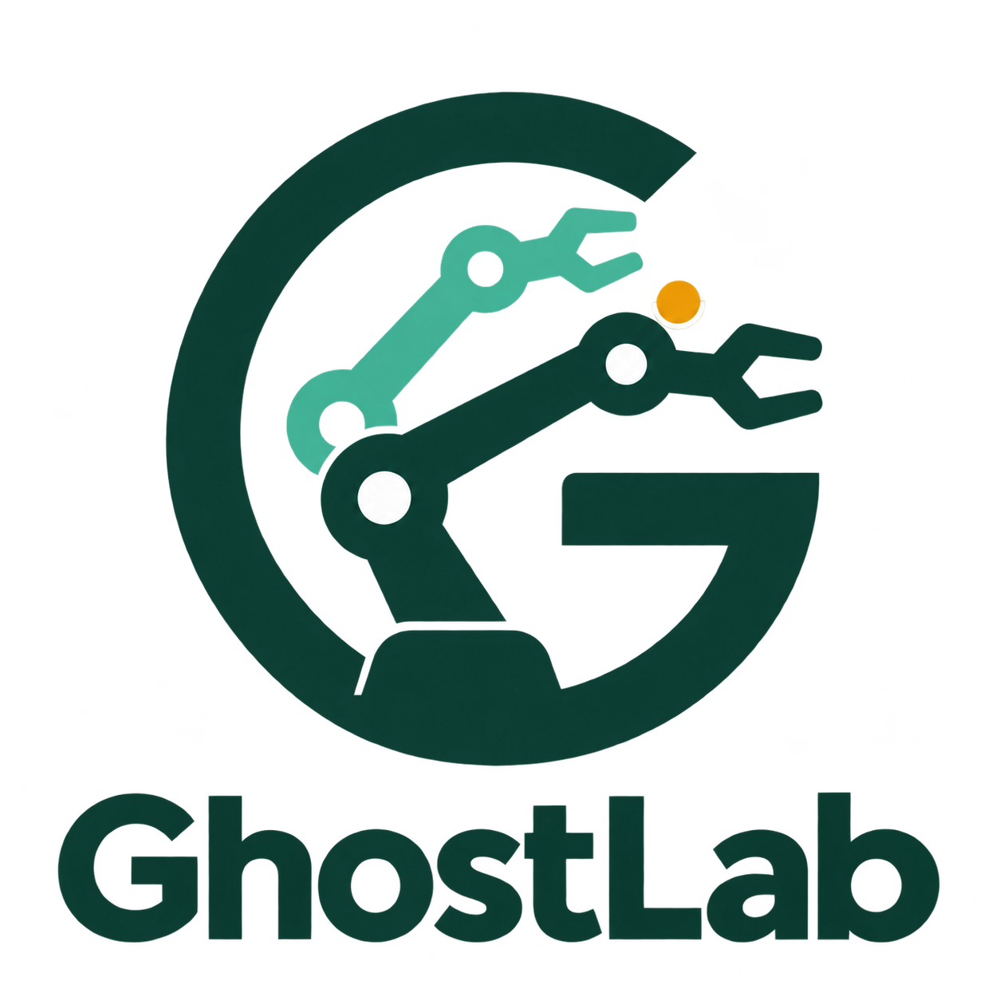
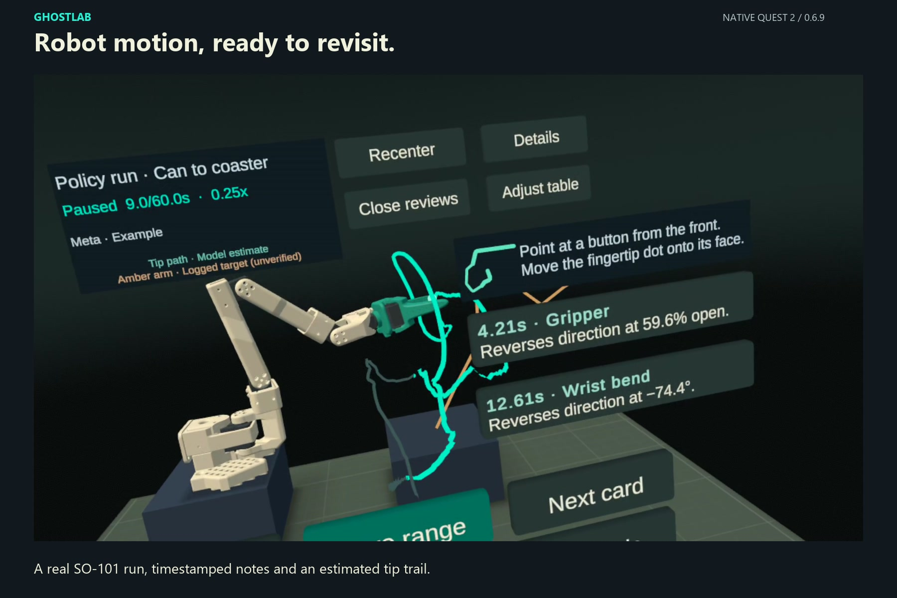
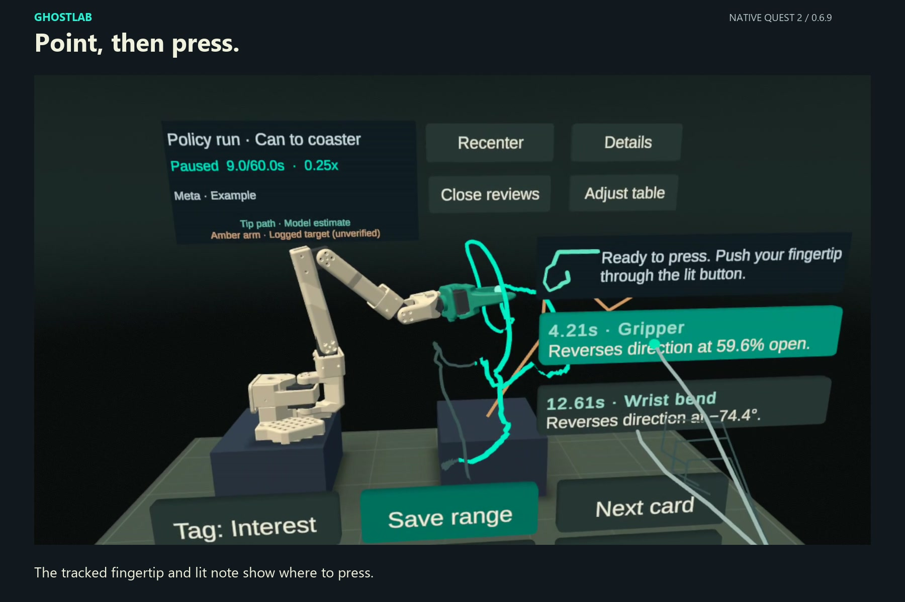
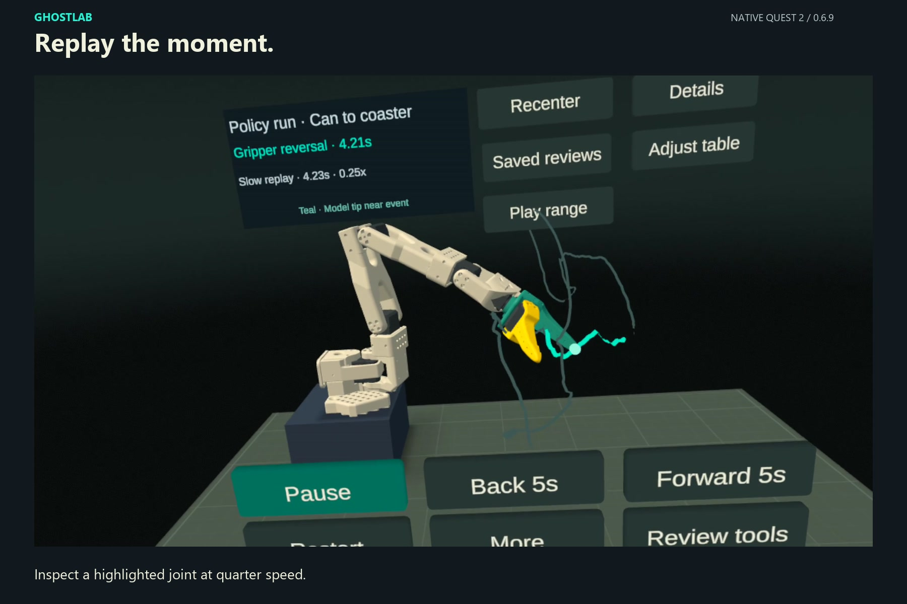
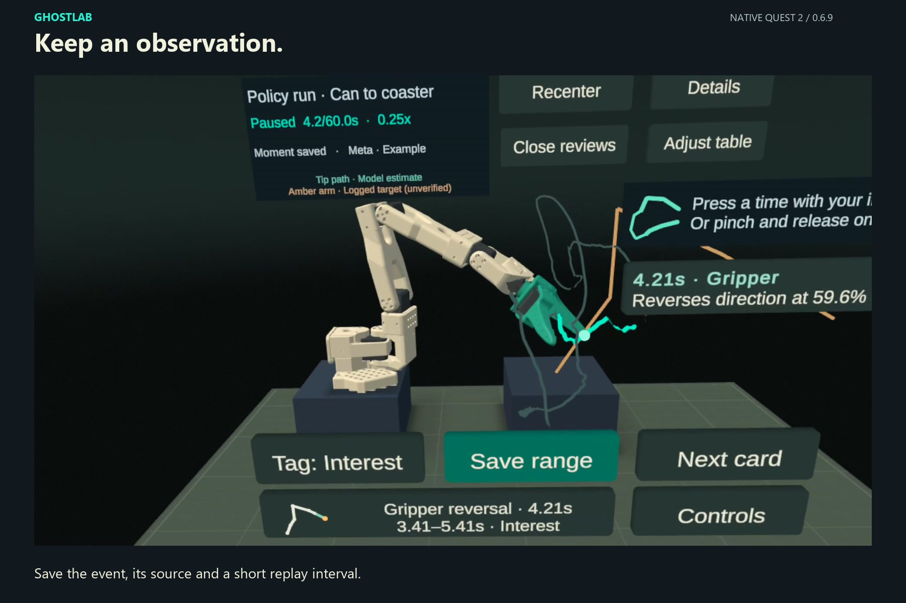
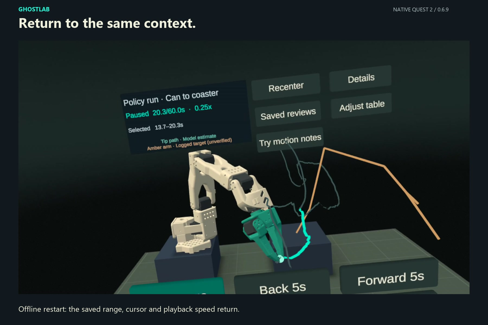
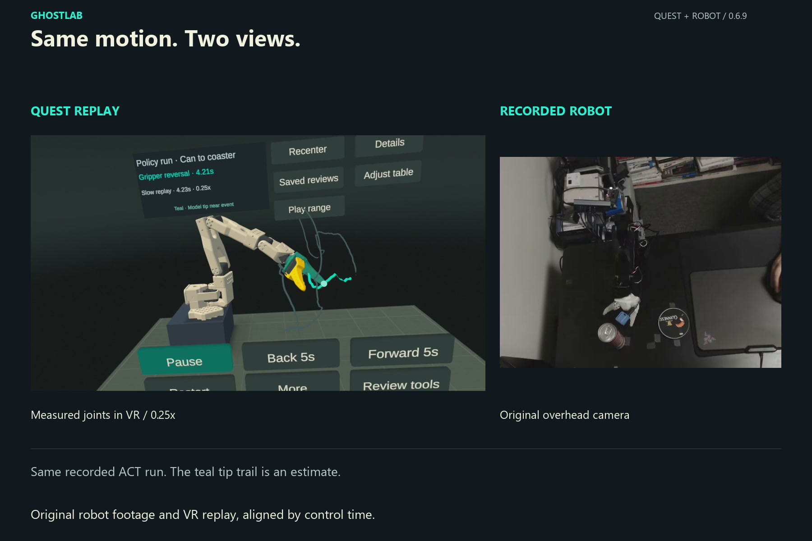
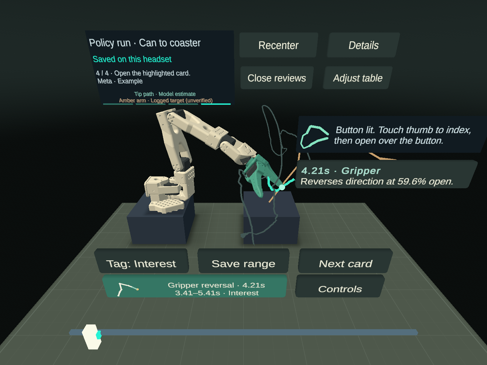

::: {.paper-project .ghostlab-project}

::: {.paper-hero}


<h1 class="paper-title">GhostLab: Review Robot Motion <br>with Your Hands</h1>

::: {.paper-venue}
Meta VR Start Developer Competition 2026 &middot; Productivity &middot; New Experience
:::

<div class="paper-authors">
  <a class="paper-author" href="https://kcsgoodboy.github.io/about.html">Chanseok Kang</a>
</div>

::: {.paper-affiliation}
SO-101 robotics &middot; Meta Quest &middot; Spatial motion review
:::

<div class="paper-links">
  <a class="paper-button ghostlab-primary" href="https://www.meta.com/s/caSHme36e">Try on Quest</a>
  <a class="paper-button" href="https://youtu.be/N_KHN0hDETw">Watch the demo</a>
  <a class="paper-button" href="https://devpost.com/software/ghostlab-ximb0c">Devpost</a>
  <a class="paper-button" href="https://github.com/goodboychan/GhostLab">Code &amp; records</a>
  <a class="paper-button" href="https://huggingface.co/datasets/chans/quantgate-so101-coaster">Demonstration dataset</a>
</div>
:::

## TL;DR

::: {.paper-tldr}
**Find the moment. Replay it. Keep the review.** GhostLab turns a recorded robot run into a workbench you can inspect at arm's length. Press a timestamped note, watch the relevant joint at quarter speed, and save an observation you can reopen offline. The bundled experience works on a Quest alone, without a robot, workstation or API key.
:::

::: {.paper-teaser}
::: {.paper-figure .paper-figure-main}
{.paper-image fig-alt="The GhostLab workbench with an SO-101 model, estimated tip trail and timestamped motion notes."}

::: {.paper-media-caption}
Native Quest 2 capture from GhostLab 0.6.9. The solid arm follows measured joint data; the teal trail estimates the gripper-tip position. Each note links an observation to its time in the original recording.
:::
:::
:::

::: {.paper-metric-strip}
::: {.paper-metric}
<strong>60 seconds</strong>
<span>1,797 samples from a real SO-101 policy run, bundled with the app</span>
:::

::: {.paper-metric}
<strong>0.25&times; replay</strong>
<span>A short interval around a selected event, with its joint highlighted</span>
:::

::: {.paper-metric}
<strong>Offline review</strong>
<span>Reopen the source, selected range, cursor and playback speed on the headset</span>
:::
:::

## Overview

::: {.paper-summary-grid}
::: {.paper-summary-card}
### Problem

After a robot run, understanding what happened often means moving between camera footage and joint plots. The movement is spatial, but the review takes place across separate two-dimensional views.
:::

::: {.paper-summary-card}
### Approach

Bring the recorded arm into a seated Quest workbench. Use hand tracking to move through time, inspect a measured event and keep the interval that matters.
:::

::: {.paper-summary-card}
### Result

The note-to-review workflow works end to end: select, replay, save and reopen. Version 0.6.10 adds a four-step guide and clearer visual feedback, and was tested on Quest 2.
:::
:::

## From teaching a robot to reviewing its motion

The idea began while I was teleoperating an SO-101. On the bench, we recorded **120 demonstrations** of a can-to-coaster task, published them on Hugging Face, and trained an **ACT (Action Chunking with Transformers) policy on 80 of them**. Once the policy ran on its own, I wanted to look at the resulting motion in a virtual environment and move through time with my hands.

GhostLab opens on `rollout_main012_1008_004335`: a **learned-policy execution** in which the arm picks up a cola can and stands it upright on a coaster. The public demonstrations are where its training data came from; the bundled run is what the policy actually did. Keeping that distinction visible is part of the review.

::: {.paper-pipeline}
::: {.pipeline-stage}
<span>Recorded motion</span>
<strong>Keep the source</strong>
<p>Load the original run with measured joints, source timestamps and any available logged targets. Missing data remains a gap.</p>
:::

::: {.pipeline-arrow}
&rarr;
:::

::: {.pipeline-stage}
<span>Spatial inspection</span>
<strong>Find the event</strong>
<p>Select a timestamped observation or drag the timeline. Replay the relevant joint slowly and inspect the estimated tip trail.</p>
:::

::: {.pipeline-arrow}
&rarr;
:::

::: {.pipeline-stage}
<span>Saved review</span>
<strong>Return to the context</strong>
<p>Keep the event, source, interval and tag together. Reopen the observation after restarting the app, including offline.</p>
:::
:::

## Watch the experience

::: {.paper-figure}
```{=html}
<div class="ghostlab-video">
  <iframe src="https://www.youtube-nocookie.com/embed/N_KHN0hDETw" title="GhostLab — narrated 2 minute 53 second demo" loading="lazy" referrerpolicy="strict-origin-when-cross-origin" allow="accelerometer; autoplay; clipboard-write; encrypted-media; gyroscope; picture-in-picture; web-share" allowfullscreen></iframe>
</div>
```

::: {.paper-media-caption}
The **2:53 demo** uses human narration, English captions and native Quest 2 footage. Scene 3 was captured on 0.6.8; scenes 4–9 use 0.6.9. The two versions differ only in parts the video does not show. The same review flow is available in 0.6.10, with the additional guidance shown below. [Watch on YouTube](https://youtu.be/N_KHN0hDETw).
:::
:::

## Use your hands to move through time

::: {.paper-media-grid}
::: {.paper-media-card}
### Select a note

{.paper-image loading="lazy" fig-alt="A tracked fingertip approaching the gripper note and its press-ready cue."}

::: {.paper-media-caption}
Point and press a time card, or pinch and release over it. The fingertip and intended target light up together. Controllers are not required.
:::
:::

::: {.paper-media-card}
### Replay the joint

{.paper-image loading="lazy" fig-alt="The gripper highlighted during a quarter-speed replay."}

::: {.paper-media-caption}
The **4.21s** example selects a gripper reversal. **Replay moment** plays a short interval at 0.25×, pulses the joint at the event and stops at **5.41s**.
:::
:::

::: {.paper-media-card}
### Keep the observation

{.paper-image loading="lazy" fig-alt="A saved Gripper reversal card with its replay interval and review tag."}

::: {.paper-media-caption}
When the replay finishes on its own, the same front button becomes **Save this moment**. Press it again to save the observation. Opening the named card later takes you back to the original event.
:::
:::

::: {.paper-media-card}
### Return offline

{.paper-image loading="lazy" fig-alt="A saved range reopened with its cursor and quarter-speed setting restored."}

::: {.paper-media-caption}
For your own interval, pinch and drag the white timeline marker, set start and end, then save a tagged range. In the recorded offline check, the app restored the **13.7–20.3s** range, the **20.3s** cursor and **0.25×** speed.
:::
:::
:::

## Motion notes connected to evidence

GhostLab analyzes continuous spans of measured joint data before it asks a model to describe anything. A reversal requires an excursion of at least **8° on both sides**, or **8 percentage points** for the gripper. Interior reversals can be detected even when the largest excursion occurs at the end of the chosen range. Gaps in the data split the analysis span.

When the lab gateway is paired, **Meta Muse Ember** receives up to four measured facts and returns one or two English observations that those facts support. The response is checked against the event IDs, joints, values and permitted wording. Selecting a note returns to the same recorded evidence that supports its description.

::: {.paper-figure .ghostlab-table}
| Label in the app | What it means | Availability |
| --- | --- | --- |
| **Meta · Example** | Two actual Meta-generated notes bundled with the example run | Works offline on a fresh headset installation |
| **On-device analysis** | New observations selected locally from the chosen interval | Works offline for new ranges |
| **Meta · Saved** | A Meta response saved with the user's review | Generation needs the paired gateway; the saved result reopens offline |
:::

Generating new notes live with Meta is an optional lab feature. The model API key stays on the GX10 (an ASUS Ascent GX10 workstation built on NVIDIA GB10); the headset receives its own pairing token. A public generation endpoint has been prepared separately, but it is not part of the standalone first-use experience.

## The physical motion and its virtual reconstruction

::: {.paper-figure .paper-figure-main}
{.paper-image loading="lazy" fig-alt="A camera view of the physical SO-101 beside the same policy run replayed on Quest."}

::: {.paper-media-caption}
An edited comparison from the demo: the robot camera recording and the Quest replay are matched by control time. This is not an in-app synchronized camera player. The measured joints drive the virtual model; the teal tip path remains a forward-kinematics estimate.
:::
:::

A lab-paired headset can also open **Live monitor**. Passthrough shows the real desk, and the measured SO-101 pose appears beside the physical Follower (the SO-101 follower arm, the one a leader arm drives during teleoperation). The optional **OpenMV wrist-camera feed** and **Record 20s** capture are also available for bench review. These features require the paired GX10 and robot setup. GhostLab's connection is read-only and does not command the arm.

## A clearer first review in 0.6.10

::: {.paper-method}
::: {.paper-method-steps}
1. **Select.** Four slim progress segments and a short instruction identify the next action. The example's first note is emphasized.
2. **Replay.** Secondary controls fade back so the selected joint and the front replay control stand out.
3. **Save.** **Saved on this headset** confirms success, and the saved card briefly pulses in teal.
4. **Reopen.** Opening that card completes the guide. The completed state survives a restart, so returning users get the ordinary controls without sitting through the introduction again.

The source label and replay stop time remain visible throughout the relevant steps.
:::

::: {.paper-figure}
{.paper-image loading="lazy" fig-alt="The 0.6.10 saved state, with local confirmation, four progress segments and a highlighted review card."}

::: {.paper-media-caption}
Editor render of the 0.6.10 interface. I separately confirmed the guidance, visual emphasis and card reopening on Quest 2.
:::
:::
:::

## Validation and current limits

::: {.paper-figure .ghostlab-table}
| Check | Recorded evidence |
| --- | --- |
| Automated behavior | **111 EditMode + 40 PlayMode tests passed** on November 16, 2026 |
| Quest 2 use | I completed note selection, replay, saving and reopening with the new guidance |
| Update and restart | All **18 existing saved files** survived the update; guide completion and the selected review persisted after restart |
| Short performance sample | **27 reports over 27.329 seconds**, each reporting 72 FPS at 72 Hz; three stale frames in total; app GPU p95 **6.78 ms** |
| Distribution | Production-signed **0.6.10 (27)** uploaded to the Competition channel on November 16, 2026 |
:::

The performance sample is a short hands-on check, not a five-minute endurance result. Independent first use on Quest 3/3S and installation through another Meta account remain unverified. [Versioned validation record](https://github.com/goodboychan/GhostLab/blob/main/docs/REVIEW_POLISH_0.6.10.md).

::: {.paper-summary-grid}
::: {.paper-summary-card}
### Joint evidence and tip estimates

The tip trail comes from forward kinematics, not a measured Cartesian position. Physical holdout checks found errors up to **18 cm**. The interface labels the trail as estimated and the amber logged target as unverified.
:::

::: {.paper-summary-card}
### Observation and control

The app reviews recorded motion and reads live telemetry. Moving through a clip does not move the physical Follower. Live bench access and wrist video are optional paired features.
:::

::: {.paper-summary-card}
### Validation scope

Automated checks and my own Quest 2 sessions support the current workflow. They do not establish a general usability success rate, precise tip registration or performance on every headset.
:::
:::

## Try it on Quest

Join the [Competition release channel](https://www.meta.com/s/caSHme36e) with a Meta account and install GhostLab. Enable hand tracking and sit comfortably at a desk or table.

1. Face the workbench; use **Recenter** if needed.
2. On first launch, the example notes are already open. On later visits, choose **Try motion notes**.
3. Press **4.21s · Gripper**, then **Replay moment**. Lower your hand while it plays.
4. After the stop at **5.41s**, press **Save this moment**.
5. Open the highlighted card to revisit the event. Use **Review tools** to choose your own interval afterward.

## Built with

::: {.paper-figure .ghostlab-table}
| Layer | Tools and role |
| --- | --- |
| Standalone Quest app | Unity 6, C#, OpenXR, Unity XR Hands and URP |
| Interaction | Custom finger-press, pinch selection and timeline-drag logic |
| Motion and data | SO-101 recordings, an ACT policy run, Python import tools and a public LeRobot-format demonstration dataset |
| Motion descriptions | Meta Model API, Muse Ember, evidence validation and local offline analysis |
| Optional bench connection | GX10, read-only Follower telemetry, Meta passthrough and OpenMV wrist video |
:::

## Next steps

Next I want to test the first review with new users, then bring recorded review onto the real desk through passthrough. Planned extensions to the review tool include inspecting demonstration episodes beside policy runs and exporting human-confirmed observations for learning experiments, starting in simulation.

## Code, data and provenance

- [GhostLab source and engineering records](https://github.com/goodboychan/GhostLab). Repository access is currently restricted; public access is pending as of November 18, 2026.
- [120 SO-101 demonstrations on Hugging Face](https://huggingface.co/datasets/chans/quantgate-so101-coaster), released under CC BY 4.0. The bundled example is a separate policy-execution recording, not a demonstration episode.
- [Related QuantGate project](https://github.com/goodboychan/nebius-physical-ai), for background on the bench and the policy runs.
- [Devpost project](https://devpost.com/software/ghostlab-ximb0c) and [narrated demo](https://youtu.be/N_KHN0hDETw).

I supplied the logo and recorded the Quest footage. The footage and gallery screenshots mix 0.6.8 and 0.6.9, which look the same on these screens; the new guide screenshot is an editor render from 0.6.10. The page layout follows the [paired-task audits project page](https://kcsgoodboy.github.io/projects/paired-task-audits-on-device/).

::: {.paper-media-caption}
Project status checked against the repository records on November 18, 2026.
:::

:::
