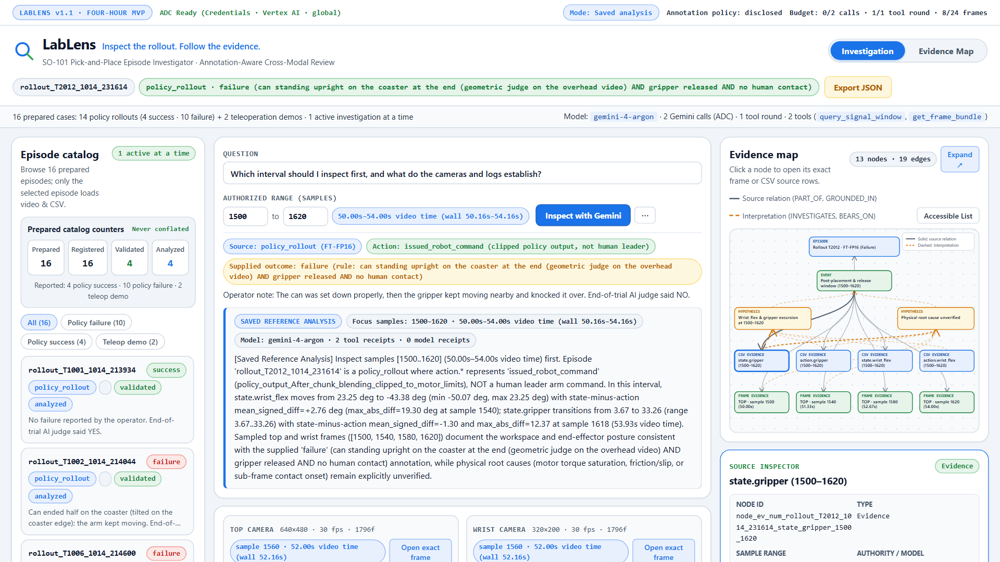
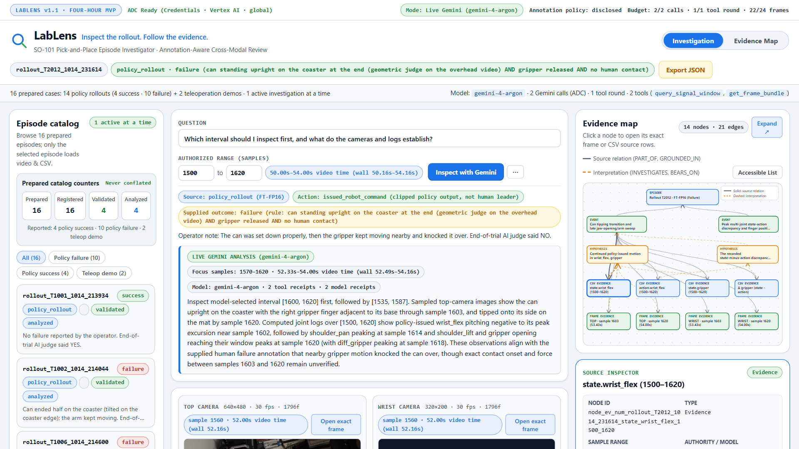
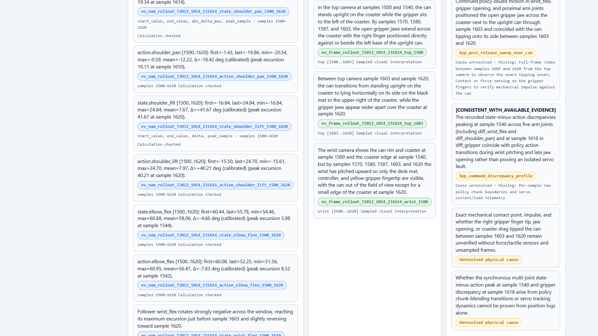
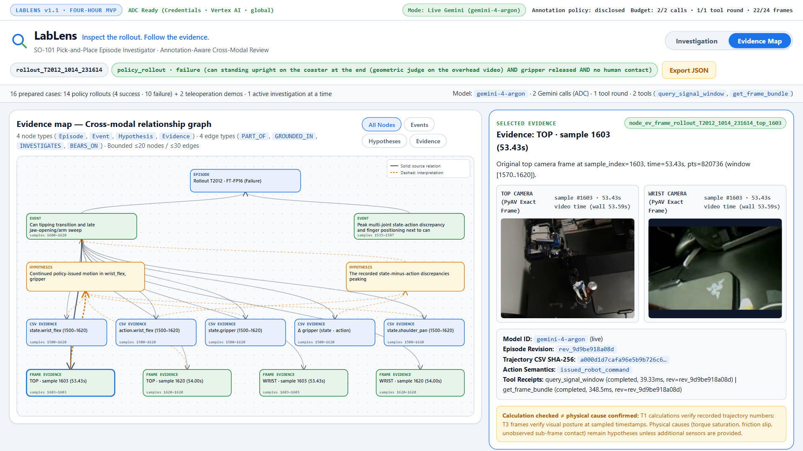
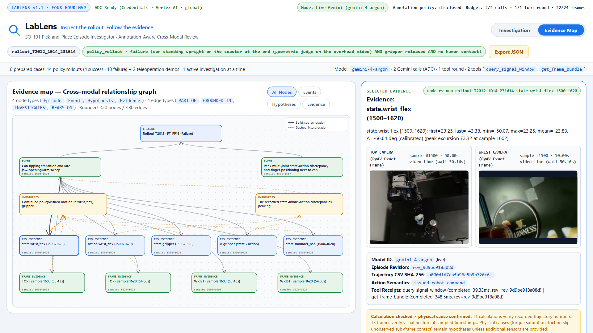
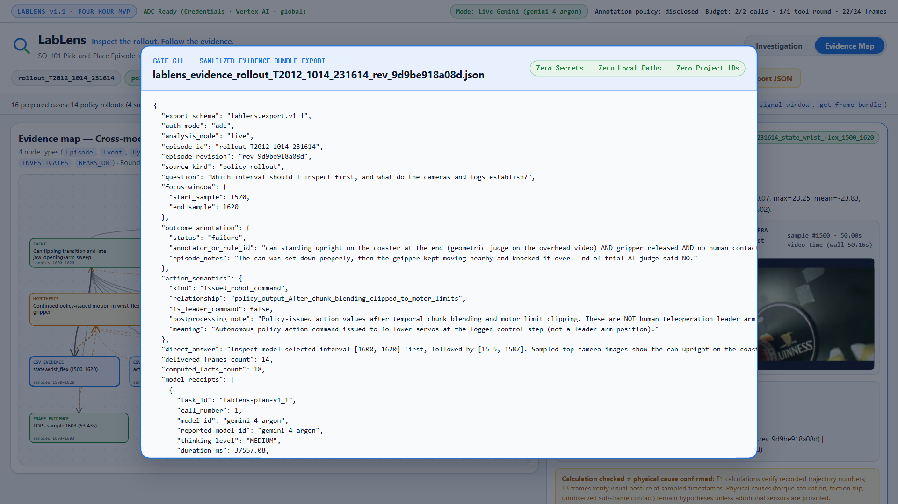

::: {.paper-project}

::: {.paper-hero}

::: {.paper-title}
LabLens: 롤아웃을 살피고, 근거를 따라가기
:::

::: {.paper-venue}
해커톤 프로젝트 · 트랙: Gemini 4 Argon in Hard Tech · 2026년 10월
:::

::: {.paper-authors}
[강찬석](../../about.html){.paper-author}
:::

::: {.paper-affiliation}
LG전자
:::

<div class="paper-links">
  <a class="paper-button" href="https://github.com/goodboychan/LabLens"><i class="fas fa-code"></i> 코드</a>
  <a class="paper-button" href="https://www.youtube.com/watch?v=9px8uzak--s"><i class="fas fa-play-circle"></i> 영상 (3 분)</a>
</div>

:::



## TL;DR

::: {.paper-tldr}
로봇 롤아웃 로그는 관절이 *무엇을* 했는지, 카메라는 장면이 *어떻게* 보였는지 알려 주지만, 둘 다 검토자에게 **어디부터 봐야 하는지**는 알려 주지 않습니다. LabLens는 Gemini 4 Argon에게 롤아웃 하나, 질문 하나, 개요 프레임 8장을 주고, **결정적 도구 정확히 두 개**(CSV 신호 구간 계산, 원본 프레임 묶음)만 요청하게 한 뒤, **모든 문장이 프레임이나 계산된 수치를 가리키는** 보고서를 돌려줍니다. 실패한 롤아웃 T2012에서는 1,796개 샘플을 캔이 넘어지는 0.7초, **샘플 1600–1620**으로 좁혔습니다.
:::

::: {.paper-teaser}

::: {.paper-figure .paper-figure-main}


::: {.paper-media-caption}
rollout_T2012_1014_231614(정책 롤아웃, 제공된 결과: 실패)에서 끊지 않고 진행한 한 번의 세션입니다. 에피소드 선택 → 질문 → 운영자 승인 → 2회 호출 실시간 실행 → 보고서 → Evidence Map(카메라 노드, 이어서 수치 노드) → 정제된 JSON 내보내기. 실제 대기 시간 115초는 영상에서 줄였고, 단계별 시간은 아래 기록에 있습니다.
:::

:::

:::

::: {.paper-metric-strip}

::: {.paper-metric}
**1,796 → 21** [에피소드 전체 샘플 수 대비 Gemini 4 Argon이 가장 먼저 보라고 지목한 구간의 샘플 수 (1600–1620, 영상 시간 53.33–54.00초)]{}
:::

::: {.paper-metric}
**2회 호출 · 도구 1라운드** [조사 1회당 고정 예산. 모델에 전달된 것은 고유 프레임 14장과 계산된 신호 요약 18개]{}
:::

::: {.paper-metric}
**112.7초** [실측 실행 시간: 계획 호출 37.6초, 서버 도구 0.4초, 검토 호출 74.8초 (Vertex AI, ADC)]{}
:::

:::

## 개요

::: {.paper-summary-grid}

::: {.paper-summary-card}
### 문제

실패한 SO-101 집어 옮기기 롤아웃은 약 60초 분량의 카메라 두 대 영상과 관절 신호 12개입니다. 검토자는 영상을 손으로 넘겨 보고, 범용 모델에게 "실패 원인을 설명해 줘"라고 하면 **기록된 것**과 **추측한 것**이 섞입니다. 정책 롤아웃과 원격조작 시연을 혼동하기도 하는데, 그러면 `action.*`의 의미 자체가 달라집니다.
:::

::: {.paper-summary-card}
### 접근

**제한된 조사 루프**입니다. 1차 호출(*계획*)은 질문과 개요 프레임 8장을 보고 신호 구간 하나와 프레임 묶음 하나를 요청합니다. 서버는 CSV와 원본 MP4에서 이를 결정적으로 계산합니다. 2차 호출(*검토*)은 모든 주장을 받은 근거 ID에 연결해야 하며, 정해진 권한 등급을 따릅니다.
:::

::: {.paper-summary-card}
### 결과

T2012에서 계획 호출은 샘플 1500–1620과 세부 구간 1570–1620을 골랐습니다. 검토 호출은 캔이 샘플 1603까지 서 있다가 1620에는 옆으로 누워 있음을 보고했고, 이것이 1602의 wrist_flex 최대 변위 및 1620을 향한 그리퍼 열림과 맞물린다고 정리했습니다. 접촉력은 **명시적으로 미확인**으로 남겼습니다.
:::

:::

## 원본 로그가 알려 주지 않는 것

::: {.paper-figure}
{.paper-image}

::: {.paper-media-caption}
같은 12개 열이 에피소드마다 다른 뜻을 가집니다. 정책 롤아웃에서 `action.*`은 **로봇에 내린 명령**(청크 블렌딩과 모터 한계 클리핑을 거친 정책 출력)이고, 원격조작 시연에서는 **사람이 움직인 리더 암**입니다. 결과 라벨은 위 카메라 기반 기하 판정과 블라인드 영상 재판정의 합의이며, 작업자 메모와는 따로 관리됩니다. LabLens는 세 가지를 모두 `episode.json`에서 읽어 모델이 말하기 전에 먼저 보여 줍니다.
:::

:::

## 루프: 호출 두 번, 도구 두 개, 에피소드 하나

::: {.paper-pipeline}

::: {.pipeline-stage}
[1차 호출 · 계획]{} **어디를 볼지**

질문 + 제공된 결과 + 개요 프레임 8장(top·wrist, 샘플 1500, 1540, 1580, 1620). Gemini 4 Argon은 구조화된 `InspectionPlanResponse`로 신호 구간 하나와 프레임 구간 하나를 돌려줍니다.
:::

::: {.pipeline-arrow}
→
:::

::: {.pipeline-stage}
[서버 · 도구]{} **추측하지 않고 계산**

`query_signal_window`는 모든 행에 대해 최솟값, 최댓값, 평균, 변화량, state−action 차이를 계산합니다(121행, 39 ms). `get_frame_bundle`은 PyAV로 원본 프레임을 정확히 디코딩합니다(8장, 349 ms). 결과마다 근거 ID와 원본의 SHA-256이 붙습니다.
:::

::: {.pipeline-arrow}
→
:::

::: {.pipeline-stage}
[2차 호출 · 검토]{} **기록과 함께 주장**

고유 프레임 14장 + 계산된 사실 18개. `EvidenceReviewResponse`는 각 항목을 계산된 사실, 시각 관찰, 가설, 미해결 중 하나로 표시하며, "verified physical cause" 같은 과잉 주장은 스키마 검증에서 거부됩니다.
:::

:::

## 롤아웃 T2012 결과

::: {.paper-result-grid}

::: {.paper-result-card .paper-result-wide}
### 모델이 실패가 일어난 구간을 고른다

{.paper-image}

Gemini 4 Argon의 답변: *"Inspect model-selected interval [1600, 1620] first, followed by [1535, 1587]. Sampled top-camera images show the can upright on the coaster … through sample 1603, and tipped onto its side on the mat by sample 1620."* 이 에피소드의 작업자 메모는 캔을 제대로 내려놓은 뒤 그리퍼가 근처에서 계속 움직이다 넘어뜨렸다고 적고 있으며, 지목된 구간이 바로 그 순간입니다.
:::

::: {.paper-result-card}
### 문장 뒤의 계산된 사실

| 신호 (샘플 1500–1620) | 처음 | 끝 | Δ | 최대 시점 |
|:--|--:|--:|--:|--:|
| state.wrist_flex (deg) | 23.25 | −43.38 | −66.64 | 1602 |
| state.shoulder_lift (deg) | −16.84 | 24.84 | +41.67 | 1620 |
| action.shoulder_pan (deg) | −1.43 | −19.86 | −18.42 | 1610 |
| state.gripper (% 열림) | 3.67 | 33.26 | +29.59 | 1620 |

모든 행은 서버가 `trajectory.csv`에서 다시 계산한 값입니다. 모델은 이 수치를 인용할 수 있지만 만들어 낼 수는 없습니다.
:::

::: {.paper-result-card}
### 가설은 가설로 남는다

{.paper-image}

두 가설 모두 *원인 미해결*로 표시되고, 부족한 근거를 명시합니다: 샘플 1603–1620 사이 프레임, 접촉·힘 센서, 서보 전류. *계산 확인 ≠ 물리적 원인 확정.*
:::

::: {.paper-result-card .paper-result-wide}
### 모든 노드는 원본으로 열린다

::: {.columns}
::: {.column width="50%"}
{.paper-image}
:::
::: {.column width="50%"}
{.paper-image}
:::
:::

Evidence Map은 노드 20개, 연결선 30개 이하로 제한되며 고립 노드가 없습니다. 실선은 기록 관계(PART_OF, GROUNDED_IN), 점선은 해석 관계(INVESTIGATES, BEARS_ON)입니다. 어떤 근거 노드를 눌러도 결론이 아니라 기록된 내용이 열립니다.
:::

:::

## 실시간 실행 기록

::: {.paper-method}

::: {.paper-method-steps}
1. 운영자가 에피소드 하나를 고릅니다. 에피소드를 바꾸면 진행 중인 조사는 취소됩니다.
2. 운영자가 서버 측 비밀값으로 실행을 승인합니다. 무인 호출이나 일괄 호출은 없습니다.
3. 1차 호출(`lablens-plan-v1_1`)이 계획 하나를 돌려주고, 서버는 최대 도구 1라운드, 도구 2개까지만 실행합니다.
4. 2차 호출(`lablens-review-v1_1`)이 보고서를 돌려줍니다. 근거 ID가 맞지 않거나 금지 표현이 있는 주장은 스키마 검증에서 실패합니다.
5. 내보내기는 정제된 JSON 묶음을 만듭니다: 비밀값, 로컬 경로, 프로젝트 ID 없음.
:::

::: {.paper-figure}
### Vertex AI (global), thinking level MEDIUM 실측

| 단계 | 모델 / 도구 | 소요 시간 | 입력 | 출력 |
|:--|:--|--:|--:|--:|
| 1차 호출 · 계획 | `gemini-4-argon` | 37.56초 | 20,855 토큰 · 프레임 8장 | 2,608 토큰 |
| 도구 T1 | `query_signal_window` | 0.04초 | 121행 · 신호 12개 + 차이 6개 | 사실 18개 |
| 도구 T3 | `get_frame_bundle` | 0.35초 | 샘플 1570, 1587, 1603, 1620 | 프레임 8장 |
| 2차 호출 · 검토 | `gemini-4-argon` | 74.76초 | 36,932 토큰 · 프레임 14장 | 5,895 토큰 |
| **합계** | | **112.70초** | | |
:::

:::

::: {.paper-figure}
{.paper-image}
:::

## 시사점과 한계

::: {.paper-summary-grid}

::: {.paper-summary-card}
### 시사점

- *어디를* 볼지는 모델이 고르고, *무엇이* 있는지는 서버가 계산합니다.
- 출처의 의미도 근거입니다: 롤아웃과 원격조작 시연을 같은 방식으로 설명해서는 안 됩니다.
- 기록이 남는 짧고 제한된 루프가 길고 자유로운 설명보다 믿기 쉽습니다.
:::

::: {.paper-summary-card}
### 한계

- 승인 1회당 에피소드 하나. 준비된 에피소드는 16개(ACT 정책 롤아웃 14개: 성공 4, 실패 10 / 원격조작 시연 2개).
- 드문드문 뽑은 프레임은 샘플 사이의 사건을 놓칠 수 있고, 30 fps 카메라와 관절 엔코더로는 접촉력을 확정할 수 없습니다.
- 제공된 주석을 검토하는 도구이며, 블라인드 결과 분류나 근본 원인 진단 도구가 아닙니다.
:::

::: {.paper-summary-card}
### 출처

이 페이지의 모든 수치는 앱이 내보낸 실시간 실행 기록에서 나왔습니다. 백엔드(FastAPI, PyAV, ADC 기반 google-genai), 프론트엔드, 릴리스 게이트 13개는 대회 기간에 만들었고, 13개 게이트를 모두 통과합니다. 코드는 Apache 2.0, SO-101 에피소드 녹화 데이터는 CC BY 4.0입니다.
:::

:::

## 인용

::: {.paper-citation}
```bibtex
@misc{kang2026lablens,
  title        = {LabLens: Inspect the Rollout, Follow the Evidence},
  author       = {Kang, Chanseok},
  year         = {2026},
  howpublished = {\url{https://github.com/goodboychan/LabLens}}
}
```
:::

:::
