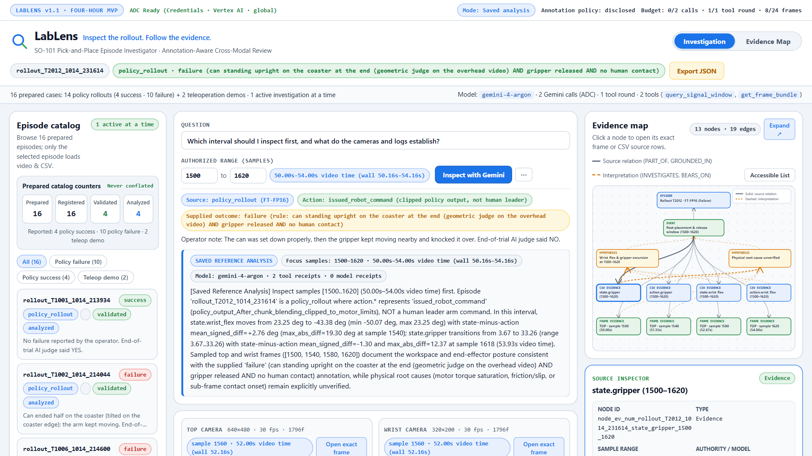
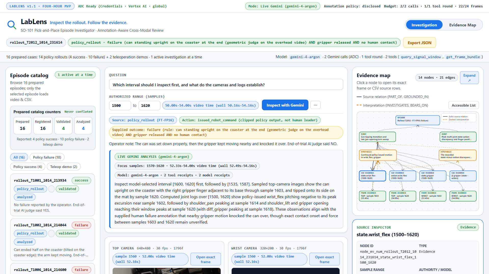
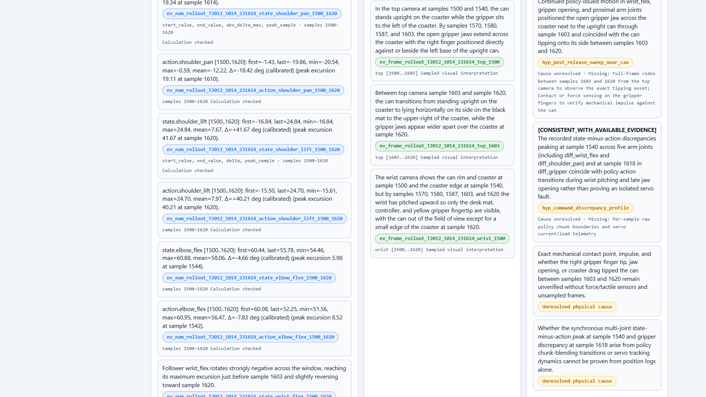
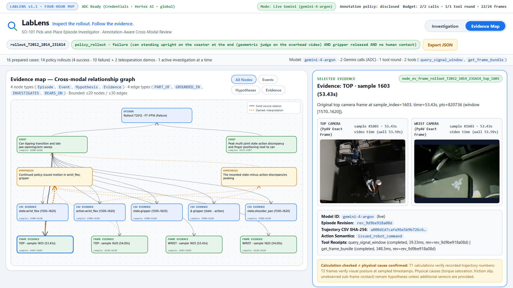
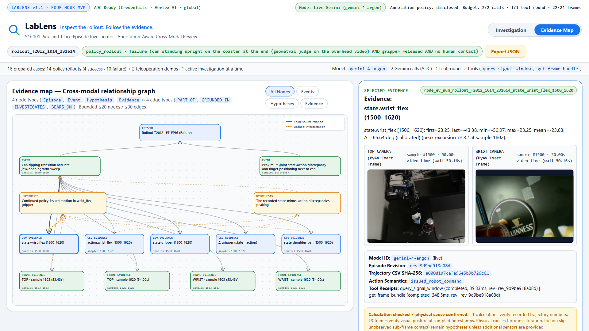
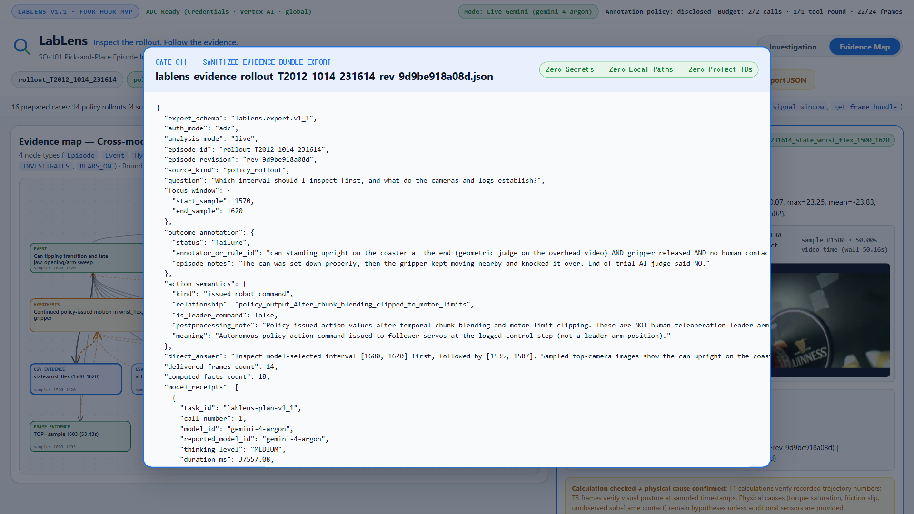

::: {.paper-project}

::: {.paper-hero}

::: {.paper-title}
LabLens: Inspect the Rollout, Follow the Evidence
:::

::: {.paper-venue}
Hackathon project · Track: Gemini 4 Argon in Hard Tech · October 2026
:::

::: {.paper-authors}
[Chanseok Kang](../../about.html){.paper-author}
:::

::: {.paper-affiliation}
LG Electronics
:::

<div class="paper-links">
  <a class="paper-button" href="https://github.com/goodboychan/LabLens"><i class="fas fa-code"></i> Code</a>
  <a class="paper-button" href="https://www.youtube.com/watch?v=9px8uzak--s"><i class="fas fa-play-circle"></i> Video (3 min)</a>
</div>

:::



## TL;DR

::: {.paper-tldr}
A robot rollout log answers *what* the joints did, and the camera answers *what the scene looked like*, but neither tells a reviewer **where to look first**. LabLens gives Gemini 4 Argon one rollout, a question and eight overview frames, lets it request **exactly two deterministic tools** (a CSV signal window and an exact frame bundle), and returns a report in which **every sentence points to a frame or a computed number**. On the failed rollout T2012 it narrowed 1,796 samples to **samples 1600–1620**, the 0.7 s in which the can tips over.
:::

::: {.paper-teaser}

::: {.paper-figure .paper-figure-main}


::: {.paper-media-caption}
One uninterrupted session on rollout_T2012_1014_231614 (policy rollout, supplied outcome: failure): episode selection → question → operator approval → live two-call run → report → Evidence Map (camera node, then numerical node) → sanitized JSON export. The live wait of 115 s is shortened in the video; per-step timings are in the receipts below.
:::

:::

:::

::: {.paper-metric-strip}

::: {.paper-metric}
**1,796 → 21** [samples in the episode versus samples in the interval Gemini 4 Argon flagged first (1600–1620, 53.33–54.00 s video time)]{}
:::

::: {.paper-metric}
**2 calls · 1 tool round** [hard budget per investigation; 14 unique frames and 18 computed signal summaries reached the model]{}
:::

::: {.paper-metric}
**112.7 s** [measured live run: 37.6 s plan call, 0.4 s server tools, 74.8 s review call on Vertex AI (ADC)]{}
:::

:::

## Overview

::: {.paper-summary-grid}

::: {.paper-summary-card}
### Problem

A failed SO-101 pick-and-place rollout is ~60 s of two camera streams and 12 joint signals. Reviewers scrub video by hand, and a general-purpose model asked to "explain the failure" mixes **what was recorded** with **what it guesses**, and can confuse a policy rollout with a teleoperation demo, which changes what `action.*` even means.
:::

::: {.paper-summary-card}
### Approach

A **bounded investigation loop**. Call 1 (*plan*) sees the question and 8 overview frames and asks for one signal window and one frame bundle. The server computes them deterministically from the CSV and the original MP4s. Call 2 (*review*) must tie every claim to the evidence IDs it was given, under a fixed authority class.
:::

::: {.paper-summary-card}
### Outcome

On T2012 the plan call chose samples 1500–1620 and a detail window 1570–1620. The review call reported the can upright through sample 1603 and on its side by sample 1620, aligned with a wrist_flex peak at 1602 and gripper opening toward 1620, and left contact force **explicitly unverified**.
:::

:::

## What a raw log leaves out

::: {.paper-figure}
{.paper-image}

::: {.paper-media-caption}
The same 12 columns mean different things in different episodes. In a policy rollout `action.*` is the **issued robot command** (policy output after chunk blending and motor-limit clipping); in a teleop demo it is the **human leader arm**. The outcome label is a consensus of an overhead-camera geometric judge and a blind video re-judge, and is kept separate from the operator note. LabLens reads all three from `episode.json` and states them before the model speaks.
:::

:::

## The loop: two calls, two tools, one episode

::: {.paper-pipeline}

::: {.pipeline-stage}
[Call 1 · plan]{} **Where to look**

Question + supplied outcome + 8 overview frames (top and wrist at samples 1500, 1540, 1580, 1620). Gemini 4 Argon returns a structured `InspectionPlanResponse`: one signal window and one frame window.
:::

::: {.pipeline-arrow}
→
:::

::: {.pipeline-stage}
[Server · tools]{} **Compute, don't guess**

`query_signal_window` computes min, max, mean, delta and state-minus-action gaps over every row (121 rows, 39 ms). `get_frame_bundle` decodes exact original frames with PyAV (8 frames, 349 ms). Each result gets an evidence ID and a SHA-256 of its source.
:::

::: {.pipeline-arrow}
→
:::

::: {.pipeline-stage}
[Call 2 · review]{} **Claim with receipts**

14 unique frames + 18 computed facts. The `EvidenceReviewResponse` labels every item as computed fact, visual observation, hypothesis or unresolved, and schema validation rejects overclaims such as "verified physical cause".
:::

:::

## Results on rollout T2012

::: {.paper-result-grid}

::: {.paper-result-card .paper-result-wide}
### The model picks the interval where the failure happens

{.paper-image}

Gemini 4 Argon's answer: *"Inspect model-selected interval [1600, 1620] first, followed by [1535, 1587]. Sampled top-camera images show the can upright on the coaster … through sample 1603, and tipped onto its side on the mat by sample 1620."* The supplied operator note for this episode says the can was set down properly and the gripper then knocked it over; the flagged window is where that happens.
:::

::: {.paper-result-card}
### Computed facts behind the sentence

| Signal (samples 1500–1620) | First | Last | Δ | Peak at |
|:--|--:|--:|--:|--:|
| state.wrist_flex (deg) | 23.25 | −43.38 | −66.64 | 1602 |
| state.shoulder_lift (deg) | −16.84 | 24.84 | +41.67 | 1620 |
| action.shoulder_pan (deg) | −1.43 | −19.86 | −18.42 | 1610 |
| state.gripper (% open) | 3.67 | 33.26 | +29.59 | 1620 |

Every row is recomputed by the server from `trajectory.csv`; the model can cite these numbers but cannot produce them.
:::

::: {.paper-result-card}
### Hypotheses stay hypotheses

{.paper-image}

Both hypotheses carry *cause unresolved* and list the missing evidence: frames between samples 1603 and 1620, contact or force sensing, servo current. *Calculation checked ≠ physical cause confirmed.*
:::

::: {.paper-result-card .paper-result-wide}
### Every node opens its source

::: {.columns}
::: {.column width="50%"}
{.paper-image}
:::
::: {.column width="50%"}
{.paper-image}
:::
:::

The Evidence Map is bounded to ≤ 20 nodes and ≤ 30 edges with no orphans. Solid edges are recorded relations (PART_OF, GROUNDED_IN); dashed edges are interpretation (INVESTIGATES, BEARS_ON). Clicking any evidence node shows what was recorded, not what was concluded.
:::

:::

## Receipts for the live run

::: {.paper-method}

::: {.paper-method-steps}
1. The operator selects one episode; switching episodes cancels any running investigation.
2. The operator approves the run with a server-side secret; there is no unattended or batch model call.
3. Call 1 (`lablens-plan-v1_1`) returns one plan; the server runs at most one tool round with at most two tools.
4. Call 2 (`lablens-review-v1_1`) returns the report; any claim without a matching evidence ID, or with a forbidden phrase, fails schema validation.
5. Export writes a sanitized JSON bundle: no secrets, no local paths, no project IDs.
:::

::: {.paper-figure}
### Measured on Vertex AI (global), thinking level MEDIUM

| Step | Model / tool | Duration | Input | Output |
|:--|:--|--:|--:|--:|
| Call 1 · plan | `gemini-4-argon` | 37.56 s | 20,855 tok · 8 frames | 2,608 tok |
| Tool T1 | `query_signal_window` | 0.04 s | 121 rows · 12 signals + 6 gaps | 18 facts |
| Tool T3 | `get_frame_bundle` | 0.35 s | samples 1570, 1587, 1603, 1620 | 8 frames |
| Call 2 · review | `gemini-4-argon` | 74.76 s | 36,932 tok · 14 frames | 5,895 tok |
| **Total** | | **112.70 s** | | |
:::

:::

::: {.paper-figure}
{.paper-image}
:::

## Takeaways and limits

::: {.paper-summary-grid}

::: {.paper-summary-card}
### Takeaways

- Let the model choose *where* to look; let the server compute *what* is there.
- Source semantics are part of the evidence: a rollout and a teleop demo must never be described the same way.
- A short, bounded loop with receipts is easier to trust than a long free-form explanation.
:::

::: {.paper-summary-card}
### Limits

- One episode per approved run; 16 prepared episodes (14 ACT policy rollouts: 4 success, 10 failure; 2 teleop demos).
- Sparse frames can miss events between samples; the 30 fps cameras and joint encoders cannot establish contact force.
- Annotation-aware review, not blind outcome classification or root-cause diagnosis.
:::

::: {.paper-summary-card}
### Provenance

Every number on this page comes from the receipts of the live run exported by the app. Backend (FastAPI, PyAV, google-genai with ADC), frontend and the 13 release gates were built during the event; all 13 gates pass. Code is Apache 2.0; the SO-101 episode recordings are CC BY 4.0.
:::

:::

## Citation

::: {.paper-citation}
```bibtex
@misc{kang2026lablens,
  title        = {LabLens: Inspect the Rollout, Follow the Evidence},
  author       = {Kang, Chanseok},
  year         = {2026},
  howpublished = {\url{https://github.com/goodboychan/LabLens}}
}
```
:::

:::
