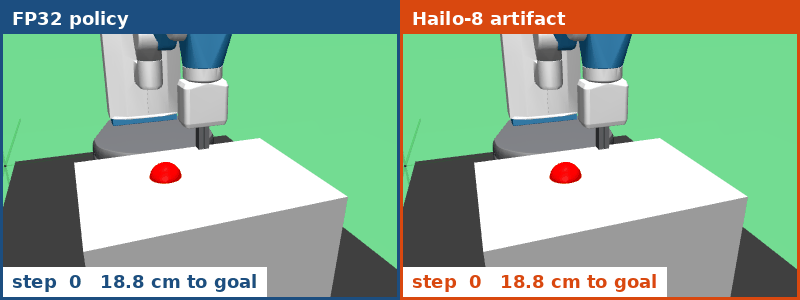
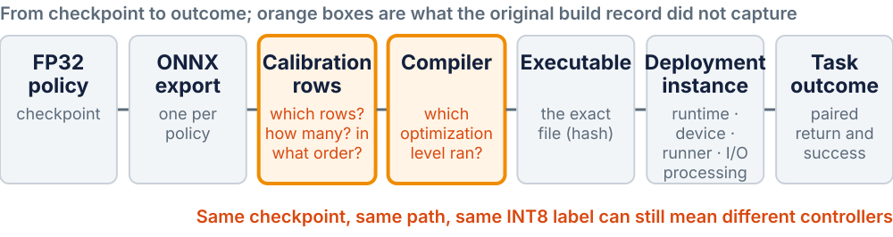
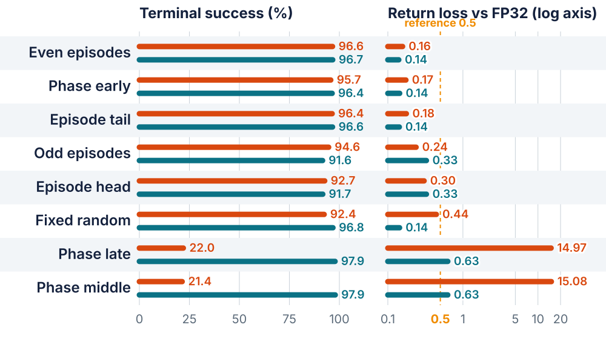
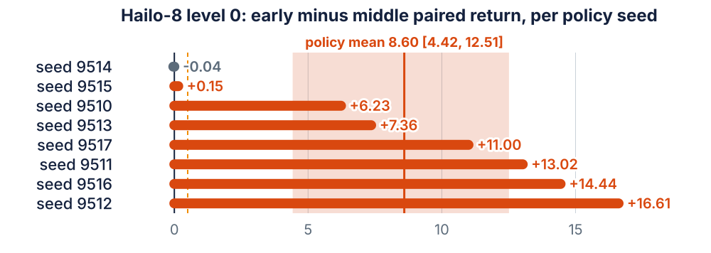
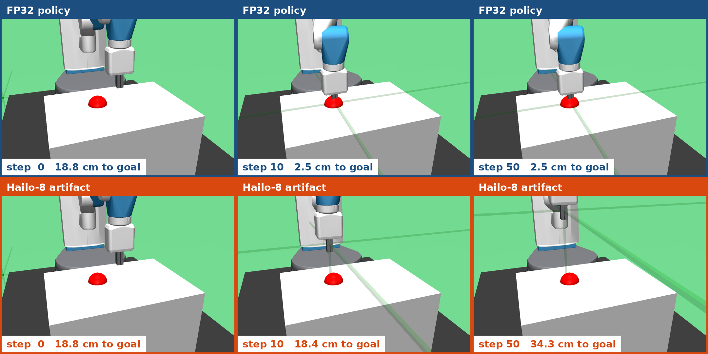
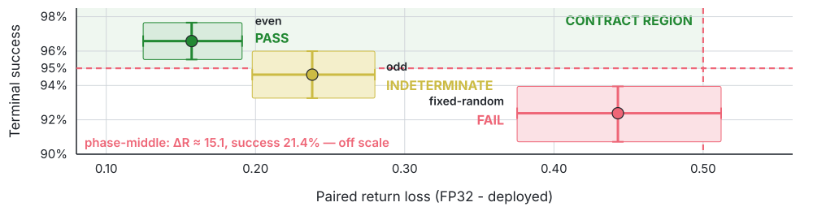

::: {.paper-project}

::: {.paper-hero}
<div class="paper-title">Same Policy, Different Artifacts: Paired Task Audits for On-Device Neural Control</div>

::: {.paper-venue}
NeurIPS 2026 Workshop on On-Device Intelligence: Foundation Models under Real-World Constraints (ODI) &middot; Poster &middot; ICC Sydney, 2026년 12월 12일
:::

<div class="paper-authors">
  <a class="paper-author" href="../../about.html">Chanseok Kang</a>
</div>

::: {.paper-affiliation}
LG Electronics
:::

<div class="paper-links">
  <a class="paper-button" href="https://openreview.net/forum?id=gvQyNdXzRc"><i class="fas fa-file-alt"></i> 논문과 리뷰 (OpenReview)</a>
  <a class="paper-button" href="assets/odi2026_poster.pdf"><i class="fas fa-image"></i> 포스터 (PDF, 61 &times; 85 cm)</a>
  <span class="paper-button"><i class="fas fa-code"></i> 코드와 기록: 추후 공개</span>
</div>
:::

## 요약

::: {.paper-tldr}
"INT8"이라는 label은 controller 하나를 가리키지 않습니다. 같은 policy, 같은 Hailo-8 toolchain 경로, 같은 1,024개의 paired 시작 상태에서 quantizer 범위를 정하는 기록 state만 바꿔도 terminal success가 **96.6%와 21.4%**로 갈립니다. 컴파일된 artifact는 checkpoint나 precision label, local error 통계가 아니라 **실제로 배포되는 그 instance의 paired task outcome**으로 판정해야 합니다.
:::

::: {.paper-teaser}
::: {.paper-figure .paper-figure-main}
{.paper-image}

::: {.paper-media-caption}
device-in-the-loop 후속 실행의 128개 paired 시작 상태 중 하나(episode seed 290000025)를, 기록된 reset state와 각 arm의 기록된 action으로 MuJoCo에서 재생했습니다. 재생된 gripper 위치는 기록과 모든 step에서 정확히 일치합니다. 빨간 점이 goal입니다. 최종 goal 거리: FP32 2.5 cm, artifact 34.3 cm. device 시작 상태 128개 중 82개가 실패하며, 이 장면은 그 중앙값입니다.
:::
:::
:::

::: {.paper-metric-strip}
::: {.paper-metric}
<strong>96.6% vs 21.4%</strong>
<span>같은 policy를 같은 1,024개 시작 상태에서 실행한 두 Hailo-8 빌드의 terminal success. 다른 것은 calibration row뿐입니다</span>
:::

::: {.paper-metric}
<strong>&asymp;30 cm</strong>
<span>최선과 최악 artifact 사이의 return 차이 14.93 [14.32, 15.55]를 episode 평균 goal 거리로 환산한 값 (Edge TPU: 0.49)</span>
:::

::: {.paper-metric}
<strong>7/8</strong>
<span>독립적으로 학습한 policy 중 같은 calibration 변경이 같은 격차를 재현한 수. policy 평균 차이 8.60 [4.42, 12.51]</span>
:::
:::

## 개요

::: {.paper-summary-grid}
::: {.paper-summary-card}
### 문제

Post-training quantization은 소수의 **calibration** state로 8-bit 수치 범위를 고정합니다. 감사한 Hailo 경로에서 compiler는 기본값인 64개 row를 썼고 개수는 보고했지만 어떤 row인지는 남기지 않았습니다. CPU만 있는 빌드 호스트는 최적화 수준을 조용히 level 0으로 낮췄습니다. 두 사실 모두 빌드 기록에 없었습니다.
:::

::: {.paper-summary-card}
### 접근

*deployment instance*는 runtime, device, runner, I/O 처리에 묶인 바로 그 실행 파일입니다. 이를 source에서 decision까지의 provenance 기록과 **paired complete-task audit**으로 판정합니다. FP32와 instance를 동일한 시작 상태에서, 매 control step마다 실제 가속기를 써서 실행합니다.
:::

::: {.paper-summary-card}
### 결과

policy 하나에 calibration 규칙 여덟 개를 적용하면 여덟 개의 controller가 나오고, Hailo-8에서는 성공률이 96.6%에서 21.4%까지 벌어집니다. 이 효과는 독립적으로 학습한 policy 7/8에서 사전 등록된 조건으로 재현되고, compiler level 1과 3에서도 남습니다. 고정 state의 오차 proxy는 이를 예측하지 못합니다.
:::
:::

## 빌드 기록에 빠진 것

::: {.paper-figure}
{.paper-image}
:::

## 감사 설계: calibration row만 바꾼다

::: {.paper-pipeline}
::: {.pipeline-stage}
<span>고정</span>
<strong>policy 하나, 경로 하나</strong>
<p>SAC FetchReach policy 하나, ONNX export 하나, toolchain&ndash;device 경로 하나, 1,024개의 paired reset seed, 그리고 매 control step의 실제 가속기. 시뮬레이터는 디바이스가 action을 돌려준 뒤에만 진행합니다.</p>
:::

::: {.pipeline-arrow}
&rarr;
:::

::: {.pipeline-stage}
<span>변경</span>
<strong>어떤 state로 calibration하는가</strong>
<p>결과를 보기 전에 고정한 여덟 규칙: 짝수/홀수 episode, episode 앞/뒤, phase early/middle/late, fixed random.</p>
:::

::: {.pipeline-arrow}
&rarr;
:::

::: {.pipeline-stage}
<span>비교</span>
<strong>paired task outcome</strong>
<p>같은 시작 상태에서 FP32와 비교한 paired return(경로 전체; FP32 평균 -0.663)과 terminal success(종점). return 0.5은 평균 goal 거리 약 1 cm입니다.</p>
:::
:::

## 결과

::: {.paper-result-grid}
::: {.paper-result-card .paper-result-wide}
### 같은 policy, 같은 경로, 여덟 개의 controller

{.paper-image}

경로당 artifact 8개, 각 1,024개 시작 상태. 경로 내부 이질성은 두 경로 모두 p &lt; 0.001 (Holm). Hailo-8 범위 14.93 [14.32, 15.55], Edge TPU 0.49 [0.46, 0.52]. Edge TPU에서는 return이 가장 나쁜 두 규칙이 성공률은 가장 높습니다. return과 success가 갈라지므로 하나만 보면 행동의 일부를 놓칩니다. 경로 내부 효과이지 vendor 비교가 아닙니다.
:::

::: {.paper-result-card}
### 독립적으로 학습한 policy에서도 반복된다

{.paper-image}

사전 등록된 replication: FetchReach SAC seed 8개 각각에 세 규칙과 256개 paired 시작 상태. Hailo의 early 빼기 middle 대비가 유일한 확증 검정이었습니다. 7/8 policy에서 middle이 early보다 나빴고, policy 평균 차이 8.60 [4.42, 12.51] (&asymp;17 cm), sign-flip p = 0.0156, 통합 성공률 45.9% 대 99.0%.
:::

::: {.paper-result-card}
### compiler를 더 세게 돌려도 사라지지 않는다

| 8개 규칙 family의 Hailo DFC 빌드 | Family range | 95% 구간 | 구분 |
|---|---:|---|---|
| Level 0 (auto), 64 rows, stride 4 | 14.93 | [14.32, 15.55] | locked |
| Level 1 (forced), 64 rows, stride 4 | 14.57 | [13.92, 15.21] | informed |
| Level 0 (forced), all 256 rows | 14.97 | [14.35, 15.58] | informed |
| Level 3 AdaRound, all 256 rows | 14.42 | [13.83, 15.04] | informed |

level 1을 강제하면 모든 artifact의 action field가 바뀌지만 최선-최악 범위는 그대로입니다. level-0 fallback도 AdaRound clamping도 단독으로는 이 폭을 설명하지 못합니다. "informed" 행은 첫 결과를 본 뒤에 설계했습니다.
:::

::: {.paper-result-card}
### 기록에는 row의 개수, 정체성, *그리고 순서*가 필요하다

같은 256개 row를 역순으로 공급하자 범위를 정하는 64개 row가 달라졌습니다. 512개 paired 시작 상태에서 terminal success **69.9% &rarr; 97.1%**, return +1.23 [1.07, 1.39]. 256개 전체를 쓴 빌드는 명시적인 first-64 대조군과 모든 action과 outcome에서 일치했습니다. toolchain이 보고하는 개수로는 이 중 아무것도 구별할 수 없습니다.
:::

::: {.paper-result-card .paper-result-wide}
### 실패한 artifact는 무엇이 달라졌나

| Calibration 규칙 | Hailo 출력 범위 | FP32 범위 밖 (%) | 경계값 (%) | Hailo 성공률 | Edge TPU 성공률 |
|---|---|---:|---:|---:|---:|
| Episode head | [-1.01, 1.00] | 1.2 | 0.4 | 92.7 | 91.7 |
| Episode tail | [-1.01, 1.00] | 0.0 | 1.2 | 96.4 | 96.6 |
| Even episodes | [-1.01, 1.00] | 0.0 | 1.6 | 96.6 | 96.7 |
| Odd episodes | [-1.01, 1.00] | 1.2 | 1.2 | 94.6 | 91.6 |
| Phase early | [-1.01, 1.00] | 0.0 | 1.6 | 95.7 | 96.4 |
| **Phase middle** | [-0.66, 0.20] | 24.2 | 21.1 | **21.4** | 97.9 |
| **Phase late** | [-0.66, 0.20] | 24.2 | 20.7 | **22.0** | 97.9 |
| Fixed random | [-1.01, 1.00] | 0.0 | 1.2 | 92.4 | 96.8 |

결과를 본 뒤, 고정된 800개 early-phase state 패널로 조사했습니다. early-phase row가 하나도 없는 두 규칙만 출력(tanh) layer를 좁은 범위로 calibration했고, 그 결과 early FP32 출력의 4분의 1이 범위 밖으로 떨어지며 Hailo-8 성공률이 무너집니다. 같은 규칙의 Edge TPU는 98% 근처를 유지합니다. 기여 요인이지 단독 원인은 아닙니다.
:::

::: {.paper-result-card}
### local proxy로는 deployment instance를 판정할 수 없다

평균 action-error norm과 RMSE가 10% 이내로 일치하는, 결과를 보지 않고 고른 artifact 쌍 5개가 paired return에서 0.08&ndash;0.17, terminal success에서 최대 5.0 포인트 차이를 보입니다. closed-loop amplification 진단(CLAE)은 선택된 구간에서는 action 크기보다 경보 순위를 잘 매겼지만, 새 데이터에서 사전 지정한 기준을 넘지 못했습니다.
:::
:::

## 실패한 artifact는 reach를 어떻게 바꾸는가

::: {.paper-figure}
{.paper-image}

::: {.paper-media-caption}
논문의 파이프라인을 그대로 재사용한 device-in-the-loop 후속 실행: policy seed 202609201, phase middle row 256개로 calibration한 Hailo-8 level-0 빌드, 새 paired 시작 상태 128개, FP32 arm과 device arm은 동일한 reset state에서 출발합니다. FP32 policy는 128/128에서 goal에 도달하고 artifact는 46/128입니다. 평균 return은 -1.06 (FP32) 대 -11.07 (device). 이 실행은 메커니즘을 보여주기 위한 것이고, 이 페이지의 다른 숫자는 모두 논문의 cohort에서 나왔습니다.
:::
:::

::: {.paper-figure}
### 128개 시작 상태 전체, step 단위로

```{=html}
<iframe src="assets/reach_interactive.html" title="인터랙티브 reach 패널: FP32 policy와 실패한 Hailo-8 artifact" style="width:100%;height:600px;border:0" loading="lazy"></iframe>
```

::: {.paper-media-caption}
왼쪽: goal 기준 gripper 위치(cm)를 위에서 본 그림. 초록 원은 5 cm 성공 반경이고, device 경로 20개는 &plusmn;40 cm 프레임을 벗어납니다. 오른쪽: 50 step episode 동안의 goal 거리. 가는 선은 개별 시작 상태, 굵은 선은 중앙값입니다. 재생 버튼으로 episode를 다시 볼 수 있고, 체크박스는 실패한 시작 상태만 남깁니다.
:::
:::

## 응용의 계약 아래에서 paired outcome으로 판정한다

::: {.paper-method}
::: {.paper-method-steps}
1. task 소유자가 빌드 전에 계약을 정합니다. paired return loss의 허용치 &tau;와 success 하한 &rho;입니다.
2. construction 항목은 빌드 시점에, execution·audit·decision 항목은 판정 시점에 기록합니다.
3. FP32와 instance를, artifact 선택에 쓰지 않은 시작 블록에서, 매 control step마다 실제 가속기로 실행합니다.
4. return-loss 구간 [L~R~, U~R~]과 success 구간 [L~S~, U~S~]에 대해 U~R~ &le; &tau;이고 L~S~ &ge; &rho;이면 **pass**, L~R~ &gt; &tau;이거나 U~S~ &lt; &rho;이면 **fail**, 그 외에는 **indeterminate**. family 단위로는 출하 전에 분리된 시작 블록이나 동시 구간이 필요합니다.
5. construction이나 execution 조건이 바뀌면 다시 판정하고, 계약이 바뀌면 있는 증거로 결정을 재평가합니다.
:::

::: {.paper-figure}
### deployment instance별 기록

| 구분 | 항목 |
|---|---|
| Source | policy, ONNX, script 해시 |
| Calibration | pool, 규칙, seed, 순서 해시; 공급·보고·추론된 개수 |
| Build | compiler, flag, 요청 및 실제 level, host, 실행 파일 해시 |
| Execution | runtime, device, runner, I/O 처리, action-dump 해시 |
| Audit | task 버전, seed, horizon, 종점 |
| Decision | 허용치, 하한, 구간, 증거 상태 |
:::
:::

::: {.paper-figure}
{.paper-image}

::: {.paper-media-caption}
각 사각형은 artifact 하나의 paired return loss와 deployment success 95% 구간의 곱이고, 계약의 허용치와 하한이 평면을 pass, fail, indeterminate 영역으로 나눕니다. 사후적인 예시이지 출하 결정이 아닙니다.
:::
:::

## 정리와 한계

::: {.paper-summary-grid}
::: {.paper-summary-card}
### 정리

- 두 실행 파일이 checkpoint, 경로, INT8 label을 공유하면서도 서로 다른 controller일 수 있습니다.
- calibration row는 provenance입니다. 개수, 정체성, 순서 모두가 결과를 바꿨습니다.
- 고정 state의 오차는 일치했지만 task outcome은 달랐습니다. 디바이스 위에서, paired로, task 전체를 감사해야 합니다.
:::

::: {.paper-summary-card}
### 한계

- 이런 일이 일어날 수 있음을 보였을 뿐 얼마나 자주인지는 모릅니다. task 3개, policy seed 8개, 가속기 2종입니다.
- GPU 호스트 빌드, 실시간 마감, 실제 로봇, foundation-model controller는 다루지 않았습니다.
- 판정 규칙은 사후적으로 예시했을 뿐 end to end로 검증하지 않았습니다.
:::

::: {.paper-summary-card}
### 출처

이 페이지의 모든 숫자는 포스터를 만드는 스크립트가 커밋된 감사 출력에서 생성한 것이며, 포스터 manifest에 각 원본 파일과 해시가 적혀 있습니다. Hailo artifact는 CPU 전용 호스트에서 DFC 3.33.1로, Edge TPU artifact는 TFLite full-integer PTQ로 빌드했습니다. 스크립트, 빌드 설정, 실행 기록은 논문과 함께 공개합니다.
:::
:::

## 인용

::: {.paper-citation}
```bibtex
@inproceedings{kang2026pairedtaskaudits,
  title     = {Same Policy, Different Artifacts: Paired Task Audits for On-Device Neural Control},
  author    = {Kang, Chanseok},
  booktitle = {NeurIPS 2026 Workshop on On-Device Intelligence: Foundation Models under Real-World Constraints},
  year      = {2026},
  url       = {https://openreview.net/forum?id=gvQyNdXzRc}
}
```
:::

:::
