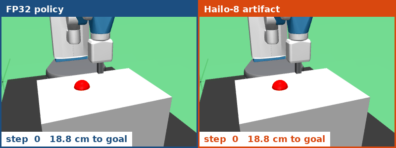
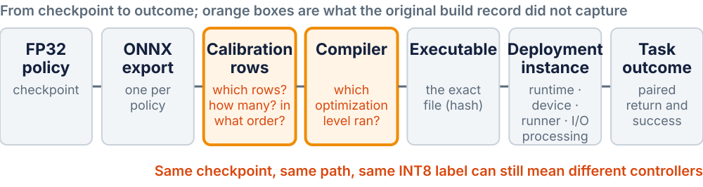
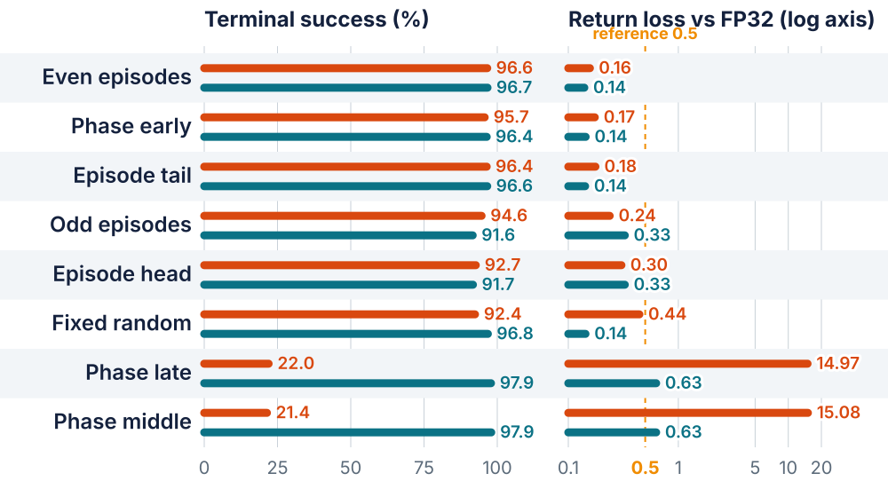
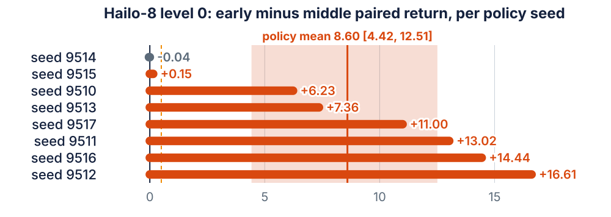
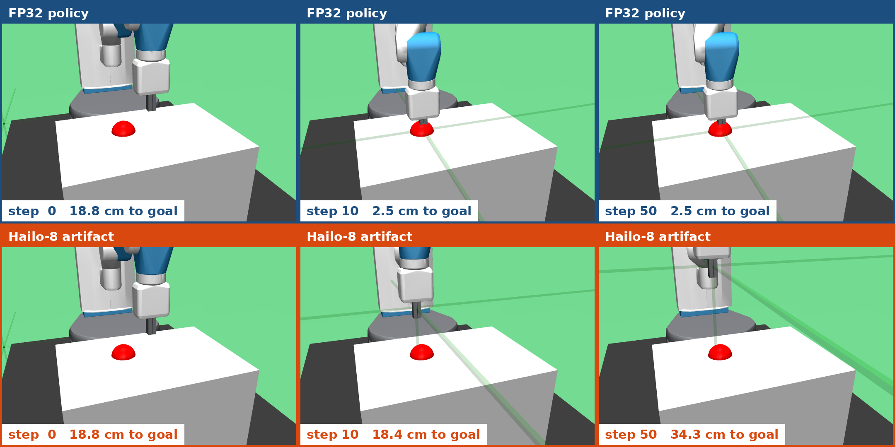
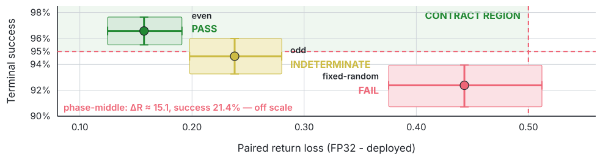

::: {.paper-project}

```{=html}
<style>
.paper-project .paper-result-card { min-width: 0; }
.paper-project .odi-table { overflow-x: auto; }
.paper-project .odi-table table { font-size: 0.92em; margin-bottom: 0.6rem; }
@media (min-width: 761px) { .paper-project .odi-results { grid-template-columns: repeat(2, minmax(0, 1fr)); } }
</style>
```

::: {.paper-hero}
<div class="paper-title">Same Policy, Different Artifacts: Paired Task Audits for On-Device Neural Control</div>

::: {.paper-venue}
NeurIPS 2026 Workshop on On-Device Intelligence: Foundation Models under Real-World Constraints (ODI) &middot; Poster &middot; ICC Sydney, 12 December 2026
:::

<div class="paper-authors">
  <a class="paper-author" href="../../about.html">Chanseok Kang</a>
</div>

::: {.paper-affiliation}
LG Electronics
:::

<div class="paper-links">
  <a class="paper-button" href="https://openreview.net/forum?id=gvQyNdXzRc"><i class="fas fa-file-alt"></i> Paper and reviews (OpenReview)</a>
  <a class="paper-button" href="assets/odi2026_poster.pdf"><i class="fas fa-image"></i> Poster (PDF, 61 &times; 85 cm)</a>
  <span class="paper-button"><i class="fas fa-code"></i> Code and records: later release</span>
</div>
:::

## TL;DR

::: {.paper-tldr}
An "INT8" label does not name one controller. With the same policy, the same Hailo-8 toolchain path and the same 1,024 paired starts, changing only which recorded states set the quantizer ranges gives **96.6% versus 21.4%** terminal success. A compiled artifact should be qualified by **paired task outcomes for its exact deployment instance**, not by its checkpoint, its precision label or a local error statistic.
:::

::: {.paper-teaser}
::: {.paper-figure .paper-figure-main}
{.paper-image}

::: {.paper-media-caption}
One of the 128 paired starts of the device-in-the-loop follow-up run (episode seed 290000025), replayed in MuJoCo from the recorded reset state and the recorded actions of each arm; the replay reproduces every recorded gripper position exactly. The red dot is the goal. Final distance to the goal: 2.5 cm (FP32) versus 34.3 cm (artifact). 82 of the 128 device starts fail; this one is their median.
:::
:::
:::

::: {.paper-metric-strip}
::: {.paper-metric}
<strong>96.6% vs 21.4%</strong>
<span>terminal success of two Hailo-8 builds of the same policy on the same 1,024 starts; only the calibration rows differ</span>
:::

::: {.paper-metric}
<strong>&asymp;30 cm</strong>
<span>best-to-worst return spread 14.93 [14.32, 15.55] as mean goal distance over the episode (Edge TPU: 0.49)</span>
:::

::: {.paper-metric}
<strong>7/8</strong>
<span>independently trained policies in which the same calibration change reproduces the gap; policy-mean contrast 8.60 [4.42, 12.51]</span>
:::
:::

## Overview

::: {.paper-summary-grid}
::: {.paper-summary-card}
### Problem

Post-training quantization fixes 8-bit numerical ranges from a few **calibration** states. On the audited Hailo path the compiler used its default of 64 rows and reported the count but not which rows; a CPU-only build host silently reduced optimization to level 0. Neither fact was in the build record.
:::

::: {.paper-summary-card}
### Approach

A *deployment instance* is the exact executable bound to its runtime, device, runner and I/O processing. We qualify it with a provenance record from source to decision and with **paired complete-task audits**: FP32 and the instance run from identical starts, with the physical accelerator in every control step.
:::

::: {.paper-summary-card}
### Outcome

Eight calibration rules on one policy give eight controllers whose task outcomes differ by up to 96.6% versus 21.4% success on Hailo-8; the effect recurs prospectively in 7/8 independently trained policies and survives compiler levels 1 and 3. Fixed-state error proxies do not predict it.
:::
:::

## What the build record leaves out

::: {.paper-figure}
{.paper-image}
:::

## The audit: vary only the calibration rows

::: {.paper-pipeline}
::: {.pipeline-stage}
<span>Fixed</span>
<strong>One policy, one path</strong>
<p>One SAC FetchReach policy, one ONNX export, one toolchain&ndash;device path, 1,024 paired reset seeds, and the physical accelerator in every control step: the simulator advances only after the device returns an action.</p>
:::

::: {.pipeline-arrow}
&rarr;
:::

::: {.pipeline-stage}
<span>Varied</span>
<strong>Which states calibrate</strong>
<p>Eight rules fixed before any outcome was read: even/odd episodes, episode head/tail, phase early/middle/late, fixed random.</p>
:::

::: {.pipeline-arrow}
&rarr;
:::

::: {.pipeline-stage}
<span>Compared</span>
<strong>Paired task outcomes</strong>
<p>Paired return (the whole route; FP32 mean -0.663) and terminal success (the endpoint) against FP32 from the same starts. 0.5 return &asymp; 1 cm mean goal distance.</p>
:::
:::

## Results

::: {.paper-result-grid .odi-results}
::: {.paper-result-card .paper-result-wide}
### Same policy, same path, eight controllers

{.paper-image}

Eight artifacts per path, 1,024 starts each; within-path heterogeneity p &lt; 0.001 (Holm) on both paths. Hailo-8 range 14.93 [14.32, 15.55]; Edge TPU 0.49 [0.46, 0.52]. On Edge TPU the two worst-return rules keep the highest success rates: return and success diverge, so either alone hides part of the behavior. Within-path effects, not a vendor comparison.
:::

::: {.paper-result-card}
### It recurs across independently trained policies

{.paper-image}

Prospective replication: three rules and 256 paired starts for each of 8 FetchReach SAC seeds; the Hailo early-minus-middle contrast was the sole confirmatory test. Middle underperforms early in 7/8 policies; policy-mean contrast 8.60 [4.42, 12.51] (&asymp;17 cm), sign-flip p = 0.0156; pooled success 45.9% vs 99.0%.
:::

::: {.paper-result-card}
### Forcing the compiler harder does not remove it

::: {.odi-table}
| Hailo DFC build of the eight-rule family | Family range | 95% interval | Status |
|---|---:|---|---|
| Level 0 (auto), 64 rows, stride 4 | 14.93 | [14.32, 15.55] | locked |
| Level 1 (forced), 64 rows, stride 4 | 14.57 | [13.92, 15.21] | informed |
| Level 0 (forced), all 256 rows used | 14.97 | [14.35, 15.58] | informed |
| Level 3 AdaRound, all 256 rows used | 14.42 | [13.83, 15.04] | informed |
:::

Forcing level 1 changes every artifact's action field, yet the best-to-worst range stays. Neither the level-0 fallback nor AdaRound clamping alone explains the spread; the "informed" rows were designed after the first result.
:::

::: {.paper-result-card .paper-result-wide}
### What the failing artifacts change

::: {.odi-table}
| Calibration rule | Hailo output range | FP32 outside (%) | At bound (%) | Hailo success | Edge TPU success |
|---|---|---:|---:|---:|---:|
| Episode head | [-1.01, 1.00] | 1.2 | 0.4 | 92.7 | 91.7 |
| Episode tail | [-1.01, 1.00] | 0.0 | 1.2 | 96.4 | 96.6 |
| Even episodes | [-1.01, 1.00] | 0.0 | 1.6 | 96.6 | 96.7 |
| Odd episodes | [-1.01, 1.00] | 1.2 | 1.2 | 94.6 | 91.6 |
| Phase early | [-1.01, 1.00] | 0.0 | 1.6 | 95.7 | 96.4 |
| **Phase middle** | [-0.66, 0.20] | 24.2 | 21.1 | **21.4** | 97.9 |
| **Phase late** | [-0.66, 0.20] | 24.2 | 20.7 | **22.0** | 97.9 |
| Fixed random | [-1.01, 1.00] | 0.0 | 1.2 | 92.4 | 96.8 |
:::

Post-outcome inspection on a fixed 800-state early-phase panel. Only the two rules with no early-phase rows calibrate the output (tanh) layer to a restricted range; a quarter of early FP32 outputs then fall outside it and Hailo-8 success collapses, while Edge TPU under the same rules stays near 98%. A contributor, not an isolated cause.
:::

::: {.paper-result-card}
### The record needs row count, identity *and* order

Supplying the same 256 rows in reverse order changed which 64 rows set the ranges: terminal success **69.9% &rarr; 97.1%** and return +1.23 [1.07, 1.39] on 512 paired starts, while the full-256 build matched an explicit first-64 control on every action and outcome. The toolchain-reported count identifies none of this.
:::

::: {.paper-result-card}
### Local proxies do not qualify a deployment instance

5 outcome-blind artifact pairs matched within 10% in mean action-error norm and RMSE still differ by 0.08&ndash;0.17 in paired return and by up to 5.0 points in terminal success. A closed-loop amplification diagnostic (CLAE) ranked alerts better than action magnitude in selected windows but missed its pre-specified criterion on fresh data.
:::
:::

## What a failing artifact does to the reach

::: {.paper-figure}
{.paper-image}

::: {.paper-media-caption}
Device-in-the-loop follow-up run on this paper's pipeline: policy seed 202609201, Hailo-8 level-0 build calibrated on all 256 phase middle rows (calibset_size 256), 128 new paired starts, FP32 arm and device arm from identical reset states. The FP32 policy reaches the goal in 128/128 starts, the artifact in 46/128; mean return -1.06 (FP32) versus -11.07 (device). This run illustrates the mechanism; the numbers elsewhere on this page come from the paper's own cohorts.
:::
:::

::: {.paper-figure}
### All 128 starts, step by step

```{=html}
<iframe src="assets/reach_interactive.html" title="Interactive reach panel: FP32 policy versus the failing Hailo-8 artifact" id="odi-reach" style="width:100%;height:520px;border:0"></iframe>
<script>(function(){var f=document.getElementById("odi-reach");function fit(){try{f.style.height=(f.contentDocument.documentElement.scrollHeight+4)+"px";}catch(e){}}f.addEventListener("load",fit);window.addEventListener("resize",fit);if(f.contentDocument&&f.contentDocument.readyState==="complete")fit();})();</script>
```

::: {.paper-media-caption}
Left: gripper position relative to the goal (cm), seen from above; the green disc is the 5 cm success radius and 20 device paths leave the &plusmn;40 cm frame. Right: distance to the goal over the 50-step episode. Thin lines are single starts, thick lines medians. Press play to replay the episode; the checkbox keeps only the failing starts.
:::
:::

## Qualify by paired outcomes, under the application's contract

::: {.paper-method}
::: {.paper-method-steps}
1. The task owner fixes the contract before building: a tolerance &tau; on paired return loss and a success floor &rho;.
2. Construction fields are recorded at build time; execution, audit and decision fields during qualification.
3. FP32 and the instance run from start blocks not used to choose the artifact, with the physical accelerator in every control step.
4. With return-loss bounds [L~R~, U~R~] and success bounds [L~S~, U~S~]: **pass** if U~R~ &le; &tau; and L~S~ &ge; &rho;; **fail** if L~R~ &gt; &tau; or U~S~ &lt; &rho;; otherwise **indeterminate**. Families need a disjoint start block or simultaneous bounds before shipping.
5. Changes to construction or execution conditions require renewed qualification; contract changes require reassessing the decision against the available evidence.
:::

::: {.paper-figure}
### Record per deployment instance

| Category | Fields |
|---|---|
| Source | policy, ONNX, script hashes |
| Calibration | pool, rule, seed, order hashes; supplied, reported and inferred counts |
| Build | compiler, flags, requested and effective level, host, executable hash |
| Execution | runtime, device, runner, I/O processing, action-dump hash |
| Audit | task version, seeds, horizon, endpoint |
| Decision | tolerance, floor, interval, evidence status |
:::
:::

::: {.paper-figure}
{.paper-image}

::: {.paper-media-caption}
Each rectangle is the product of the 95% intervals for paired return loss and deployment success of one artifact; the contract's tolerance and floor cut the plane into pass, fail and indeterminate regions. A retrospective illustration, not a prospective shipping decision.
:::
:::

## Takeaways and limits

::: {.paper-summary-grid}
::: {.paper-summary-card}
### Takeaways

- Two executables can share checkpoint, path and INT8 label and implement different controllers.
- Calibration rows are provenance: count, identity and order all changed outcomes.
- Fixed-state error matched; task outcomes did not. Audit the complete task, paired, on the device.
:::

::: {.paper-summary-card}
### Limits

- The study shows that this can happen, not how often: three tasks (FetchReach, FetchPush, Ant), eight policy seeds, two accelerators.
- No GPU-host builds, real-time deadlines, physical robots or foundation-model controllers.
- The qualification rule is illustrated retrospectively, not validated end to end.
:::

::: {.paper-summary-card}
### Provenance

The numbers in the result cards are generated from the committed audit outputs of the paper's experiments by the scripts that build the poster; the poster manifest lists each source file and its hash. The reach animation, the filmstrip and the distance chart come from a separate device-in-the-loop follow-up run on the same pipeline, not from the paper's cohorts; its traces are committed, and the frames are replayed from them. Hailo artifacts were built on a CPU-only host with DFC 3.33.1; Edge TPU artifacts with TFLite full-integer PTQ. Scripts, build configurations and per-run records will be released with the paper.
:::
:::

## Citation

::: {.paper-citation}
```bibtex
@inproceedings{kang2026pairedtaskaudits,
  title     = {Same Policy, Different Artifacts: Paired Task Audits for On-Device Neural Control},
  author    = {Kang, Chanseok},
  booktitle = {NeurIPS 2026 Workshop on On-Device Intelligence: Foundation Models under Real-World Constraints},
  year      = {2026},
  url       = {https://openreview.net/forum?id=gvQyNdXzRc}
}
```
:::

:::
