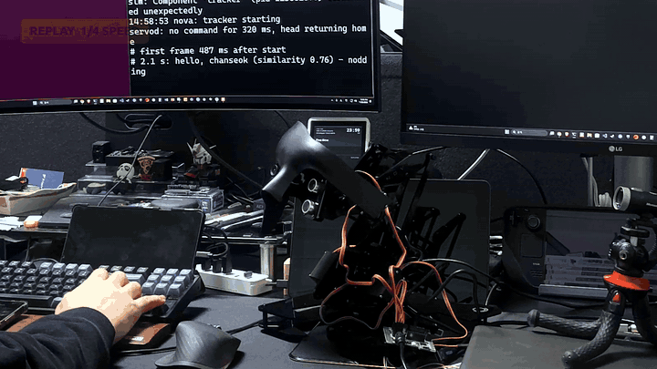
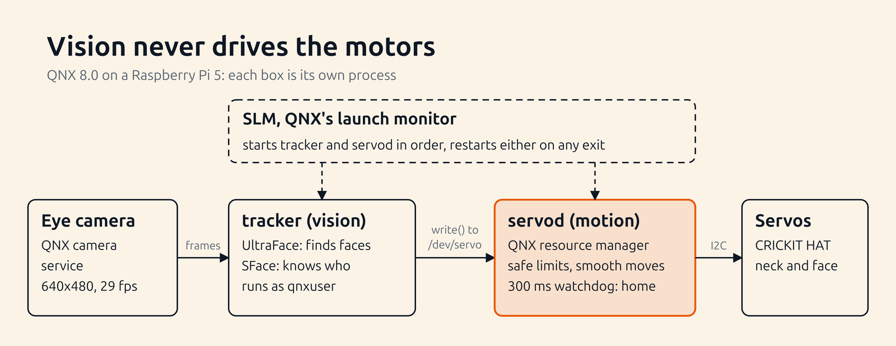
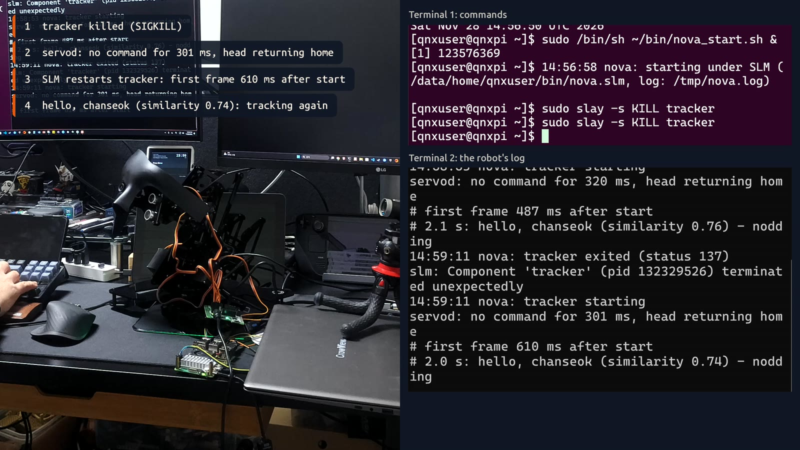
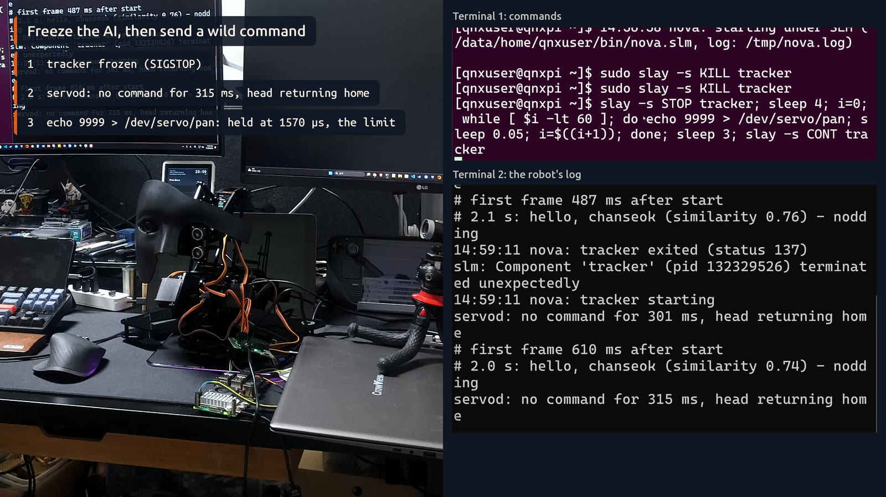
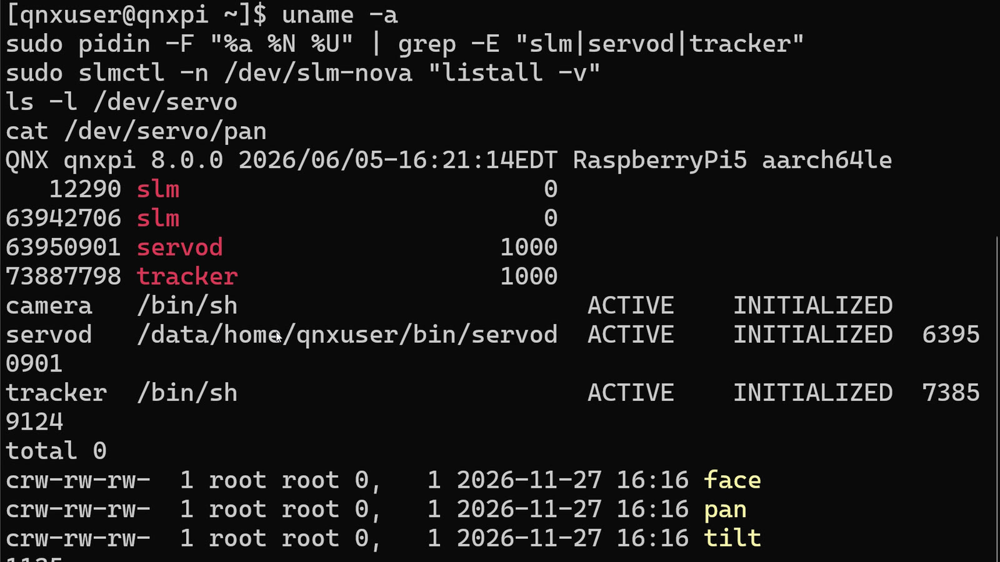
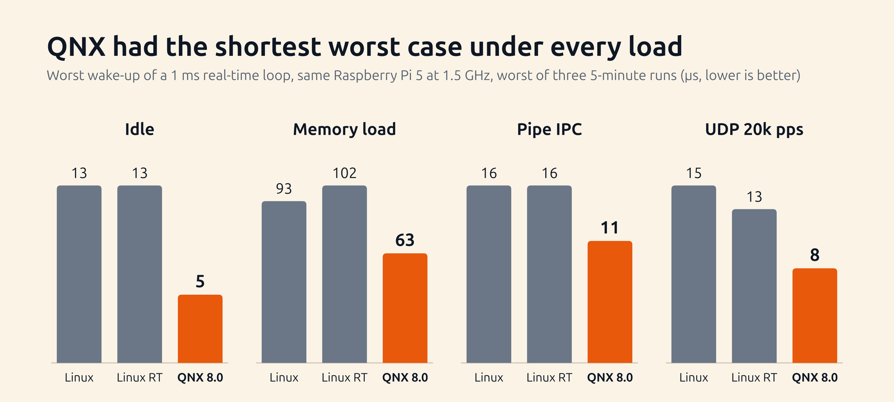
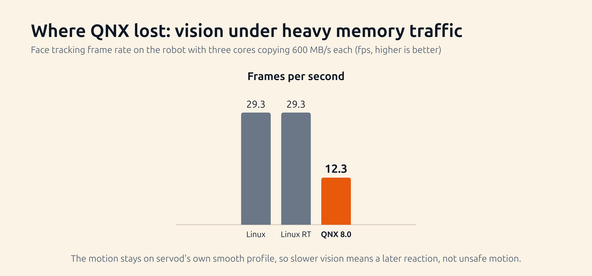
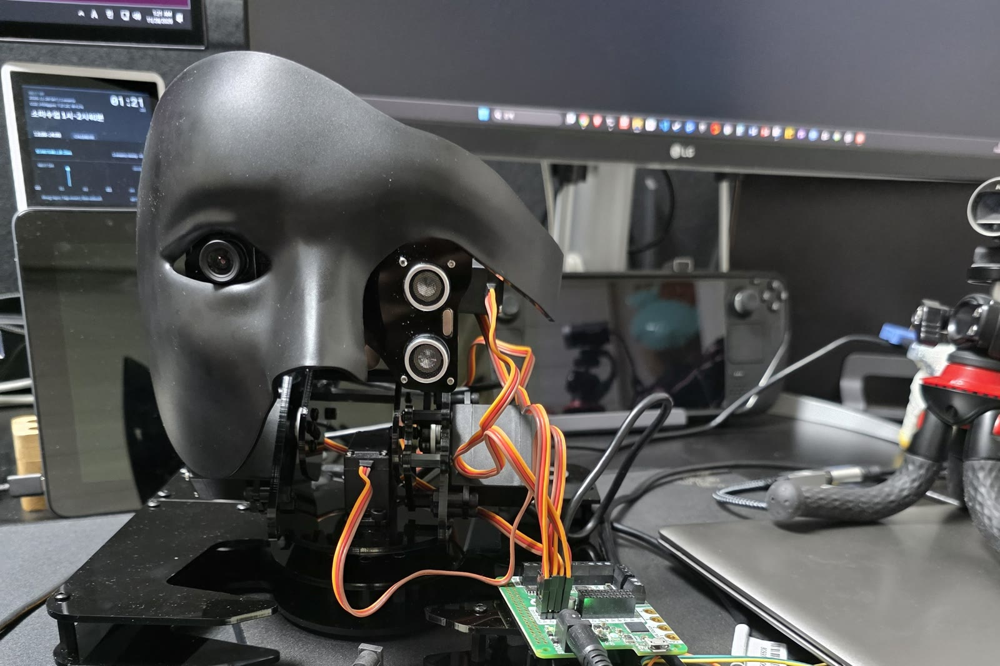
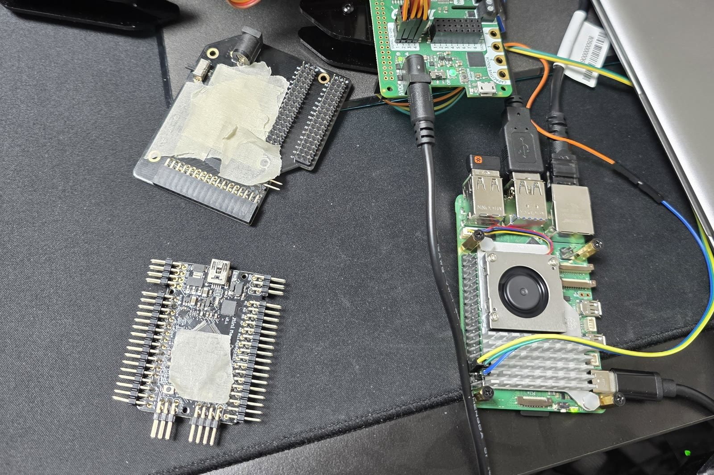

::: {.paper-project}

::: {.paper-hero}
<div class="paper-title">When the AI Crashes, the Robot Doesn't</div>

::: {.paper-venue}
QNX Global Hackathon 2026 &middot; Robotics &amp; Medical &middot; 2026년 11월&ndash;12월
:::

<div class="paper-authors">
  <a class="paper-author" href="../../about.html">Chanseok Kang</a>
</div>

::: {.paper-affiliation}
개인 프로젝트
:::

<div class="paper-links">
  <a class="paper-button" href="https://github.com/goodboychan/qnx-hackathon"><i class="fab fa-github"></i> 코드와 결과 (GitHub)</a>
  <a class="paper-button" href="https://www.youtube.com/watch?v=FhvpcueTXqg"><i class="fab fa-youtube"></i> 영상 (2:55)</a>
  <a class="paper-button" href="https://github.com/goodboychan/qnx-hackathon/blob/main/docs/codelab.md"><i class="fas fa-book"></i> 코드랩</a>
  <a class="paper-button" href="https://github.com/qnx/bsp_raspberrypi-bcm2712-rpi5/pull/4"><i class="fas fa-code-branch"></i> 업스트림 BSP 수정</a>
</div>
:::

## 요약

::: {.paper-tldr}
모터 바로 옆에서 AI를 돌리는 로봇이라면, AI가 고장 나도 모터는 안전해야 합니다. 얼굴을 따라보는 로봇 머리를 QNX 8.0과 Raspberry Pi 5 위에서 처음부터 다시 만들면서 비전과 모터 제어를 별도 프로세스로 나눴고, 비전은 servo를 직접 움직이지 못하게 했습니다. 움직이는 도중에 비전 프로세스를 죽이면 **301 ms** 뒤 servo 서버가 머리를 제자리로 돌립니다. QNX의 System Launch and Monitor(SLM)가 tracker를 다시 띄우고, 새 tracker는 시작 **610 ms** 뒤 첫 프레임을 받아 다시 인사합니다. 재부팅은 필요 없습니다. tracker가 멈추거나 터무니없는 명령이 들어와도 결과는 같습니다. 머리는 제자리로 돌아가거나 관절 한계에서 멈춥니다.
:::

::: {.paper-teaser}
::: {.paper-figure .paper-figure-main}
{.paper-image}

::: {.paper-media-caption}
+0.00 s에 `sudo slay -s KILL tracker`를 실행합니다. servod가 명령이 끊긴 것을 알아채고 머리를 제자리로 돌리고, SLM이 새 tracker를 띄우면 새 tracker가 얼굴을 찾아 고개를 끄덕입니다. 시계는 kill 이후 실제로 흐른 시간입니다.
:::
:::
:::

::: {.paper-metric-strip}
::: {.paper-metric}
<strong>301 ms &rarr; 제자리</strong>
<span>kill부터 servod의 watchdog이 머리를 제자리로 돌리기까지 (timeout 300 ms)</span>
:::

::: {.paper-metric}
<strong>610 ms</strong>
<span>재시작부터 새 tracker의 첫 카메라 프레임까지. 시작 2.0초 뒤 다시 얼굴에 인사</span>
:::

::: {.paper-metric}
<strong>5 &micro;s vs 13 &micro;s</strong>
<span>같은 Pi 5에서 1 ms 실시간 루프의 최악 깨어남 지연(부하 없음). QNX 8.0과 Linux, Linux PREEMPT_RT 비교</span>
:::
:::

## 개요

::: {.paper-summary-grid}
::: {.paper-summary-card}
### 문제

사람 곁에서 일하는 로봇은 모터 바로 옆에서 AI를 돌립니다. 가장 먼저 고장 나거나 멈추는 쪽은 AI이고, 그때 모터가 따라 움직이면 안 됩니다. 출발점이 된 로봇 머리는 카메라로 얼굴을 알아보도록 만든 키트였는데, 제조사가 사라지면서 약속한 튜토리얼도 나오지 않았습니다.
:::

::: {.paper-summary-card}
### 접근

tracker는 기기 안에서 얼굴을 찾고 누구인지 알아보지만, 할 수 있는 일은 `/dev/servo`에 목표 각도를 쓰는 것뿐입니다. 이 경로의 주인은 **servod**입니다. QNX resource manager이자 servo에 닿는 유일한 프로세스로, 모든 명령을 관절 한계 안으로 자르고, 부드러운 속도 곡선으로 움직이며, 300 ms 동안 명령이 없으면 머리를 제자리로 돌립니다. QNX의 **SLM**은 둘을 순서대로 띄우고 tracker가 종료되면 바로 다시 띄웁니다.
:::

::: {.paper-summary-card}
### 결과

Raspberry Pi 5의 QNX 8.0에서 tracker를 죽여도 재부팅 없이 복구되고, tracker가 멈추거나 터무니없는 명령이 들어와도 안전하게 버팁니다. 두 프로세스 모두 root로 돌지 않습니다. 같은 Pi에서 QNX는 시험한 모든 부하 조건에서 최악 깨어남 지연이 가장 짧았고, 메모리 트래픽이 많을 때의 비전 처리량에서는 졌습니다.
:::
:::

## 구조

::: {.paper-figure}
{.paper-image}

::: {.paper-media-caption}
tracker는 ONNX Runtime으로 UltraFace(얼굴 검출, 카메라 29 fps에서 프레임당 26 ms)와 SFace(얼굴 인식)를 돌리며, 일반 사용자 권한으로 CPU 3에서 `SCHED_FIFO` 우선순위 60으로 실행됩니다. servod는 경로를 등록하자마자 root 권한을 버립니다. 자동 시작을 켜 두면 전원을 넣고 14초 뒤부터 머리가 얼굴을 따라봅니다.
:::
:::

## AI가 고장 나는 세 가지 방식

::: {.paper-pipeline}
::: {.pipeline-stage}
<span>크래시</span>
<strong>`slay -s KILL tracker`</strong>
<p>servod가 301 ms 동안 명령이 없다고 보고하고 머리를 제자리로 돌립니다. SLM이 tracker를 다시 띄우면 시작 610 ms 뒤 첫 프레임이 들어오고, 2.0초 뒤 다시 얼굴에 인사합니다.</p>
:::

::: {.pipeline-arrow}
&rarr;
:::

::: {.pipeline-stage}
<span>멈춤</span>
<strong>`slay -s STOP tracker`</strong>
<p>tracker는 살아 있지만 아무 명령도 보내지 않습니다. 315 ms 뒤 servod가 머리를 제자리로 돌립니다. tracker가 다시 움직이면 프레임이 끊겼던 것을 알아채고 스스로 종료하고, SLM이 카메라 서비스를 새로 띄운 뒤 tracker를 다시 시작합니다.</p>
:::

::: {.pipeline-arrow}
&rarr;
:::

::: {.pipeline-stage}
<span>터무니없는 명령</span>
<strong>`echo 9999 > /dev/servo/pan`</strong>
<p>servod는 요청을 pan 한계인 1570 &micro;s로 자르고, 속도 곡선을 따라 거기까지만 움직입니다. 마지막 write 후 310 ms가 지나면 머리는 다시 제자리로 돌아갑니다.</p>
:::
:::

## 결과

::: {.paper-result-grid}
::: {.paper-result-card .paper-result-wide}
### 실시간으로 본 크래시

{.paper-image}

얼굴을 따라보던 도중에 tracker를 죽였습니다. Pi의 다른 프로세스는 아무 영향도 받지 않았습니다. 카메라 서비스, servod, 셸이 그대로 돌았고, 약 2초 뒤 머리는 다시 얼굴을 따라봤습니다. 같은 촬영에서 앞서 한 kill에서는 320 ms와 487 ms가 나왔습니다.
:::

::: {.paper-result-card}
### 멈춘 뒤, 불가능한 각도

{.paper-image}

셸 한 줄로 tracker를 멈추고, `/dev/servo/pan`에 9999를 60번 쓰고, 기다렸다가 tracker를 풀어 줍니다. 머리는 pan 한계까지만 돌아가고, write가 멈추면 제자리로 돌아옵니다.
:::

::: {.paper-result-card}
### QNX 8.0에서, root 없이

{.paper-image}

`uname -a`는 Raspberry Pi 5의 QNX 8.0.0을 보여 줍니다. `pidin`에서 servod와 tracker는 uid 1000으로 돌고, SLM은 카메라 설정, servod, tracker를 모두 ACTIVE로 보여 줍니다.
:::

::: {.paper-result-card}
### 만들면서 찾은 것

- Pi 5용 Quick Start 이미지는 2026-06-17 이후 부트로더에서 부팅되지 않습니다. `config.txt`는 `kernel_address=0x8000000`을 요구하지만 이미지는 0x80000에서 실행되도록 링크되어 있어서, 0x80000으로 바꾸면 해결됩니다.
- QNX는 모니터가 없어도 그래픽 스택을 띄우고, 1080p 화면 출력이 DRAM 대역폭을 약 0.5 GB/s 씁니다.
- QNX의 기본 `memset`은 NEON 버전보다 8배 느리고, `LIBC_STRINGS=aarch64_neon`으로 NEON 버전을 고를 수 있습니다.
:::

::: {.paper-result-card .paper-result-wide}
### 스케줄링 지연: 같은 Pi에서 QNX 8.0과 Linux

{.paper-image}

| 실행별 최악 깨어남 지연 (&micro;s) | 부하 없음 | 메모리 3 &times; 600 MB/s | 파이프 IPC | UDP 20k pps |
|---|---:|---:|---:|---:|
| Linux stock | 13 / 12 / 13 | 93 / 71 / 83 | 13 / 13 / 16 | 15 / 12 / 15 |
| Linux PREEMPT_RT | 13 / 12 / 10 | 61 / 65 / 102 | 16 / 15 / 14 | 13 / 9 / 13 |
| **QNX 8.0** | **5 / 5 / 5** | **61 / 63 / 59** | **11 / 8 / 8** | **8 / 6 / 6** |

CPU를 1.5 GHz로 고정하고, CPU 0~2에 배경 부하를 건 상태에서 CPU 3의 1 ms `SCHED_FIFO` 루프를 쟀습니다. 조건마다 5분씩 세 번, 한 번에 90만 번 깨어납니다. QNX는 모든 조건에서 최악값이 가장 짧고 가장 일정했습니다. 메모리와 IPC 부하에서 중앙값은 Linux가 더 낮았습니다.
:::

::: {.paper-result-card .paper-result-wide}
### 로봇 루프 전체

| 콜백 &rarr; servo, p50 / max (ms) | 부하 없음 | 메모리 부하 |
|---|---:|---:|
| Linux stock | 23.2 / 34.4 (28.3 fps) | 30.2 / 33.6 (29.3 fps) |
| Linux PREEMPT_RT | 23.3 / 26.2 (29.4 fps) | 32.1 / 35.9 (29.3 fps) |
| QNX 8.0 | 27.1 / 29.8 (29.3 fps) | **79.6 / 99.4 (12.3 fps)** |

카메라 &rarr; 얼굴 검출 &rarr; servo 명령까지를 조건마다 60초씩 세 번 쟀고, 같은 tracker를 각 OS용으로 빌드했습니다.
:::

::: {.paper-result-card .paper-result-wide}
### QNX가 진 곳

{.paper-image}

부하가 없으면 세 OS 모두 카메라 속도를 따라갑니다. 메모리 부하에서는 QNX의 얼굴 검출이 3분의 1로 느려집니다. 이 보드에서는 QNX의 DRAM 쓰기 대역폭이 Linux보다 낮아서, 같은 부하가 메모리 버스를 거의 채우기 때문입니다. 원인의 일부는 모니터가 없어도 도는 QNX의 화면 출력(약 0.5 GB/s)이었고, 다른 원인 다섯 가지는 배제했습니다. 모터는 servod의 속도 곡선을 그대로 따르므로, 비전이 느려지면 반응이 늦어질 뿐 위험하게 움직이지는 않습니다.
:::
:::

## 하드웨어

::: {layout-ncol=2}
{.paper-image}

{.paper-image}
:::

키트의 외형, servo, 눈 카메라는 그대로 쓰고 Arduino Mega와 servo 보드를 바꿨습니다. CRICKIT은 자체 5 V 전원으로 I2C를 통해 servo를 구동하므로, Pi와는 점퍼선 세 가닥(SDA, SCL, GND)만 연결합니다. 취미용 servo는 위치를 알려 주지 않기 때문에, 머리를 받친 채 관절을 하나씩 움직여 관절마다 제자리, 한계, 방향을 찾았습니다. 이 과정은 [코드랩](https://github.com/goodboychan/qnx-hackathon/blob/main/docs/codelab.md)에 단계별로 정리했습니다.

## 영상

```{=html}
<div style="position:relative;width:100%;aspect-ratio:16/9;margin:0.5rem 0 1.5rem">
  <iframe src="https://www.youtube-nocookie.com/embed/FhvpcueTXqg" title="When the AI Crashes, the Robot Doesn't (2:55)" style="position:absolute;inset:0;width:100%;height:100%;border:0;border-radius:6px" loading="lazy" allow="accelerometer; encrypted-media; gyroscope; picture-in-picture" allowfullscreen></iframe>
</div>
```

## QNX 8.0을 쓴 방식

::: {.paper-method}
::: {.paper-method-steps}
1. **Resource manager와 메시지 전달.** servod는 `resmgr_attach()`로 `/dev/servo/pan`, `tilt`, `face`를 등록합니다. tracker의 `write()`는 하나하나가 Neutrino 메시지입니다. tracker는 답을 받을 때까지 기다리고, 메시지를 받은 servod 스레드는 tracker의 우선순위로 실행됩니다. `io_write()`는 값을 자르고 바로 답하며, 별도의 50 Hz `motion()` 스레드가 관절을 움직이고 300 ms watchdog을 돌립니다.
2. **System Launch and Monitor.** `nova.slm`에 카메라 설정, servod, tracker를 적어 둡니다. `waitfor`는 `/dev/servo/pan`이 생길 때까지 tracker를 붙잡아 두고, tracker가 종료되면 SLM이 바로 다시 띄웁니다.
3. **Ability와 최소 권한.** servod는 경로를 등록할 때만 root를 쓰고, 그 뒤 일반 사용자로 바뀌며 `procmgr_ability()`로 setuid를 다시 쓸 수 없게 잠급니다. tracker는 처음부터 root가 없습니다.
4. **실시간 스케줄링, 카메라 API, BSP의 I2C 드라이버.** 얼굴 검출을 포함한 카메라 콜백은 root 없이 한 코어에서 `SCHED_FIFO` 60으로 돕니다. 프레임은 QNX 카메라 API에서 촬영 시각과 함께 받고, servod는 `/dev/i2c1`에 `devctl(DCMD_I2C_SEND)`로 CRICKIT을 제어합니다.
:::

::: {.paper-figure}
### 코드에서 볼 곳

| QNX 기능 | 위치 |
|---|---|
| Resource manager | `src/servod/servod.c`의 `main()`, `io_write()`, `motion()` |
| SLM | `tools/nova.slm`, `tools/nova_start.sh`가 실행 |
| Ability | `servod.c`의 `drop_privileges()` |
| 카메라 API | `src/tracker/cam_qnx.c` |
| I2C | `src/tracker/servo.c`의 `i2c_write()` |
| 고해상도 타이머 | `src/rt_loop.c`, 지연 측정 벤치마크 |
| ONNX Runtime 패키지 | `src/tracker/face_ort.c` (`apk add onnxruntime`) |
:::
:::

## 배운 점과 한계

::: {.paper-summary-grid}
::: {.paper-summary-card}
### 배운 점

- 안전 규칙을 servo에 닿는 유일한 프로세스 안에 두니, AI의 크래시와 멈춤, 잘못된 명령이 모두 같은 방식으로 끝납니다.
- QNX에서는 그 경계가 파일 경로입니다. 셸을 포함해 어떤 클라이언트가 쓰든 같은 한계와 같은 watchdog이 적용됩니다.
- 지연과 처리량은 별개의 문제입니다. 이 Pi에서 QNX는 최악 지연이 가장 짧았지만, 메모리 부하에서 얼굴 검출 속도는 가장 많이 떨어졌습니다.
:::

::: {.paper-summary-card}
### 한계

- 로봇 한 대, 카메라 한 대이고, 녹화한 촬영에서 고장 방식마다 몇 번씩만 실행했습니다(kill: 320 ms, 301 ms. 멈춤: 315 ms, 313 ms).
- 취미용 servo는 위치를 알려 주지 않으므로 "제자리"는 servod가 명령한 위치이지 측정한 각도가 아닙니다.
- 멈춘 tracker는 안전하게 붙잡아 두지만, 다시 움직이기 전까지는 아무도 재시작하지 않습니다.
- 메모리 부하에서 비전이 느려지는 원인의 나머지는 아직 설명하지 못했고, 업스트림 BSP 수정은 아직 열려 있는 pull request입니다.
:::

::: {.paper-summary-card}
### 출처

2026년 11월부터 12월까지 QNX Global Hackathon 2026을 위해 처음부터 만들었습니다. 그 과정에서 Raspberry Pi 5용 Quick Start 이미지가 최신 부트로더에서 부팅되지 않는 원인을 찾아 업스트림에 수정을 제안했습니다. 저장소에 코드, 코드랩, 벤치마크 로그와 결과가 모두 있습니다. 코드는 Apache-2.0입니다.
:::
:::

## 인용

::: {.paper-citation}
```bibtex
@software{kang2026qnxrobothead,
  title  = {When the AI Crashes, the Robot Doesn't: A Fail-Safe Robot Head on QNX 8.0},
  author = {Kang, Chanseok},
  year   = {2026},
  url    = {https://github.com/goodboychan/qnx-hackathon},
  note   = {QNX Global Hackathon 2026, Robotics and Medical}
}
```
:::

:::
