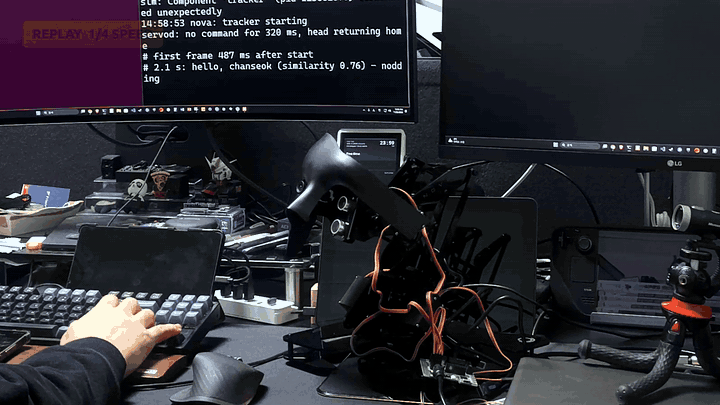
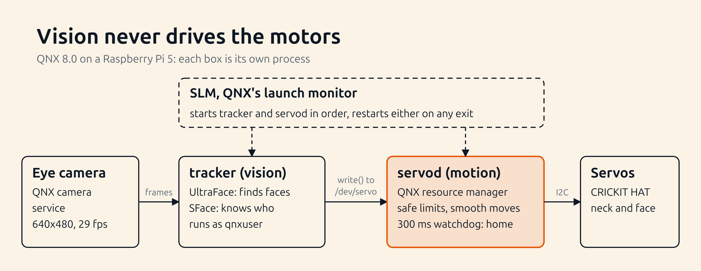
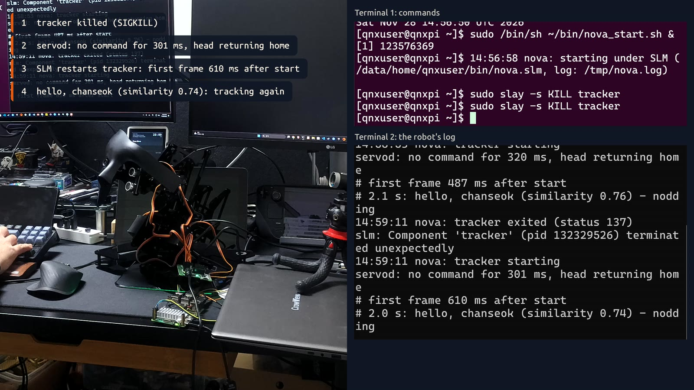
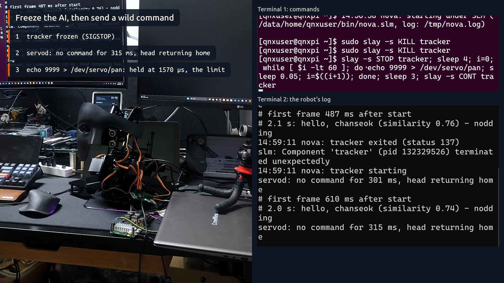
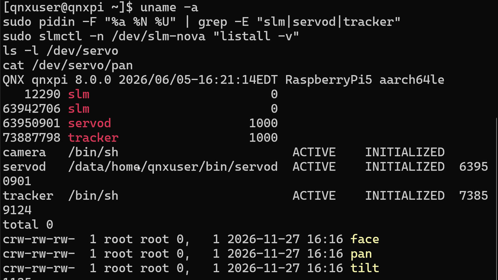
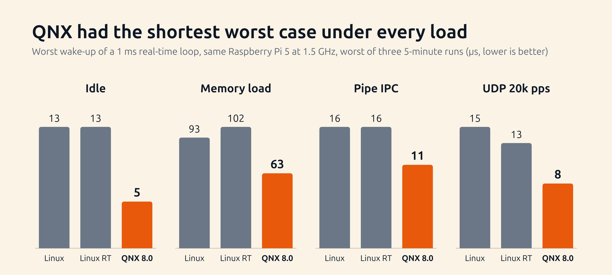
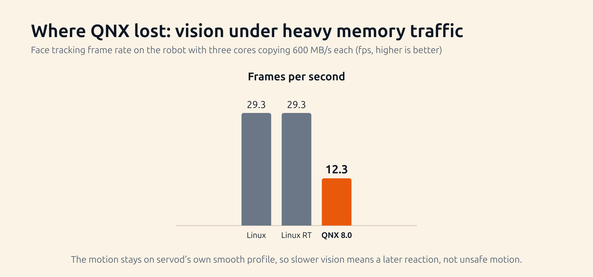
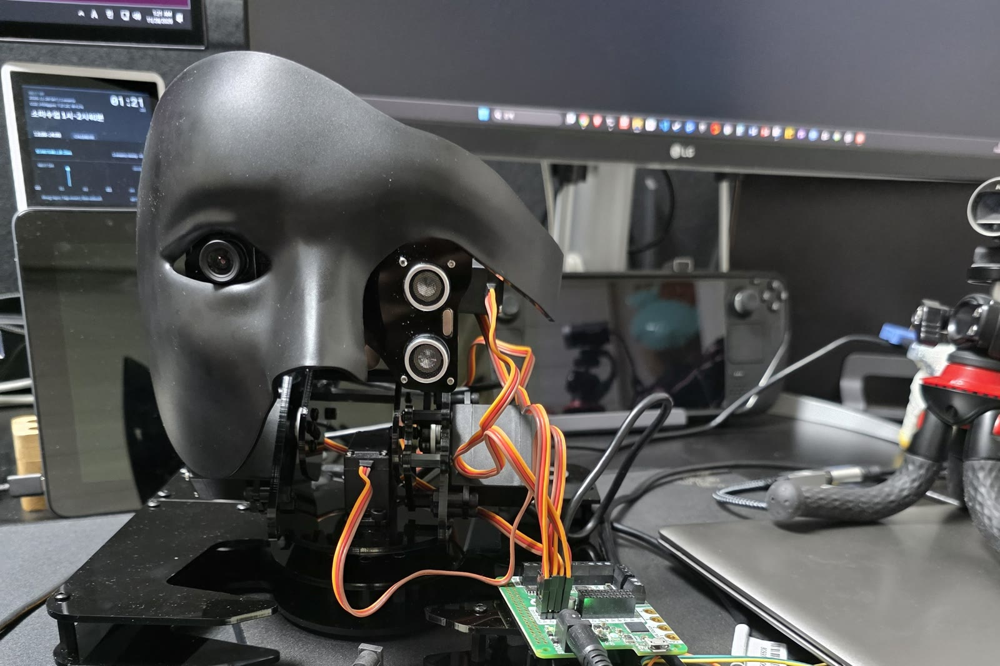
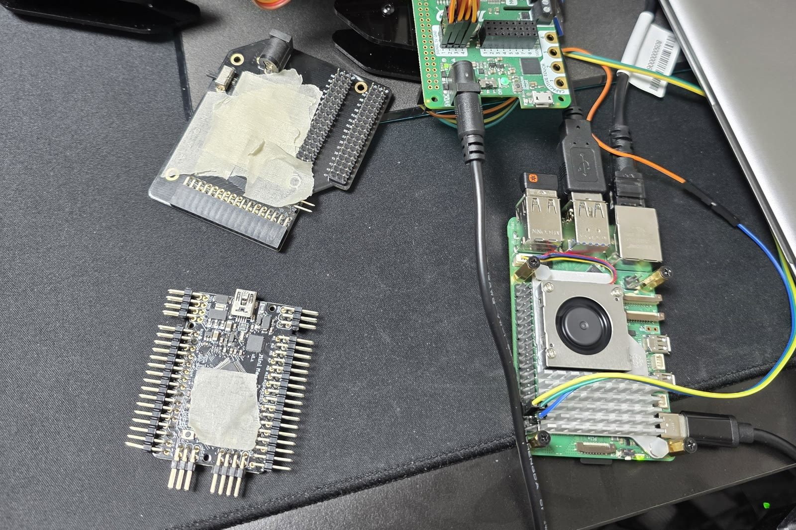

::: {.paper-project}

::: {.paper-hero}
<div class="paper-title">When the AI Crashes, the Robot Doesn't</div>

::: {.paper-venue}
QNX Global Hackathon 2026 &middot; Robotics &amp; Medical &middot; November&ndash;December 2026
:::

<div class="paper-authors">
  <a class="paper-author" href="../../about.html">Chanseok Kang</a>
</div>

::: {.paper-affiliation}
Independent project
:::

<div class="paper-links">
  <a class="paper-button" href="https://github.com/goodboychan/qnx-hackathon"><i class="fab fa-github"></i> Code and results (GitHub)</a>
  <a class="paper-button" href="https://www.youtube.com/watch?v=FhvpcueTXqg"><i class="fab fa-youtube"></i> Video (2:55)</a>
  <a class="paper-button" href="https://github.com/goodboychan/qnx-hackathon/blob/main/docs/codelab.md"><i class="fas fa-book"></i> Codelab</a>
  <a class="paper-button" href="https://github.com/qnx/bsp_raspberrypi-bcm2712-rpi5/pull/4"><i class="fas fa-code-branch"></i> Upstream BSP fix</a>
</div>
:::

## TL;DR

::: {.paper-tldr}
A robot that runs AI next to its motors needs the motors to stay safe when the AI fails. We rebuilt a face-tracking robot head from scratch on QNX 8.0 and a Raspberry Pi 5 so that the vision and the motion are separate processes, and the vision never drives a servo. Kill the vision process in the middle of a move and **301 ms** later the servo server turns the head home. QNX's System Launch and Monitor restarts the tracker, which sees its first frame **610 ms** after it starts and greets the face again, with no reboot. A frozen tracker and an impossible command end the same way: the head goes home or stops at the joint limit.
:::

::: {.paper-teaser}
::: {.paper-figure .paper-figure-main}
{.paper-image}

::: {.paper-media-caption}
`sudo slay -s KILL tracker` at +0.00 s. servod notices the silence and turns the head home, SLM starts a new tracker, and the new tracker finds the face and nods hello. The clock counts real time since the kill.
:::
:::
:::

::: {.paper-metric-strip}
::: {.paper-metric}
<strong>301 ms &rarr; home</strong>
<span>from the kill to servod's watchdog turning the head home (300 ms timeout)</span>
:::

::: {.paper-metric}
<strong>610 ms</strong>
<span>from the restart to the new tracker's first camera frame; 2.0 s after starting it greets the face again</span>
:::

::: {.paper-metric}
<strong>5 &micro;s vs 13 &micro;s</strong>
<span>worst wake-up of a 1 ms real-time loop on the same Pi 5, idle: QNX 8.0 against Linux and Linux PREEMPT_RT</span>
:::
:::

## Overview

::: {.paper-summary-grid}
::: {.paper-summary-card}
### Problem

Robots that work beside people run AI right next to their motors, and the AI is the part most likely to crash or stall. When it does, the motors must not follow it. The head we started from came as a kit built to recognize faces through its camera; its maker disappeared, and the promised tutorial never came.
:::

::: {.paper-summary-card}
### Approach

The tracker finds and recognizes faces on the device, but it can only write target angles to `/dev/servo`. That path belongs to **servod**, a QNX resource manager and the only process that reaches the servos. It clamps every command to the joint's limits, moves on a smooth profile and sends the head home after 300 ms of silence. QNX's **SLM** starts both in order and restarts the tracker whenever it exits.
:::

::: {.paper-summary-card}
### Outcome

On QNX 8.0 on a Raspberry Pi 5, the head recovers from a killed tracker without a reboot and stays safe through a frozen tracker and an impossible command. Neither process runs as root. On the same Pi, QNX had the shortest worst-case wake-up under every load we tried, and it lost on vision throughput under heavy memory traffic.
:::
:::

## Architecture

::: {.paper-figure}
{.paper-image}

::: {.paper-media-caption}
The tracker runs UltraFace (face detection, 26 ms per frame at the camera's 29 fps) and SFace (face recognition) on ONNX Runtime, at `SCHED_FIFO` priority 60 on CPU 3, as an ordinary user. servod gives up root right after it registers its paths. With autostart enabled, the head is tracking 14 s after power-on.
:::
:::

## Three ways for the AI to fail

::: {.paper-pipeline}
::: {.pipeline-stage}
<span>Crash</span>
<strong>`slay -s KILL tracker`</strong>
<p>servod reports 301 ms of silence and turns the head home. SLM restarts the tracker; its first frame arrives 610 ms after it starts, and 2.0 s in it greets the face again.</p>
:::

::: {.pipeline-arrow}
&rarr;
:::

::: {.pipeline-stage}
<span>Freeze</span>
<strong>`slay -s STOP tracker`</strong>
<p>The tracker is alive but silent. 315 ms later servod sends the head home. When the tracker resumes, it sees the gap in its frames and exits, and SLM restarts it with a fresh camera service.</p>
:::

::: {.pipeline-arrow}
&rarr;
:::

::: {.pipeline-stage}
<span>Wild command</span>
<strong>`echo 9999 > /dev/servo/pan`</strong>
<p>servod clamps the request to the pan limit, 1570 &micro;s, and moves there on its profile. 310 ms after the last write the head goes home again.</p>
:::
:::

## Results

::: {.paper-result-grid}
::: {.paper-result-card .paper-result-wide}
### The crash, live

{.paper-image}

The tracker was killed in the middle of tracking a face. No other process on the Pi noticed: the camera service, servod and the shell kept running, and the head was tracking again about two seconds later. An earlier kill in the same session gave 320 ms and 487 ms.
:::

::: {.paper-result-card}
### Freeze, then an impossible angle

{.paper-image}

One shell line freezes the tracker, writes 9999 to `/dev/servo/pan` sixty times, waits, and lets the tracker go. The head turns only as far as the pan limit and comes back once the writes stop.
:::

::: {.paper-result-card}
### It runs on QNX 8.0, without root

{.paper-image}

`uname -a` reports QNX 8.0.0 on the Raspberry Pi 5. `pidin` shows servod and the tracker as uid 1000, and SLM lists the camera setup, servod and the tracker as ACTIVE.
:::

::: {.paper-result-card}
### Found along the way

- The Pi 5 Quick Start image does not boot with bootloaders from 2026-06-17 on: its `config.txt` asks for `kernel_address=0x8000000`, but the image is linked to run at 0x80000. Setting 0x80000 fixes it.
- QNX starts its graphics stack even with no monitor, and the 1080p scan-out costs about 0.5 GB/s of DRAM bandwidth.
- QNX's default `memset` is 8&times; slower than its NEON variant; `LIBC_STRINGS=aarch64_neon` selects it.
:::

::: {.paper-result-card .paper-result-wide}
### Scheduling latency: QNX 8.0 against Linux on the same Pi

{.paper-image}

| Worst wake-up per run (&micro;s) | Idle | Memory 3 &times; 600 MB/s | Pipe IPC | UDP 20k pps |
|---|---:|---:|---:|---:|
| Linux stock | 13 / 12 / 13 | 93 / 71 / 83 | 13 / 13 / 16 | 15 / 12 / 15 |
| Linux PREEMPT_RT | 13 / 12 / 10 | 61 / 65 / 102 | 16 / 15 / 14 | 13 / 9 / 13 |
| **QNX 8.0** | **5 / 5 / 5** | **61 / 63 / 59** | **11 / 8 / 8** | **8 / 6 / 6** |

A 1 ms `SCHED_FIFO` loop on CPU 3 while CPUs 0 to 2 run a background load, with the CPU fixed at 1.5 GHz: 5 minutes &times; 3 runs per condition, 900,000 wake-ups each. QNX had the shortest and most repeatable worst case in every condition. Linux had the lower median under memory and IPC load.
:::

::: {.paper-result-card .paper-result-wide}
### The whole robot loop

| Callback &rarr; servo, p50 / max (ms) | Idle | Memory load |
|---|---:|---:|
| Linux stock | 23.2 / 34.4 (28.3 fps) | 30.2 / 33.6 (29.3 fps) |
| Linux PREEMPT_RT | 23.3 / 26.2 (29.4 fps) | 32.1 / 35.9 (29.3 fps) |
| QNX 8.0 | 27.1 / 29.8 (29.3 fps) | **79.6 / 99.4 (12.3 fps)** |

Camera &rarr; face detection &rarr; servo command, 60 s &times; 3 runs per condition, with the same tracker built for each OS.
:::

::: {.paper-result-card .paper-result-wide}
### Where QNX lost

{.paper-image}

Idle, all three keep up with the camera. Under memory load QNX's face detector slows to a third: on this board QNX's DRAM write bandwidth is lower than Linux's, so the same load nearly fills the memory bus. We traced part of it to QNX's display scan-out, which runs even with no monitor (about 0.5 GB/s), and ruled out five other causes. The motion stays on servod's own profile, so slower vision means a later reaction, not an unsafe move.
:::
:::

## The hardware

::: {layout-ncol=2}
{.paper-image}

{.paper-image}
:::

We kept the kit's shell, servos and eye camera and replaced its Arduino Mega and servo board. The CRICKIT drives the servos over I2C from its own 5 V supply, so three jumper wires (SDA, SCL, GND) connect it to the Pi. Hobby servos report no position, so the servo map (home, limits and direction of each joint) was found by moving one joint at a time with the head supported; the [codelab](https://github.com/goodboychan/qnx-hackathon/blob/main/docs/codelab.md) walks through it.

## Video

```{=html}
<div style="position:relative;width:100%;aspect-ratio:16/9;margin:0.5rem 0 1.5rem">
  <iframe src="https://www.youtube-nocookie.com/embed/FhvpcueTXqg" title="When the AI Crashes, the Robot Doesn't (2:55)" style="position:absolute;inset:0;width:100%;height:100%;border:0;border-radius:6px" loading="lazy" allow="accelerometer; encrypted-media; gyroscope; picture-in-picture" allowfullscreen></iframe>
</div>
```

## How QNX 8.0 is used

::: {.paper-method}
::: {.paper-method-steps}
1. **Resource manager and message passing.** servod registers `/dev/servo/pan`, `tilt` and `face` with `resmgr_attach()`. Each `write()` from the tracker is a Neutrino message: the tracker waits for the reply, and the servod thread that receives it runs at the tracker's priority. `io_write()` clamps the value and replies; a separate 50 Hz `motion()` thread moves the joints and runs the 300 ms watchdog.
2. **System Launch and Monitor.** `nova.slm` describes the camera setup, servod and the tracker. `waitfor` holds the tracker back until `/dev/servo/pan` exists, and SLM restarts the tracker the moment it exits.
3. **Abilities and least privilege.** servod keeps root only to register its paths, then switches to an ordinary user and locks itself out of setuid with `procmgr_ability()`. The tracker never has root.
4. **Real-time scheduling, the camera API and the BSP's I2C driver.** The camera callback, including face detection, runs at `SCHED_FIFO` 60 on one core without root. Frames come from the QNX camera API with capture timestamps, and servod reaches the CRICKIT with `devctl(DCMD_I2C_SEND)` on `/dev/i2c1`.
:::

::: {.paper-figure}
### Where to look in the code

| QNX feature | Where |
|---|---|
| Resource manager | `main()`, `io_write()`, `motion()` in `src/servod/servod.c` |
| SLM | `tools/nova.slm`, started by `tools/nova_start.sh` |
| Abilities | `drop_privileges()` in `servod.c` |
| Camera API | `src/tracker/cam_qnx.c` |
| I2C | `i2c_write()` in `src/tracker/servo.c` |
| High-resolution timers | `src/rt_loop.c`, the latency benchmark |
| ONNX Runtime package | `src/tracker/face_ort.c` (`apk add onnxruntime`) |
:::
:::

## Takeaways and limits

::: {.paper-summary-grid}
::: {.paper-summary-card}
### Takeaways

- The safety rules live in the one process that can reach the servos, so a crash, a freeze and a bad command from the AI all end the same way.
- On QNX the boundary is a file path. Any client, including a shell, gets the same clamping and the same watchdog.
- Latency and throughput are separate questions. QNX had the tightest worst case on this Pi, and the face detector lost the most under memory load.
:::

::: {.paper-summary-card}
### Limits

- One robot, one camera, and a few runs of each failure in the recorded session (kills: 320 and 301 ms; freezes: 315 and 313 ms).
- Hobby servos give no position feedback, so "home" is the position servod commands, not a measured angle.
- A frozen tracker is held safe, but nothing restarts it until it resumes.
- The rest of the vision slowdown under memory load is not explained, and the upstream BSP fix is still an open pull request.
:::

::: {.paper-summary-card}
### Provenance

Built from scratch for the QNX Global Hackathon 2026 in November and December 2026. Along the way we found why the Raspberry Pi 5 Quick Start image no longer boots on current bootloaders and proposed the fix upstream. The repository has the code, the codelab, the benchmark logs and the results. Code under Apache-2.0.
:::
:::

## Citation

::: {.paper-citation}
```bibtex
@software{kang2026qnxrobothead,
  title  = {When the AI Crashes, the Robot Doesn't: A Fail-Safe Robot Head on QNX 8.0},
  author = {Kang, Chanseok},
  year   = {2026},
  url    = {https://github.com/goodboychan/qnx-hackathon},
  note   = {QNX Global Hackathon 2026, Robotics and Medical}
}
```
:::

:::
