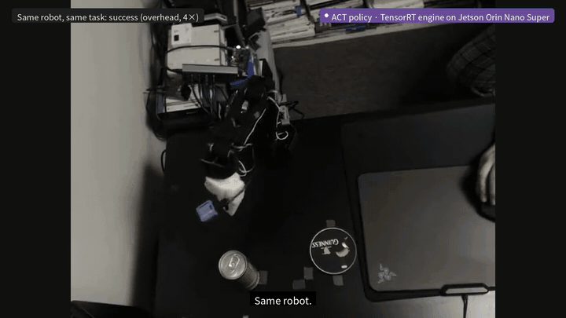
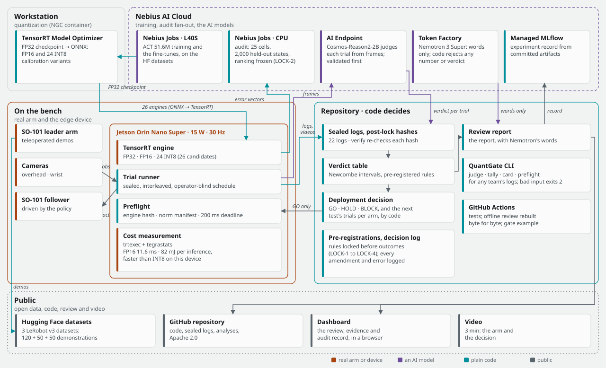
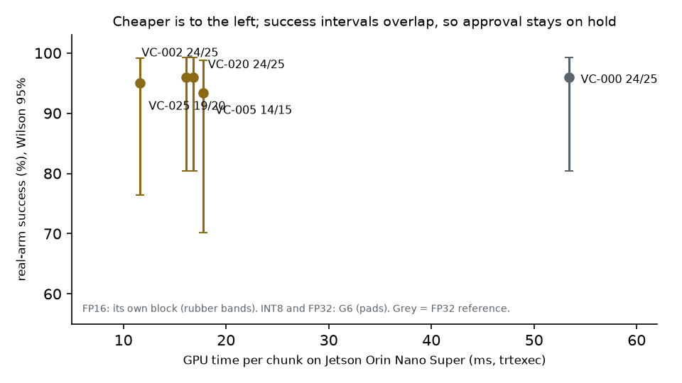
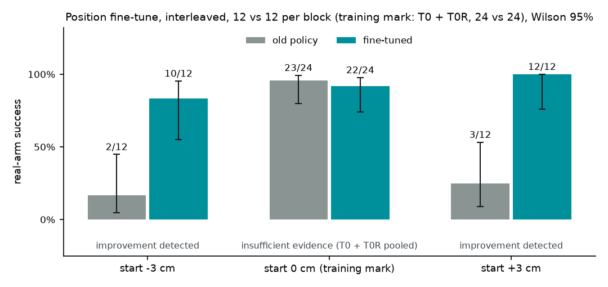
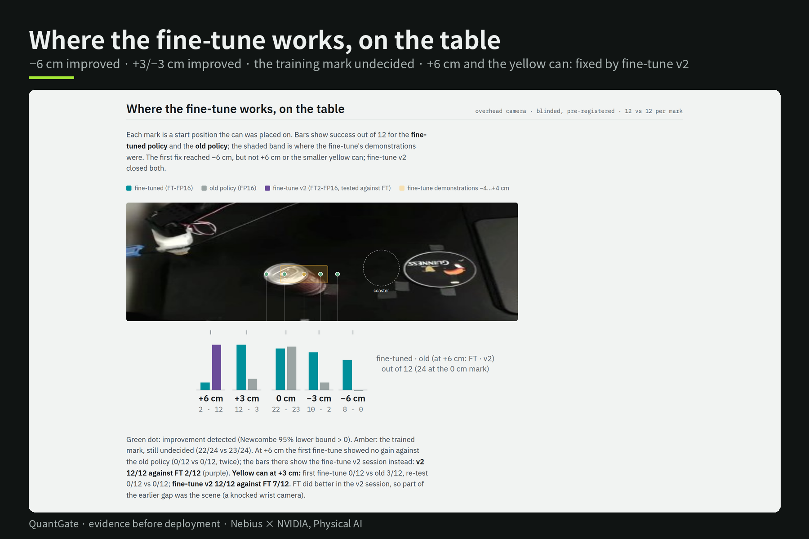

::: {.paper-project}

::: {.paper-hero}
<div class="paper-title">QuantGate: A Deployment Review for Quantized Robot Policies</div>

::: {.paper-venue}
Nebius &times; NVIDIA Global AI Hackathon &middot; Physical AI track &middot; 2026년 10월 30일 제출
:::

<div class="paper-authors">
  <a class="paper-author" href="../../about.html">Chanseok Kang</a>
</div>

::: {.paper-affiliation}
개인 프로젝트
:::

<div class="paper-links">
  <a class="paper-button" href="https://github.com/goodboychan/nebius-physical-ai"><i class="fas fa-code"></i> 코드 (Apache 2.0)</a>
  <a class="paper-button" href="https://www.youtube.com/watch?v=fC_mkn_U36Q"><i class="fas fa-play-circle"></i> 영상 (3분)</a>
  <a class="paper-button" href="https://claude.ai/artifact/2tUAoJHBeT8uLU96BmgPNK"><i class="fas fa-chart-bar"></i> 대시보드</a>
  <a class="paper-button" href="https://huggingface.co/datasets/chans/quantgate-so101-coaster"><i class="fas fa-database"></i> 데이터셋 (Hugging Face)</a>
  <a class="paper-button" href="https://devpost.com/software/quantgate"><i class="fas fa-file-alt"></i> Devpost 소개글</a>
</div>
:::

## 요약

::: {.paper-tldr}
로봇 policy 하나도 여러 build로 배포될 수 있습니다. QuantGate는 ACT checkpoint 하나의 FP32, FP16, INT8 24개 build를 **Jetson에서 측정한 비용**과 **봉인된 실물 시행 745회에서 측정한 동작**으로 비교하고, 다음에 검증할 build와 배포해도 되는 build가 있는지를 알려 줍니다. 이 연구에서는 FP16이 가장 저렴한 build였고, INT8의 offline 순위는 실물 결과를 예측하지 못했으며(**73/75 대 73/75**), **아직 승인된 build는 없습니다**. 근거가 충분하지 않기 때문이고, review는 이 판단을 바꿀 수 있는 다음 시험을 함께 제시합니다.
:::

::: {.paper-teaser}
::: {.paper-figure .paper-figure-main}
{.paper-image}

::: {.paper-media-caption}
Jetson Orin Nano Super 위의 LeRobot ACT policy가 SO-101 로봇 팔로 캔을 집어 코스터 위에 세웁니다. 모든 build에서 benchmark와 open-loop 지표는 괜찮아 보였지만, 팔이 여전히 캔을 코스터에 올릴지, 그리고 얼마나 확신할 수 있는지는 어느 쪽도 알려 주지 않았습니다.
:::
:::
:::

::: {.paper-metric-strip}
::: {.paper-metric}
<strong>11.6 ms &middot; 82 mJ</strong>
<span>Jetson에서 FP16의 추론 1회 비용(trtexec, 15 W). 모든 INT8 build(16.8&ndash;17.1 ms, 101 mJ)보다 빠르고 저렴합니다. FP32는 53.4 ms, 403 mJ</span>
:::

::: {.paper-metric}
<strong>73/75 대 73/75</strong>
<span>offline audit 상위 INT8 build와 무작위로 고른 INT8 build의 실물 성공 횟수</span>
:::

::: {.paper-metric}
<strong>745</strong>
<span>봉인되고 섞인 순서로 진행한 실물 시행 수. 봉인 해제 전에 로그를 hash로 고정했고, 주요 분석은 사전등록했습니다</span>
:::
:::

## 개요

::: {.paper-summary-grid}
::: {.paper-summary-card}
### 문제

policy를 edge 기기에 배포하려면 build를 골라야 합니다. FP32, FP16, 또는 여러 INT8 calibration 중 하나이고, 각각이 서로 다른 artifact입니다. 속도 benchmark와 offline 점수는 얻기 쉽지만, 팔이 여전히 작업을 해내는지는 알려 주지 않습니다. 작은 실물 표본은 과하게 해석하기도 쉽습니다.
:::

::: {.paper-summary-card}
### 접근

build마다 **deployment review**를 합니다. 대상 기기에서 잰 비용, 실물 시행 전에 고정한 offline audit, 미리 정한 규칙 아래에서 봉인하고 섞어 진행한 실물 시행을 함께 봅니다. 모든 숫자와 판정(GO, HOLD, BLOCK)은 코드가 씁니다. AI 모델은 프레임을 판정하고 설명할 뿐, 결정하지 않습니다.
:::

::: {.paper-summary-card}
### 결과

다음에 검증할 build는 FP16입니다. precision 효과는 확인되지 않았고, 대신 배포 조건(그립, 시작 위치, 부딪힌 카메라)이 성공률을 바꿨습니다. 위치에 대한 약점은 새 시연 100개와 두 번의 fine-tune으로 고쳤고, 매번 학습에 없던 조건에서 봉인된 시험으로 다시 확인했습니다.
:::
:::

## 영상

::: {.paper-figure}


::: {.paper-media-caption}
3분 영상이며, 그중 약 101초가 실물 로봇 팔 장면입니다. review가 개발자에게 알려 주는 내용, 만든 방법, 찾아낸 실패를 담았습니다.
:::
:::

## Review가 동작하는 방식

::: {.paper-pipeline}
::: {.pipeline-stage}
<span>측정</span>
<strong>기기에서 잰 비용</strong>
<p>ACT checkpoint 하나(51.6M parameter)로 만든 TensorRT engine 26개를 Jetson에서 고정된 timing cache로 빌드하고, 15 W에서 trtexec와 tegrastats로 측정합니다.</p>
:::

::: {.pipeline-arrow}
&rarr;
:::

::: {.pipeline-stage}
<span>선별</span>
<strong>고정된 offline audit</strong>
<p>INT8 cell마다 held-out state 2,000개를 Nebius Jobs(CPU 병렬)에서 채점합니다. 순위는 실물 시행 전에 고정해, 실물 결과로 검증할 수 있게 했습니다.</p>
:::

::: {.pipeline-arrow}
&rarr;
:::

::: {.pipeline-stage}
<span>시험</span>
<strong>봉인된 실물 시행</strong>
<p>섞인 순서로 진행하고, 운영자는 시행 번호만 봅니다. 결과는 자동 판정과, 저장된 영상을 코드로 다시 판정한 blind 재판정에서 나오며, 로그는 봉인 해제 전에 hash로 고정합니다.</p>
:::

::: {.pipeline-arrow}
&rarr;
:::

::: {.pipeline-stage}
<span>결정</span>
<strong>판정은 코드가</strong>
<p>Newcombe 구간으로 FP32 대비 non-inferiority를 보고, 배치 오차 허용치와 기기 위 preflight를 확인합니다. 결과는 GO, HOLD, BLOCK과 다음 시험에 필요한 arm별 시행 수입니다.</p>
:::
:::

::: {.paper-figure}
{.paper-image}
:::

### 모델별 역할

| 구성 요소 | 모델 또는 도구 | 하는 일 | 할 수 없는 일 |
|---|---|---|---|
| 로봇 policy | ACT(51.6M), Nebius Jobs(L40S)에서 학습 | 캔을 집어 옮김 | &mdash; |
| 후보 | TensorRT FP32 / FP16 / INT8 engine | review 대상 build | &mdash; |
| 판정 모델 | Nebius AI Endpoint의 Cosmos-Reason2-2B | 캔이 코스터 위에 서 있는지 판정 | 단독으로 판정 결정. held-out 녹화로 먼저 검증함 |
| 작성 모델 | Nebius Token Factory의 Nemotron 3 Super | review를 말로 설명 | 숫자, 판정, 승인 단어 작성(코드가 거부) |
| 판정 | 일반 코드 | 모든 숫자, 구간, GO / HOLD / BLOCK | &mdash; |

## 결과

::: {.paper-result-grid}
::: {.paper-result-card .paper-result-wide}
### 비용이 낮다고 승인되는 것은 아닙니다

{.paper-image}

이 기기에서는 INT8이 아니라 FP16이 가장 빠르고 저렴했습니다. 기기에서 직접 측정해야만 보이는 결과입니다. 하지만 FP32 대비 성공률은 아직 판단할 수 없습니다. arm당 25회로는 성공률 구간 폭이 약 &plusmn;28 pp라서 모든 비교가 INSUFFICIENT_EVIDENCE이고, 배포는 HOLD입니다. 사전등록한 ceiling 규칙은 두 arm이 모두 95% 이상이면 표본 수와 상관없이 판단을 보류하게 합니다. 사전등록한 수정 규칙 아래에서는 arm당 약 120회로 성공 기준에 대한 검정력 80%를 얻습니다.
:::

::: {.paper-result-card}
### Offline audit은 실물 결과를 예측하지 못했습니다

audit 상위 INT8 cell은 실물에서 **73/75**, 무작위로 고른 cell도 **73/75**였습니다. offline 순위는 배치 오차와도 관계가 없었습니다(Spearman 0.02&ndash;0.08). 일부러 검은 프레임으로 calibration한 build는 offline 점수가 나빴지만 실물에서는 11/12였습니다. 이 build는 실물 시행 전에 입력 검사가 잡아냅니다.
:::

::: {.paper-result-card}
### Precision이 아니라 배포 조건이 성공률을 바꿨습니다

precision 효과는 확인되지 않았습니다. 그리퍼의 미끄럼 방지 패드를 떼자 성공이 **8/24**로 떨어졌고, 시작 위치를 3 cm 옮기자 **0/3**이었습니다. INT8이 그리퍼 떨림을 두 배로 늘리는 것처럼 보였지만, 사전등록한 시험에서는 1.3배였고 유의하지 않았습니다(p = 0.12). 그립, 시작 위치, 캔 크기, 카메라 장착 상태를 배포 조건으로 기록해, 실패를 기본적으로 build 탓으로 돌리지 않습니다.
:::

::: {.paper-result-card .paper-result-wide}
### 찾고, 데이터로 고치고, 봉인된 시험으로 다시 확인했습니다

{.paper-image}

&minus;4&hellip;+4 cm에서 새 시연 50개를 모으고 Nebius Jobs에서 25분 동안 fine-tune한 뒤, 학습에 없던 위치에서 미리 정한 규칙으로 비교했습니다. **+3 cm에서 12/12 대 3/12**(+75 pp, 95% CI [+38, +91]), **&minus;3 cm에서 10/12 대 2/12**였습니다. 학습 위치에서는 아직 판단할 수 없어(22/24 대 23/24, 사전등록한 반복 시험 포함), review는 그 위치에서 승인하지 않습니다.
:::

::: {.paper-result-card .paper-result-wide}
### 수정이 닿는 범위와 두 번째 수정

{.paper-image}

새로 사전등록한 시험으로 첫 fine-tune의 범위를 확인했습니다. 시연 범위를 벗어난 **&minus;6 cm에서는 8/12 대 0/12**였지만, **+6 cm에서는 0/12 대 0/12**, **작은 노란 캔으로 +3 cm에서는 0/12 대 3/12**였습니다. 시연 50개(노란 캔, +5 cm와 +7 cm 시작)를 더 모아 두 번째 fine-tune을 하자 두 약점이 모두 해결됐습니다. **노란 캔에서 12/12 대 7/12**, **+6 cm에서 12/12 대 2/12**로, 역시 학습에 없던 조건이며 학습 위치에서도 떨어지지 않았습니다(12/12 대 12/12).
:::

::: {.paper-result-card}
### AI 판정 모델도 검증 대상입니다

한 단어로 답하게 한 prompt에서 Cosmos-Reason2는 실패 21개 중 **1개**만 잡았습니다. 검증한 prompt는 held-out 녹화에서 20/21을 잡았고, 새 실물 시행 96회에서도 실패 **22/24**를 잡고 오경보는 **2/72**였습니다. 그래도 놓치는 경우가 있습니다. 시작 위치에 서 있는 캔은 성공처럼 보입니다. 2 Hz shadow supervisor는 실패를 감지하지 못했고, 그대로 보고했습니다.
:::

::: {.paper-result-card}
### 말은 모델이, 사실은 코드가 씁니다

Nemotron 보고서는 세 번 바뀌었습니다. 마지막 버전에서는 모든 판정, 숫자, 상태를 코드가 쓰고, 모델은 review가 왜 이렇게 나왔는지와 남은 질문만 씁니다. 검증기는 숫자, 판정 label, 승인 단어, 알려진 오독이 들어간 문장을 거부합니다. Token Factory에서 모델 6개를 비교했을 때, 반복마다 근거에 없는 숫자가 하나도 없고 형식을 모두 지킨 모델은 Nemotron 3 Super뿐이었습니다.
:::
:::

## 승인 규칙

::: {.paper-method}
::: {.paper-method-steps}
1. 결과를 보기 전에 규칙을 고정합니다. 사전등록과, 봉인된 로그의 post-lock hash(LOCK-1부터 LOCK-4)로 고정하고, 모든 수정과 오류는 기록합니다.
2. 각 후보는 같은 세션에서 섞인 순서로 진행한 FP32 시행과 비교합니다.
3. $p_{\text{cand}} - p_{\text{FP32}}$의 Newcombe 95% 하한이 &minus;10 pp보다 크면 **성공 기준**을 충족합니다.
4. 최종 **GO**에는 배치 오차가 5 px 허용치 안에 있고, ceiling 규칙이 비교를 보류하지 않으며, 기기 위 preflight(engine hash, 정규화 manifest, runner의 200 ms chunk 마감)를 통과하는 것도 필요합니다.
5. 그렇지 않으면 review는 **HOLD**(근거 부족) 또는 **BLOCK**(검사 실패)을 내고, 다음 시험에 필요한 arm별 시행 수를 알려 줍니다. gate를 통과했다는 것은 "다음에 검증할 가치가 있다"는 뜻이지 "승인"이 아닙니다.
:::

::: {.paper-figure}
### Review가 개발자에게 알려 주는 것

| 질문 | 이 연구의 답 |
|---|---|
| 어떤 build를 먼저 검증할까? | FP16: 추론 1회 11.6 ms, 82 mJ |
| 어떤 build를 믿지 말아야 할까? | 검은 프레임 calibration(입력 검사), preflight를 통과하지 못한 build |
| 배포를 승인할 수 있나? | 아직 아닙니다: INSUFFICIENT_EVIDENCE, HOLD |
| 무엇이 있으면 결론이 날까? | 사전등록한 수정 ceiling 규칙과 arm당 약 120회 |
| 내 결과에도 쓸 수 있나? | `quantgate.py judge your_results.csv`가 같은 규칙을 적용합니다 |
:::
:::

## 공개하는 실패 사례

::: {.paper-summary-grid}
::: {.paper-summary-card}
### 부딪힌 손목 카메라

학습 위치의 성공률이 갑자기 떨어졌습니다. 모든 결과를 봉인한 채 소프트웨어 원인을 배제했고, 남아 있던 표시물과 축이 틀어진 손목 카메라를 찾아 장착부를 고쳤습니다. 이후 사전등록한 health check는 정상으로 돌아왔다고 나왔습니다. 문제 있는 환경에서 진행한 6회는 열어 보지 않고 폐기했습니다.
:::

::: {.paper-summary-card}
### 환경이 결과에 영향을 줬습니다

fine-tune v2 세션에서는 첫 fine-tune도 이전보다 좋았습니다(0/12에서 7/12와 2/12). 부딪힌 카메라가 이전 차이의 일부 원인이었다는 해석과 맞지만, 세션 간 비교로는 확정할 수 없어 그렇게 주장하지 않습니다.
:::

::: {.paper-summary-card}
### 시뮬레이터는 아직 실물을 예측하지 못합니다

이 작업의 Isaac Sim twin은 실물 14회 중 10회와 일치했지만, 매번 실패로 예측했기 때문입니다. 실물에 맞춰 보정하기 전까지는 탐색용으로만 둡니다.
:::
:::

## 배운 점과 한계

::: {.paper-summary-grid}
::: {.paper-summary-card}
### 배운 점

- 비용은 대상 기기에서 측정해야 합니다. precision 이름만으로는 비용을 알 수 없습니다.
- offline 순위는 실물로 검증할 가설이지, 실물 시험을 대신하지 않습니다.
- "실패가 관찰되지 않음"은 안전성 근거가 아닙니다. review는 근거가 어디까지인지 말해야 합니다.
- AI 판정 모델이나 작성 모델은 정답을 주는 도구가 아니라, held-out 데이터로 검증할 구성 요소입니다.
:::

::: {.paper-summary-card}
### 한계

- 로봇 팔 하나, 작업 하나, 기본 policy 하나이고, arm당 12&ndash;25회라 구간이 넓습니다.
- fine-tune 블록에서는 두 policy의 움직임이 눈에 띄게 달라 운영자 blinding이 부분적이었습니다.
- 세션 간 비교는 통제되지 않았고, 아직 외부 팀이 써 보지 않았습니다.
:::

::: {.paper-summary-card}
### 출처

숫자는 LOCK-4(2026년 10월 23일)에 고정했고 모두 커밋된 결과물에서 나옵니다. `quantgate.py verify | review`는 GPU, 로봇, API 키 없이 review를 다시 만듭니다. 학습 데이터는 LeRobot v3 데이터셋 3개(시연 120 + 50 + 50개, CC BY 4.0)로 공개했습니다. 보고서 문장에 쓴 serverless Nemotron 모델은 2026년 11월 9일 Token Factory에서 종료됐지만, 커밋된 보고서는 그대로입니다. 코드는 Claude Code와 함께 작성했고, 연구 설계, 실험대 구성, 모든 시행은 제가 직접 했습니다.
:::
:::

## 인용

::: {.paper-citation}
```bibtex
@misc{kang2026quantgate,
  title        = {QuantGate: A Deployment Review for Quantized Robot Policies},
  author       = {Kang, Chanseok},
  howpublished = {Nebius $\times$ NVIDIA Global AI Hackathon, Physical AI track},
  year         = {2026},
  url          = {https://github.com/goodboychan/nebius-physical-ai}
}
```
:::

:::
