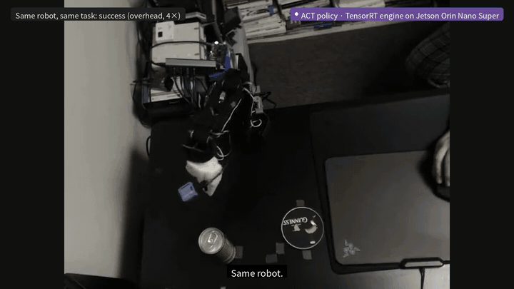
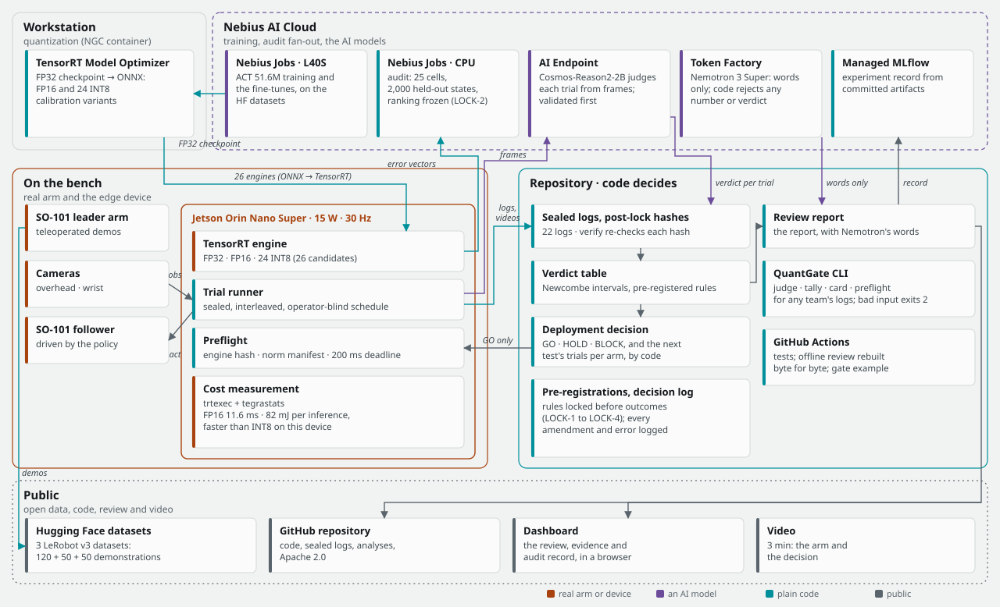
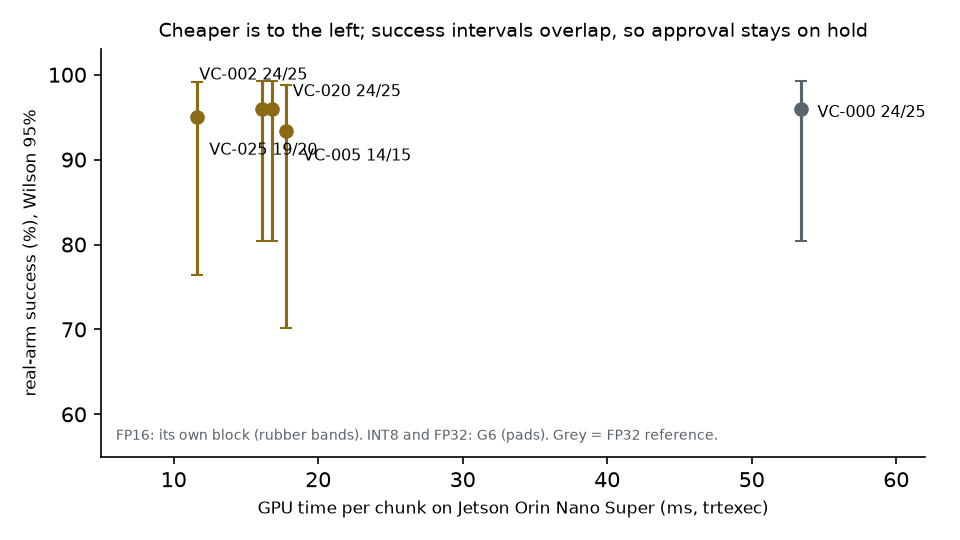
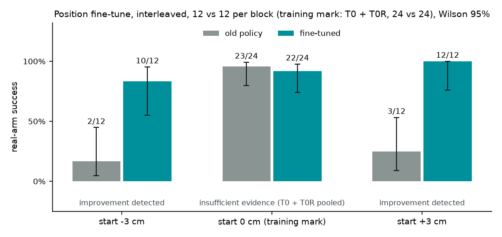
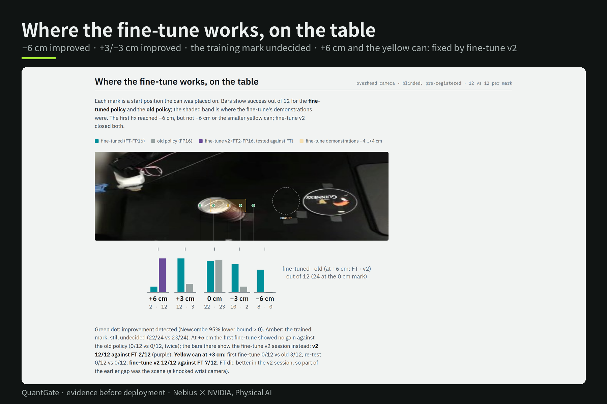

::: {.paper-project}

::: {.paper-hero}
<div class="paper-title">QuantGate: A Deployment Review for Quantized Robot Policies</div>

::: {.paper-venue}
Nebius &times; NVIDIA Global AI Hackathon &middot; Physical AI track &middot; Submitted 30 October 2026
:::

<div class="paper-authors">
  <a class="paper-author" href="../../about.html">Chanseok Kang</a>
</div>

::: {.paper-affiliation}
Personal project
:::

<div class="paper-links">
  <a class="paper-button" href="https://github.com/goodboychan/nebius-physical-ai"><i class="fas fa-code"></i> Code (Apache 2.0)</a>
  <a class="paper-button" href="https://www.youtube.com/watch?v=fC_mkn_U36Q"><i class="fas fa-play-circle"></i> Video (3 min)</a>
  <a class="paper-button" href="https://claude.ai/artifact/2tUAoJHBeT8uLU96BmgPNK"><i class="fas fa-chart-bar"></i> Dashboard</a>
  <a class="paper-button" href="https://huggingface.co/datasets/chans/quantgate-so101-coaster"><i class="fas fa-database"></i> Datasets (Hugging Face)</a>
  <a class="paper-button" href="https://devpost.com/software/quantgate"><i class="fas fa-file-alt"></i> Devpost write-up</a>
</div>
:::

## TL;DR

::: {.paper-tldr}
One robot policy can ship as many different builds. QuantGate compares the FP32, FP16 and 24 INT8 builds of one ACT checkpoint by **cost measured on the Jetson** and **behavior measured in 745 sealed real-arm trials**, then says which build to validate next and whether any may be deployed. In this study FP16 was the cheapest build, the INT8 offline ranking did not predict the arm (**73/75 vs 73/75**), and **no build is approved yet**: the evidence is not strong enough, and the review names the test that could change that.
:::

::: {.paper-teaser}
::: {.paper-figure .paper-figure-main}
{.paper-image}

::: {.paper-media-caption}
An SO-101 arm, driven by a LeRobot ACT policy on a Jetson Orin Nano Super, picks up a can and stands it on a coaster. Benchmarks and open-loop metrics looked fine for every build; neither said whether the arm would still put the can on the coaster, or how sure we could be.
:::
:::
:::

::: {.paper-metric-strip}
::: {.paper-metric}
<strong>11.6 ms &middot; 82 mJ</strong>
<span>FP16 per inference on the Jetson (trtexec, 15 W), faster and cheaper than every INT8 build (16.8&ndash;17.1 ms, 101 mJ); FP32 53.4 ms, 403 mJ</span>
:::

::: {.paper-metric}
<strong>73/75 vs 73/75</strong>
<span>real-arm successes of the offline audit's top-ranked INT8 builds and of randomly picked ones</span>
:::

::: {.paper-metric}
<strong>745</strong>
<span>real-arm trials, all under sealed, interleaved schedules; logs hashed before unsealing, primary analyses pre-registered</span>
:::
:::

## Overview

::: {.paper-summary-grid}
::: {.paper-summary-card}
### Problem

Shipping a policy to an edge device means choosing a build: FP32, FP16, or one of many INT8 calibrations. Each is a different artifact. Speed benchmarks and offline scores are cheap, but they do not say whether the arm still completes the task, and small real-arm samples are easy to overread.
:::

::: {.paper-summary-card}
### Approach

A **deployment review** per build: cost measured on the target device, an offline audit frozen before any real trial, and sealed, interleaved real-arm trials under rules fixed in advance. Code writes every number and verdict (GO, HOLD or BLOCK); AI models judge frames and explain, but never decide.
:::

::: {.paper-summary-card}
### Outcome

FP16 is the next build to validate. No precision effect was shown; deployment conditions (grip, start position, a knocked camera) moved success instead. A position weakness was fixed with 100 new demonstrations and two fine-tunes, each re-tested sealed at conditions never in training.
:::
:::

## The video

::: {.paper-figure}


::: {.paper-media-caption}
Three minutes, about 101 s of it on the real arm: what the review tells a developer, how it was built, and the failures it found.
:::
:::

## How the review works

::: {.paper-pipeline}
::: {.pipeline-stage}
<span>Measure</span>
<strong>Cost on the device</strong>
<p>26 TensorRT engines of one ACT checkpoint (51.6M parameters), built on the Jetson with a frozen timing cache and timed with trtexec and tegrastats at 15 W.</p>
:::

::: {.pipeline-arrow}
&rarr;
:::

::: {.pipeline-stage}
<span>Screen</span>
<strong>Offline audit, frozen</strong>
<p>2,000 held-out states scored per INT8 cell (one of the 24 INT8 calibration builds) on Nebius Jobs (CPU fan-out). The ranking was frozen before any real trial, so the arm could test it.</p>
:::

::: {.pipeline-arrow}
&rarr;
:::

::: {.pipeline-stage}
<span>Test</span>
<strong>Sealed real-arm trials</strong>
<p>Interleaved schedules; the operator saw trial numbers only. Outcomes from an automatic judge and a blind re-judge of the saved video by code; logs hashed before unsealing.</p>
:::

::: {.pipeline-arrow}
&rarr;
:::

::: {.pipeline-stage}
<span>Decide</span>
<strong>Code writes the verdict</strong>
<p>Non-inferiority against FP32 with Newcombe intervals, a placement tolerance and an on-device preflight. GO, HOLD or BLOCK, and the next test's trials per arm.</p>
:::
:::

::: {.paper-figure}
{.paper-image}
:::

### Which model does what

| Part | Model or tool | Its job | What it is not allowed to do |
|---|---|---|---|
| Robot policy | ACT (51.6M), trained on Nebius Jobs (L40S) | picks up the can | &mdash; |
| Candidates | TensorRT FP32 / FP16 / INT8 engines | the builds under review | &mdash; |
| Judge | Cosmos-Reason2-2B on a Nebius AI Endpoint | says whether the can ended standing on the coaster | decide a verdict on its own; validated on held-out recordings first |
| Writer | Nemotron 3 Super on Nebius Token Factory | explains the review in words | write any number, verdict or approval word (code rejects them) |
| Verdicts | plain code | every number, interval and GO / HOLD / BLOCK | &mdash; |

## Results

::: {.paper-result-grid}
::: {.paper-result-card .paper-result-wide}
### Cost is not approval

{.paper-image}

On this device the fastest and cheapest build is FP16, not INT8, and only on-device measurement showed it. Its success against FP32 is still undecided: with 25 trials per experiment arm the success interval is about &plusmn;28 percentage points (pp) wide, so every comparison is INSUFFICIENT_EVIDENCE and deployment stays HOLD. The pre-registered ceiling rule keeps two arms that are both at or above 95% undecided at any sample size; under a revised, pre-registered rule, about 120 trials per arm give 80% power for the success criterion.
:::

::: {.paper-result-card}
### The offline audit did not predict the arm

The audit's top-ranked INT8 cells went **73/75** on the arm; randomly picked cells also went **73/75**. The offline rank did not track placement error either (Spearman 0.02&ndash;0.08). A deliberately broken, black-frame-calibrated build scored badly offline yet went 11/12 on the arm; an input check catches it before the arm.
:::

::: {.paper-result-card}
### Deployment conditions moved success, not precision

No precision effect was shown. Removing the gripper's anti-slip pads dropped success to **8/24**; moving the start 3 cm gave **0/3**. INT8 seemed to make the gripper chatter twice as much; a pre-registered test found 1.3&times;, not significant (p = 0.12). Grip, start position, can size and camera mounting are recorded as deployment conditions, so a failure is not blamed on the build by default.
:::

::: {.paper-result-card .paper-result-wide}
### Found, fixed with data, re-tested sealed

{.paper-image}

50 new demonstrations at &minus;4&hellip;+4 cm and a 25-minute fine-tune on Nebius Jobs, compared under a rule fixed in advance at positions never in training: **12/12 vs 3/12 at +3 cm** (+75 pp, 95% CI [+38, +91]) and **10/12 vs 2/12 at &minus;3 cm**. At the training mark it is still undecided (22/24 vs 23/24, with a pre-registered replication), so the review does not approve it there.
:::

::: {.paper-result-card .paper-result-wide}
### How far the fix reaches, and the second fix

{.paper-image}

A new pre-registration mapped the reach of the first fine-tune: **8/12 vs 0/12 at &minus;6 cm**, beyond its demonstrations, but **0/12 vs 0/12 at +6 cm** and **0/12 vs 3/12 with a smaller yellow can at +3 cm**. Fifty more demonstrations (the yellow can, starts at +5 and +7 cm) and a second fine-tune closed both gaps: **12/12 vs 7/12 with the yellow can** and **12/12 vs 2/12 at +6 cm**, again at conditions never in training, with no drop at the trained spot (12/12 vs 12/12).
:::

::: {.paper-result-card}
### The AI judge is a part to validate

With a one-word prompt Cosmos-Reason2 caught **1 of 21** failures. A validated prompt caught 20/21 on held-out recordings, then held up live on 96 new trials: **22/24** failures caught, **2/72** false alarms. It still misses some: a can left standing at the start looks like a success to it. A 2 Hz shadow supervisor did not detect failures, and we report that.
:::

::: {.paper-result-card}
### The model writes words, code writes facts

The Nemotron report went through three versions. In the last, code writes every verdict, number and status; the model writes only why the review came out as it did, plus the open questions, and a validator rejects any digit, verdict label, approval word or known misreading. In a six-model comparison on Token Factory, Nemotron 3 Super was the only variant with zero unmatched numbers and a complete format in every repeat.
:::
:::

## The approval rule

::: {.paper-method}
::: {.paper-method-steps}
1. Rules are fixed before outcomes are read: pre-registrations and post-lock hashes of the sealed logs (LOCK-1 to LOCK-4); every amendment and error is logged.
2. Each candidate is compared with FP32 from interleaved trials in the same session.
3. The **success criterion** is met when the Newcombe 95% lower bound of $p_{\text{cand}} - p_{\text{FP32}}$ is above &minus;10 pp.
4. A final **GO** also needs placement error within its 5 px tolerance, the ceiling rule not holding the comparison undecided, and the on-device preflight passing (engine hash, normalization manifest, the runner's 200 ms chunk deadline).
5. Otherwise the review says **HOLD** (not enough evidence) or **BLOCK** (a check failed), and states how many trials per arm the next test needs. Passing the gate means "worth validating next", not "approved".
:::

::: {.paper-figure}
### What the review tells a developer

| Question | Answer in this study |
|---|---|
| Which build do I validate first? | FP16: 11.6 ms, 82 mJ per inference |
| Which do I distrust? | the black-frame calibration (input check); any build that fails the preflight |
| Can I approve deployment? | Not yet: INSUFFICIENT_EVIDENCE, HOLD |
| What would settle it? | a revised, pre-registered ceiling rule and about 120 trials per arm |
| Bring your own results | `quantgate.py judge your_results.csv` applies the same rules |
:::
:::

## Failures we publish

::: {.paper-summary-grid}
::: {.paper-summary-card}
### A knocked wrist camera

Success at the trained spot suddenly fell. Every result stayed sealed while we ruled out the software, found stray markers and a wrist camera knocked off-axis, and fixed the mount. A pre-registered health check then came back nominal. Six trials run in the bad scene were discarded unopened.
:::

::: {.paper-summary-card}
### The scene mattered

In the fine-tune v2 session the first fine-tune also did better than before (7/12 and 2/12 against 0/12), which fits the knocked camera having caused part of the earlier gap. A comparison across sessions cannot settle it, so the page does not claim it.
:::

::: {.paper-summary-card}
### The simulator cannot predict the arm yet

An Isaac Sim twin of the task agreed with 10 of 14 real runs only because it predicts failure every time. It stays exploratory until it is calibrated against the arm.
:::
:::

## Takeaways and limits

::: {.paper-summary-grid}
::: {.paper-summary-card}
### Takeaways

- Measure cost on the target device; the precision name does not tell you the cost.
- An offline ranking is a hypothesis for the arm to test, not a substitute for it.
- "No failure observed" is not safety evidence. A review should say how far its evidence goes.
- An AI judge or writer is a component to validate on held-out data, not an oracle.
:::

::: {.paper-summary-card}
### Limits

- One robot arm, one task, one base policy; 12&ndash;25 trials per arm, so intervals are wide.
- Operator blinding was partial in the fine-tune blocks, where the two policies move visibly differently.
- Comparisons across sessions were not controlled, and no outside team has tried the review yet.
:::

::: {.paper-summary-card}
### Provenance

Numbers are frozen at LOCK-4 (23 October 2026) and come from committed artifacts; `quantgate.py verify | review` rebuilds the review with no GPU, robot or API key. Training data are public as three LeRobot v3 datasets (120 + 50 + 50 demonstrations, CC BY 4.0). The serverless Nemotron model used for the report text was retired by Token Factory on 9 November 2026; the committed reports are unchanged. Code was written with Claude Code; the study design, the bench and every trial are mine.
:::
:::

## Citation

::: {.paper-citation}
```bibtex
@misc{kang2026quantgate,
  title        = {QuantGate: A Deployment Review for Quantized Robot Policies},
  author       = {Kang, Chanseok},
  howpublished = {Nebius $\times$ NVIDIA Global AI Hackathon, Physical AI track},
  year         = {2026},
  url          = {https://github.com/goodboychan/nebius-physical-ai}
}
```
:::

:::
