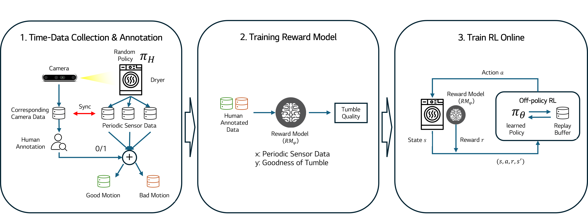
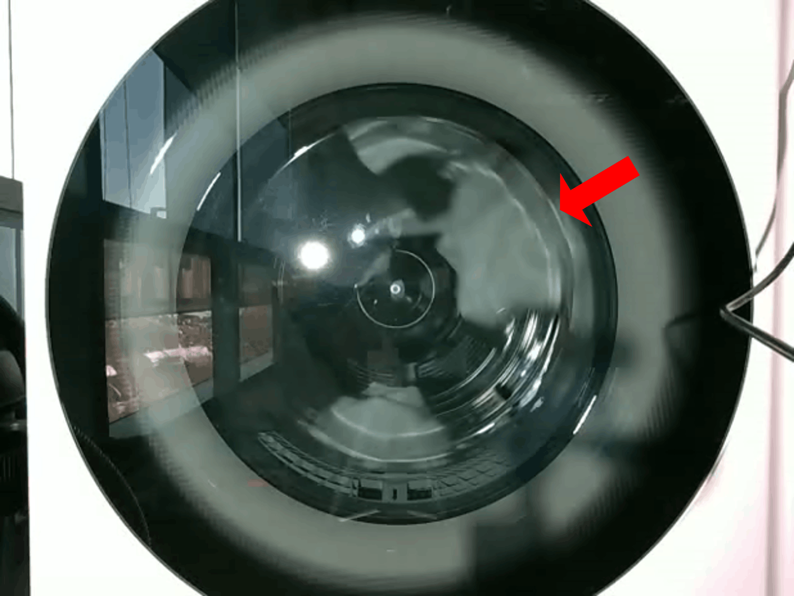
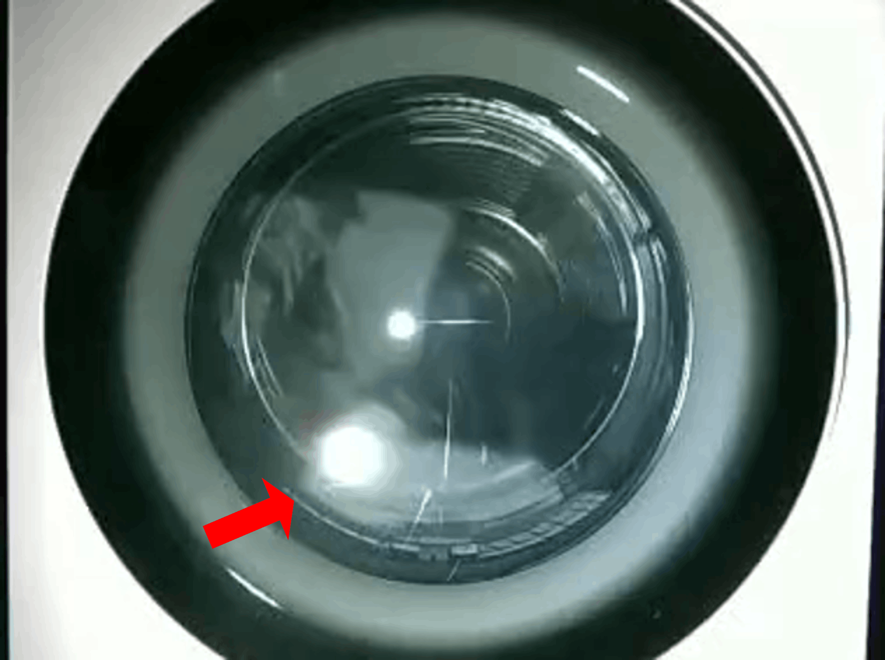
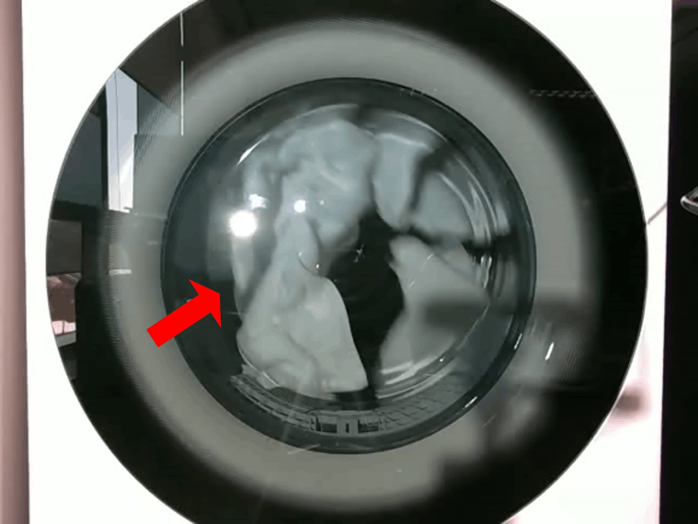
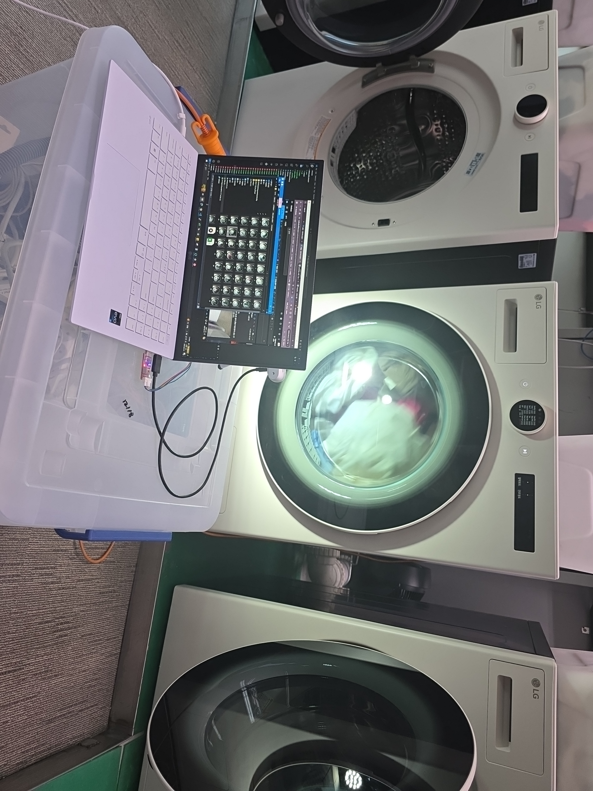
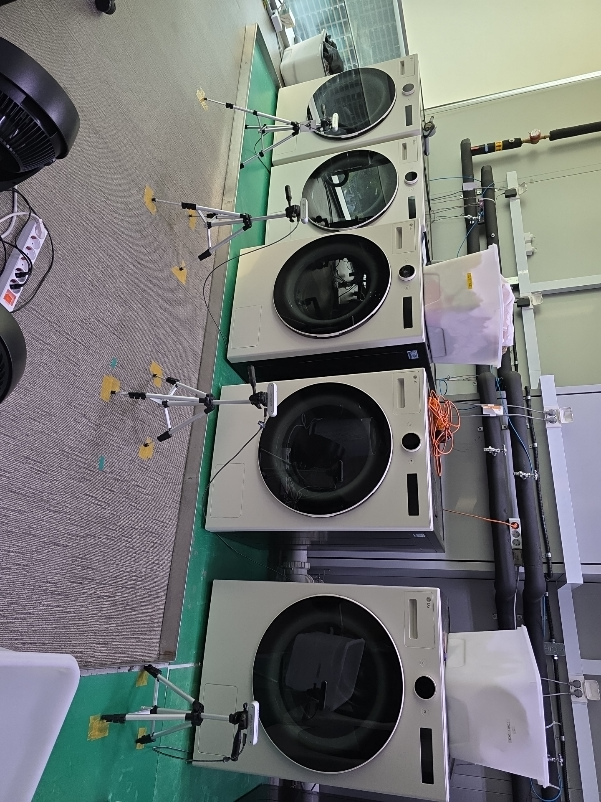

::: {.paper-project}

::: {.paper-hero}
<div class="paper-title">Sensor-Based Reward Learning from Video Labels for Tumble Motion Control in a Household Dryer</div>

::: {.paper-venue}
2026 IEEE 22nd International Conference on Automation Science and Engineering (CASE), August 2026
:::

<div class="paper-authors">
  <span class="paper-author">Jinwoo Lee</span>
  <a class="paper-author" href="../../about.html">Chanseok Kang</a>
  <span class="paper-author">Guntae Bae</span>
</div>

::: {.paper-affiliation}
LG Electronics AI Lab
:::

<div class="paper-links">
  <a class="paper-button" href="https://ieeexplore.ieee.org/document/11704219" target="_blank" rel="noopener"><i class="ai ai-ieee"></i> IEEE</a>
  <a class="paper-button" href="https://doi.org/10.1109/CASE69030.2026.11704219" target="_blank" rel="noopener"><i class="fas fa-link"></i> DOI</a>
  <!-- Add a local manuscript after placing projects/reward-learning-dryer/assets/paper.pdf:
  <a class="paper-button" href="assets/paper.pdf"><i class="fas fa-file-pdf"></i> PDF</a>
  -->
</div>
:::

## TL;DR

::: {.paper-tldr}
이 연구는 건조기 내부 영상을 보고 사람이 판단할 수 있는 세탁물 모션 품질을 센서 기반 reward model로 옮깁니다. 이 reward model로 강화학습을 해서, 실제 제품 센서만으로 동작하는 drum-speed 제어 정책을 학습합니다.
:::

::: {.paper-teaser}
::: {.paper-figure .paper-figure-main}
{.paper-image}

::: {.paper-media-caption}
Learning-based reward model pipeline: 개발 단계에서 모은 영상 supervision을 sensor-only reward model로 증류하고, 이 모델을 강화학습 제어에 씁니다.
:::
:::
:::

## Overview

::: {.paper-summary-grid}
::: {.paper-summary-card}
### Problem

건조 효율을 높이려면 세탁물이 drum 안에서 cataracting motion을 유지해야 합니다. 하지만 실제 제품에서 쓸 수 있는 motor current, RPM 계열 센서만으로는 내부 모션 상태를 직접 관측하기 어렵습니다.
:::

::: {.paper-summary-card}
### Approach

개발 단계에서 센서 데이터와 내부 영상을 동기화해 수집하고, 영상 기반 label 또는 pairwise preference로 sensor-only reward model을 학습합니다. 그다음 이 reward model을 고정해 두고 SAC 기반 drum-speed 제어 정책을 학습합니다.
:::

::: {.paper-summary-card}
### Outcome

5개의 load composition에서 expert-designed baseline 대비 normalized moisture-removal metric이 평균 2.15%, 최대 2.86% 개선되었습니다.
:::
:::

## Motion Labels

::: {.paper-result-grid .paper-motion-grid}
::: {.paper-result-card}
### Bad Motion: Wall-Following

{.paper-image}

세탁물이 drum 벽면을 따라 붙어 움직이면 공기와 접촉하는 유효 표면적이 줄어듭니다.
:::

::: {.paper-result-card}
### Bad Motion: Rolling

{.paper-image}

세탁물이 drum 하단에서 rolling 형태로 움직이면 목표로 하는 falling motion에 도달하지 못합니다.
:::

::: {.paper-result-card}
### Good Motion: Tumbling

{.paper-image}

목표 motion은 세탁물 표면을 heated airflow에 더 고르게 노출시켜 건조 효율을 높입니다.
:::
:::

## Method

::: {.paper-pipeline}
::: {.pipeline-stage}
<span>Stage 1</span>
<strong>Collect</strong>
<p>실제 건조기에서 onboard sensor sequence와 drum 내부 영상을 동기화해 수집합니다.</p>
:::

::: {.pipeline-arrow}
&rarr;
:::

::: {.pipeline-stage}
<span>Stage 2</span>
<strong>Learn Reward</strong>
<p>영상 label 또는 preference를 이용해 sensor history만 입력으로 받는 LSTM 기반 reward model을 학습합니다.</p>
:::

::: {.pipeline-arrow}
&rarr;
:::

::: {.pipeline-stage}
<span>Stage 3</span>
<strong>Train Control</strong>
<p>고정된 reward model이 주는 reward로 drum speed를 조절하는 SAC controller를 학습합니다.</p>
:::
:::

::: {.paper-method}
::: {.paper-method-steps}
1. drum speed를 모터 동작 범위에서 sweep하며 센서 데이터와 내부 영상을 동시에 기록합니다.
2. 영상 clip마다 desirable/undesirable tumble motion label을 붙이거나, 두 clip을 비교해 상대적인 motion quality preference를 표시합니다.
3. annotation을 sensor window와 정렬하고 sensor-only reward model을 학습합니다.
4. 학습된 reward로 Soft Actor-Critic 기반 incremental drum-speed controller를 학습합니다.
5. 최종 controller는 영상 없이 제품 센서 stream만으로 동작합니다.
:::

::: {.paper-figure}
### Motion Supervision

핵심은 영상을 개발 단계의 supervision으로만 쓰는 것입니다. 사람이 영상을 보고 판단할 수 있는 tumble quality를 reward model로 증류합니다. 이 모델은 sensor history만 보고 scalar motion quality를 예측하므로, 최종 controller는 실제 제품의 센서 제약 안에서 동작할 수 있습니다.

::: {.paper-metric-strip}
::: {.paper-metric}
<strong>5</strong>
<span>평가한 load composition</span>
:::

::: {.paper-metric}
<strong>2.15%</strong>
<span>평균 상대 성능 개선</span>
:::

::: {.paper-metric}
<strong>2.86%</strong>
<span>최대 상대 성능 개선</span>
:::
:::
:::
:::

## Development Setup

::: {.paper-figure}
::: {.paper-figure-grid .paper-setup-grid}
{.paper-image}

{.paper-image}
:::

::: {.paper-media-caption}
sensor stream과 drum 내부 motion을 동기화해 기록하고, 학습된 controller를 평가하는 데 쓴 실제 가정용 건조기 setup입니다.
:::
:::

## Results

::: {.paper-result-grid}
::: {.paper-result-card .paper-result-wide}
### Moisture-Removal Performance

제안한 controller는 평가한 load 5개 모두에서 normalized moisture-removal metric을 개선했습니다. 평균 metric은 0.6129에서 0.6261로 2.15% 올랐습니다.
:::

::: {.paper-result-card}
### Load Coverage

실험에 쓴 load는 3 kg/5 kg mixed-fabric load, cotton-to-polyester 비율을 달리한 조합, 3 kg towel-heavy load입니다.
:::

::: {.paper-result-card}
### Preference Reward Check

towel-heavy load에서는 preference-based reward model도 검증했습니다. 이 reward는 binary motion label의 전반적인 추세를 따랐고, 성능은 기존 모델 대비 2.10% 개선되었습니다.
:::

::: {.paper-result-card}
### Deployment Constraint

영상은 개발 단계에서 annotation을 만들기 위해서만 사용합니다. RL 학습과 deployment 단계에서는 reward model과 controller 모두 onboard sensor sequence만 사용합니다.
:::
:::

## Videos

::: {.paper-media-grid}
::: {.paper-media-card .paper-media-feature}
```{=html}
<video class="paper-video" controls muted loop playsinline preload="metadata">
  <source src="assets/CASE26_0577_AV_i.mp4" type="video/mp4">
</video>
```

::: {.paper-media-caption}
건조기 tumble-motion control을 보여주는 supplementary video입니다.
:::
:::
:::

## Citation

::: {.paper-citation}
```bibtex
@misc{lee2026sensorRewardDryer,
  title  = {Sensor-Based Reward Learning from Video Labels for Tumble Motion Control in a Household Dryer},
  author = {Lee, Jinwoo and Kang, Chanseok and Bae, Guntae},
  note   = {2026 IEEE 22nd International Conference on Automation Science and Engineering (CASE)},
  year   = {2026}
}
```
:::

:::
