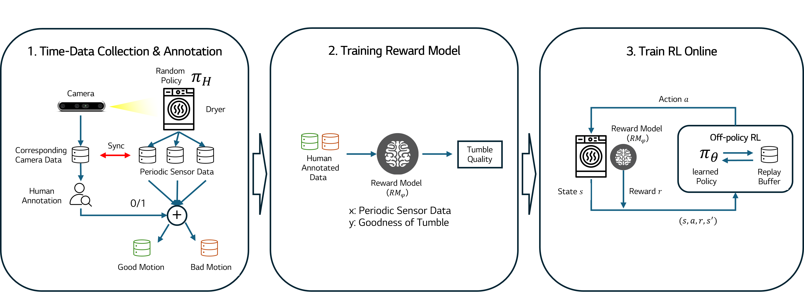
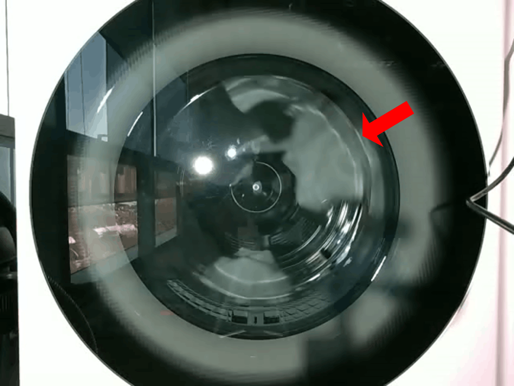
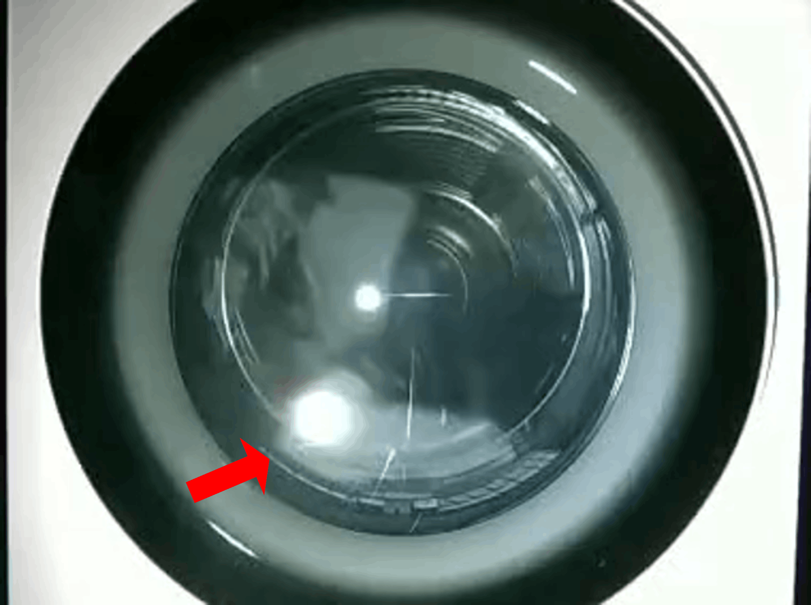
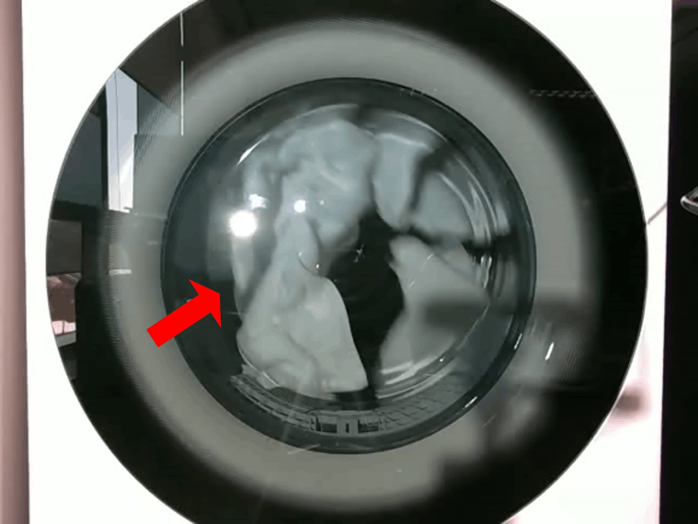
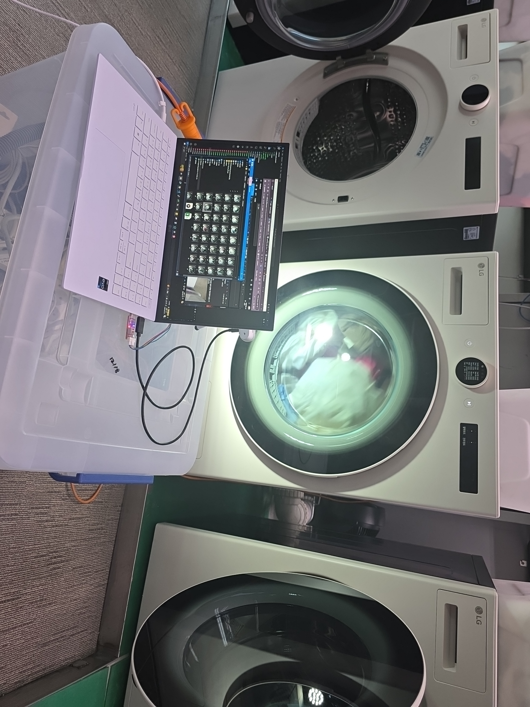
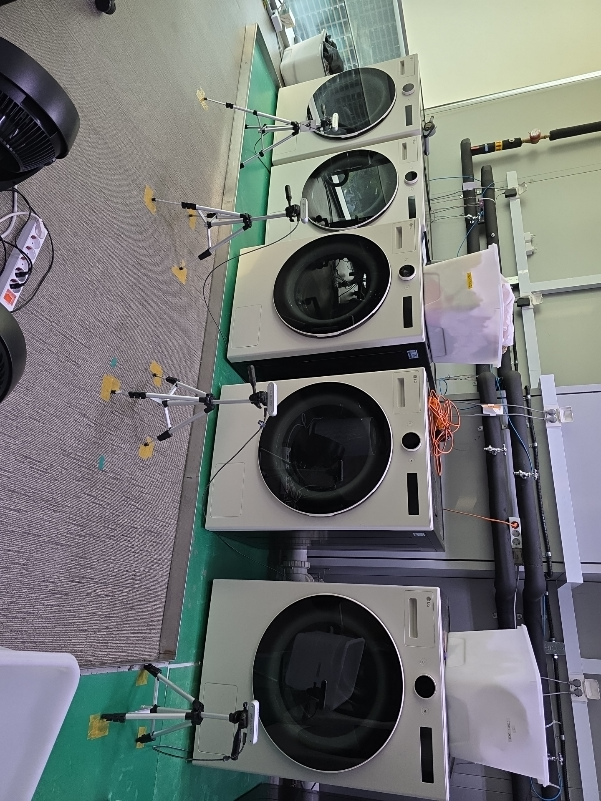

::: {.paper-project}

::: {.paper-hero}
<div class="paper-title">Sensor-Based Reward Learning from Video Labels for Tumble Motion Control in a Household Dryer</div>

::: {.paper-venue}
2026 IEEE 22nd International Conference on Automation Science and Engineering (CASE), August 2026
:::

<div class="paper-authors">
  <span class="paper-author">Jinwoo Lee</span>
  <a class="paper-author" href="../../about.html">Chanseok Kang</a>
  <span class="paper-author">Guntae Bae</span>
</div>

::: {.paper-affiliation}
LG Electronics AI Lab
:::

<div class="paper-links">
  <a class="paper-button" href="https://ieeexplore.ieee.org/document/11704219" target="_blank" rel="noopener"><i class="ai ai-ieee"></i> IEEE</a>
  <a class="paper-button" href="https://doi.org/10.1109/CASE69030.2026.11704219" target="_blank" rel="noopener"><i class="fas fa-link"></i> DOI</a>
  <!-- Add a local manuscript after placing projects/reward-learning-dryer/assets/paper.pdf:
  <a class="paper-button" href="assets/paper.pdf"><i class="fas fa-file-pdf"></i> PDF</a>
  -->
</div>
:::

## TL;DR

::: {.paper-tldr}
This work turns human judgments of laundry motion in video into a sensor-only reward model that can be deployed on the dryer, then uses reinforcement learning to improve drum-speed control. No video is needed at runtime.
:::

::: {.paper-teaser}
::: {.paper-figure .paper-figure-main}
{.paper-image}

::: {.paper-media-caption}
Learning-based reward model pipeline. Video supervision collected during development is distilled into a sensor-only reward model, which then supplies the reward for reinforcement learning.
:::
:::
:::

## Overview

::: {.paper-summary-grid}
::: {.paper-summary-card}
### Problem

Efficient drying depends on keeping the laundry in cataracting motion, but production sensors such as motor current and drum speed cannot observe the tumble state inside the drum directly.
:::

::: {.paper-summary-card}
### Approach

During development, the method records sensor trajectories together with synchronized video from inside the drum. Human labels or preferences on that video train a sensor-only reward model, which stays frozen during SAC-based policy learning.
:::

::: {.paper-summary-card}
### Outcome

Across five load compositions, the learned controller improved normalized moisture-removal performance by 2.15% on average and 2.86% in the best case compared with an expert-designed baseline.
:::
:::

## Motion Labels

::: {.paper-result-grid .paper-motion-grid}
::: {.paper-result-card}
### Bad Motion: Wall-Following

{.paper-image}

The laundry stays attached to the drum wall, so less of its surface is exposed to the airflow.
:::

::: {.paper-result-card}
### Bad Motion: Rolling

{.paper-image}

The load rolls near the bottom of the drum rather than entering the desired falling motion.
:::

::: {.paper-result-card}
### Good Motion: Tumbling

{.paper-image}

The target motion exposes laundry surfaces more evenly to the heated airflow, which makes drying more efficient.
:::
:::

## Method

::: {.paper-pipeline}
::: {.pipeline-stage}
<span>Stage 1</span>
<strong>Collect</strong>
<p>Synchronized onboard sensor sequences and internal drum video are gathered on a real dryer.</p>
:::

::: {.pipeline-arrow}
&rarr;
:::

::: {.pipeline-stage}
<span>Stage 2</span>
<strong>Learn Reward</strong>
<p>Video labels or pairwise preferences supervise an LSTM-based reward model that consumes sensor histories only.</p>
:::

::: {.pipeline-arrow}
&rarr;
:::

::: {.pipeline-stage}
<span>Stage 3</span>
<strong>Train Control</strong>
<p>The frozen reward model supplies rewards to a SAC controller that adjusts drum speed from onboard sensors.</p>
:::
:::

::: {.paper-method}
::: {.paper-method-steps}
1. Sweep drum speed over the operating motor range while recording synchronized sensor and video data.
2. Annotate video clips as desirable or undesirable tumble motion, or compare clip pairs by relative motion quality.
3. Align annotations with sensor windows and train a sensor-only reward model.
4. Use the learned reward to train an incremental drum-speed controller with Soft Actor-Critic.
5. Deploy the final controller without video input; only production sensor streams are required.
:::

::: {.paper-figure}
### Motion Supervision

The main design choice is to use video only as supervision during development. Tumble quality that a person can judge from video is distilled into a reward model that maps sensor histories to a scalar motion-quality score, so the learned controller only needs the sensors a production dryer already has.

::: {.paper-metric-strip}
::: {.paper-metric}
<strong>5</strong>
<span>evaluated load compositions</span>
:::

::: {.paper-metric}
<strong>2.15%</strong>
<span>average relative gain</span>
:::

::: {.paper-metric}
<strong>2.86%</strong>
<span>best-case gain</span>
:::
:::
:::
:::

## Development Setup

::: {.paper-figure}
::: {.paper-figure-grid .paper-setup-grid}
{.paper-image}

{.paper-image}
:::

::: {.paper-media-caption}
Real household dryer used to collect synchronized sensor streams, observe tumble motion inside the drum, and evaluate the learned controller.
:::
:::

## Results

::: {.paper-result-grid}
::: {.paper-result-card .paper-result-wide}
### Moisture-Removal Performance

The proposed controller improved the normalized moisture-removal metric for all five evaluated loads. The mean metric rose from 0.6129 to 0.6261, a relative improvement of 2.15%.
:::

::: {.paper-result-card}
### Load Coverage

The experiments cover 3 kg and 5 kg mixed-fabric loads, different cotton-to-polyester ratios, and a towel-heavy 3 kg load.
:::

::: {.paper-result-card}
### Preference Reward Check

A preference-based reward model was also validated on the towel-heavy load. Its rewards followed the overall trend of the binary motion labels, and the controller trained with it improved performance by 2.10% over the existing model.
:::

::: {.paper-result-card}
### Deployment Constraint

Video is used only for annotation during development. During RL training and deployment, both the reward model and controller use onboard sensor sequences only.
:::
:::

## Videos

::: {.paper-media-grid}
::: {.paper-media-card .paper-media-feature}
```{=html}
<video class="paper-video" controls muted loop playsinline preload="metadata">
  <source src="assets/CASE26_0577_AV_i.mp4" type="video/mp4">
</video>
```

::: {.paper-media-caption}
Supplementary demonstration of dryer tumble-motion control.
:::
:::
:::

## Citation

::: {.paper-citation}
```bibtex
@misc{lee2026sensorRewardDryer,
  title  = {Sensor-Based Reward Learning from Video Labels for Tumble Motion Control in a Household Dryer},
  author = {Lee, Jinwoo and Kang, Chanseok and Bae, Guntae},
  note   = {2026 IEEE 22nd International Conference on Automation Science and Engineering (CASE)},
  year   = {2026}
}
```
:::

:::
